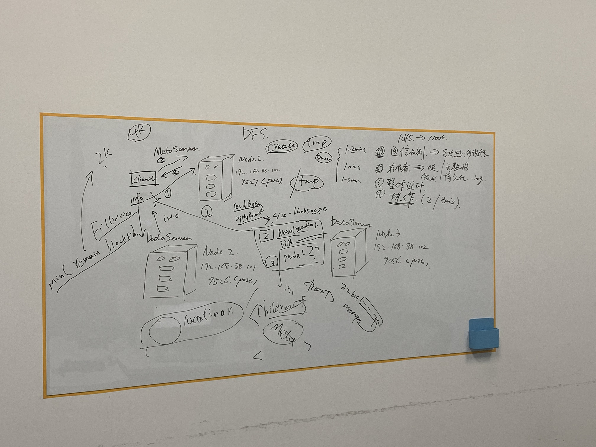

## 消失的半个月，难得喘口气

折腾了半个月的分布式文件系统期末结课结课实验，终于汇报结束了。

第15周了，很多课程都是实验节课，最近半个月实验压力也别大。但是好在昨天把大数据的实验和C++的实验都完成了，周六还有一场英语考试，紧张刺激的15周就终于要迎来胜利的曙光了！

这半个月主要在忙这些事，科研搁置了很多。今天开始，我要把失去的，都补回来哈哈哈哈！！

`最后一个月的工作重心转移到MLLMs RAG prompt与技术学习上来。`

## 做难事，收获颇丰

本科之前从来没有接触过分布式，Java编程也是菜的一批...

其实这个大实验很早就着手准备了，但是一直理解不了架构，导致一拖再拖。最后的一周冲刺，每天晚上干到一点多，这种感觉前所未有。

马老师说过：梦想还是要有的，万一实现了呢

上个月的主线任务完成度不错：务必11月要执行的-**带着把程序写成东西的思想，疯狂Coding**！！！！

11月完成的任务：

1. 循环神经网路、attention机制、Transformer架构基础知识理解(但是又快忘了😂)
2. 三个卷积神经网络结构的编写
3. Java分布式文件系统项目(大部头费时费力收获颇丰)
4. C++五子棋程序(大部头费时费力收获颇丰)

## 切入

要快速上手一个方向或者一个小领域，一般来说需要掌握一些基础知识（最基本的概念和原理）、前沿进展（近几年的研究方向与热点）和特定的工具（例如编程语言、框架）。



思考：深度学习领域基础知识是什么？前沿进展有哪些？需要学习哪些特定的工具去学习？

思考：自然语言处理领域的基础知识是什么？前沿进展有哪些？需要学习哪些特定的工具去学习？

思考：大模型领域基础知识是什么？前沿进展有哪些？需要学习哪些特定的工具去学习？



## 客观分析一下自己目前的水平



革命尚未成功，同志还需努力



机器学习基础：吴恩达机器学习课程刷完，理解基本概念

深度学习：小土堆pytorch教程刷完，李沐的实战教程一直在断断续续看不系统。经典的网络架构梳理出来了，但是对于架构细节与实现还是**眼高手低**的状态。

NLP：这学期听了自然语言处理这门课，但是吸收效果一般，尚未开始系统学习。

## 12月任务



不要吝惜代码，实现，虽然不是必要的，会很大程度上加深你的理解。



2024年最后一个月，主要任务就一个：把之前**深度学习**所有相关知识整合、查漏补缺、复现Coding

今天5号了，这个月的任务除了复习最后的三门课之外，更多的精力要分配给如下任务：

- 卷积神经网络学习(还剩VGG、ResNet没有实现)
- 语言神经网络学习
- 多读经典论文、多复现代码(循环神经网络、Attention、Transformer、BERT掌握)
- 精进python、C++(必须精通使用)
