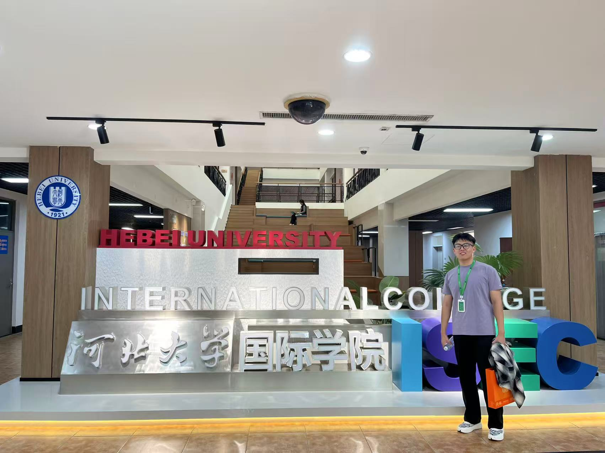

## 拖欠

九月基本上没有更新blog内容，其实不是没有写东西，而是一直在整理。

这个月阅读了大量的经典工作的源代码，把GPT-2、Llama-2、Qwen2&3的源代码都阅读复现完了，进行了架构细节的梳理，后续会同步更新。架构细节对比图是我自己根据源代码的设计细节自己手动绘制实现的，网上没有见过的细节对比梳理，首次尝试手绘，希望大家批评指正。

多模态方面阅读了CLIP以及ViT的论文以及源代码，完成了复现与架构设计。

Prompt压缩的最新文章一直在跟进阅读，但是由于阅读源代码，论文阅读耽搁了很久没有推进，**十月份要在论文上赶一赶进度了**。

## 玩和吃

魁圣阁的烧麦真不错，味真足，真心推荐！

华联地下一层的麻辣香锅差评！！！我才点了多少啊，花了老子71块大洋😭，再也不吃了。。。

严骥带着我和刘熙宸去看了IMAX的F1，真好看，位列本年度最佳毋庸置疑；后面要多去看IMAX了，争取每周去看一场电影。

去年的地坛书市错过了，今年赶上了，人好多和赶集一样，体验一般。

## 回忆涌上心头

九月的最后一天和茂然回河大了，校园的一草一木都是那样的亲切，好几座新的大楼拔地而起，熟悉又陌生；应了那句古话：“雕栏玉砌应犹在，只是朱颜改”啊！

逛了宿舍、学院教学楼、图书馆，一幕幕满载着无数的青春回忆，如过眼云烟般在脑海中涌现。

国庆第一天去任丘参加了马哥瑶姐的婚礼，晚上带着茂然和老于在沧州市里逛了逛，吃了晚饭，难得相聚😋

## 略带疲惫，回家充电

九月总是熬夜，睡眠不是很好；国庆回家后这几天睡的真香，我要把九月失去的觉都补回来～

十月希望能延续好在家里调整好的作息吧！🙏

十月要多读论文了，有了九月打下的源码基础，尽快找到能做的点子来，加油，晚安！✌️
