

  <h1>AGENTIC RETRIEVAL-AUGMENTED GENERATION: A SURVEY ON AGENTIC RAG</h1>
  <h3>Aditi Singh | Abul Ehtesham | Saket Kumar | Tala Talaei Khoei</h3>
  https://arxiv.org/abs/2501.09136

论文更多侧重于理论概念层面，实践中还会遇到很多问题和bug，需要自行体会。

## Abstract

文章首先以LLM在**文本生成**和**自然语言理解**方面的革新引入。然后笔锋一转(however)，揭示了对依赖静态数据“革新”的局限性，静态训练数据使得LLM不能够及时地动态响应、处理实时需求。针对这一局限性，引出文章重点介绍的技术： **Retrieval-Augmented Generation (RAG)** 。RAG的出现使得LLM可以及时更新训练数据，利用最新数据作出实时响应。当然，传统的RAG技术在多步推理和复杂任务管理上同样存在缺陷。

Agentic RAG通过将AI agents嵌入到RAG pipeline中超越了传统RAG在多步推理和复杂任务管理上存在的缺陷。Agents利用代理式设计组件动态管理检索策略，迭代改善上下文理解，适应工作流对于复杂任务的需要。

本文从RAG范式演化与基础原则开始，提供了一个对于Agentic RAG的全面探索。对于Agentic RAG架构细节、下游任务应用，以及强调了在系统扩充、确保道德决策和优化现实应用程序的性能方面的挑战。

## RAG基础

RAG面临的限制：

缺乏上下文理解、无法进行多步推理、难以处理复杂任务

1. outdated information
2. hallucinated responses
3.  an inability to adapt to dynamic
4. real-world scenarios

### Foundations of Retrieval-Augmented Generation



RAG = LLM + Information retrieval



RAG就是融合LLM的生成能力和实时数据的信息检索能力

### Core Components of RAG

- **Retrieveal**
- **Augmentation**
- **Generation**

## AI Agent

### Components of  AI Agent

1. **LLM (with defined Role and Task)**: LLM用作核心推理引擎
2. **Memory (Short-Term and Long-Term)**: 维护上下文信息
3. **Planning (Reflection & Self-Critique)**: 引导推理、拆分复杂任务
4. **Tools Vector Search, Web Search, APIs, etc.**: 调用外部资源

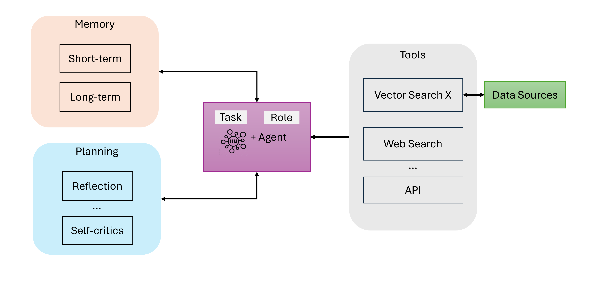

Agentic工作流的四个核心模式：

1. Reflection - 反省模式

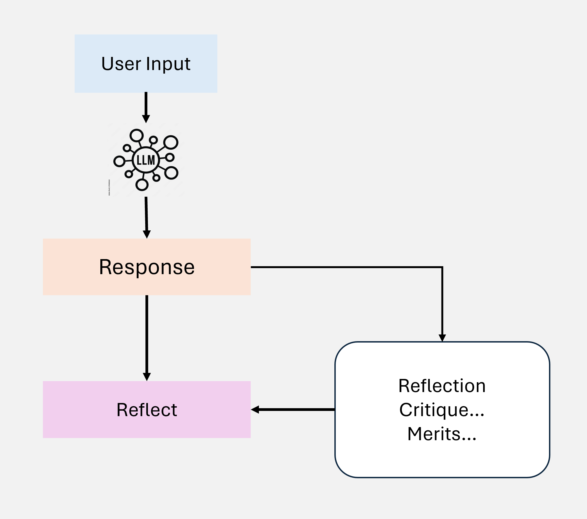

Agent根据输出相应作出自我评估，不断优化输出质量。

2. Planning - 规划模式

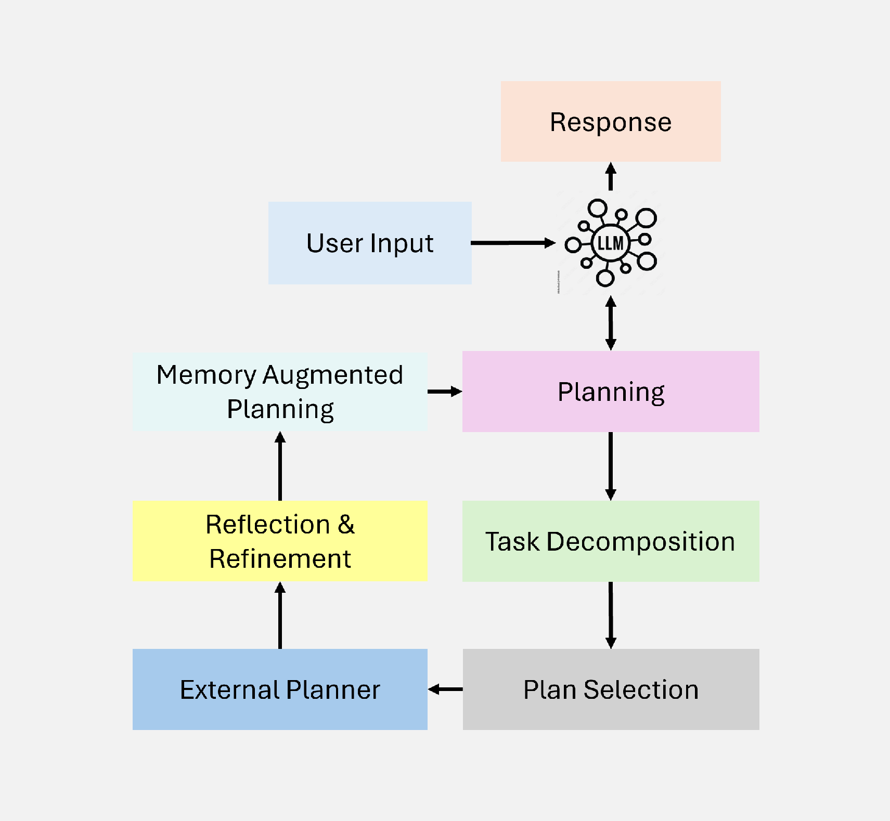

Agent制定任务执行计划，对复杂任务拆分、分配。

3. Tool Use - 工具使用模式

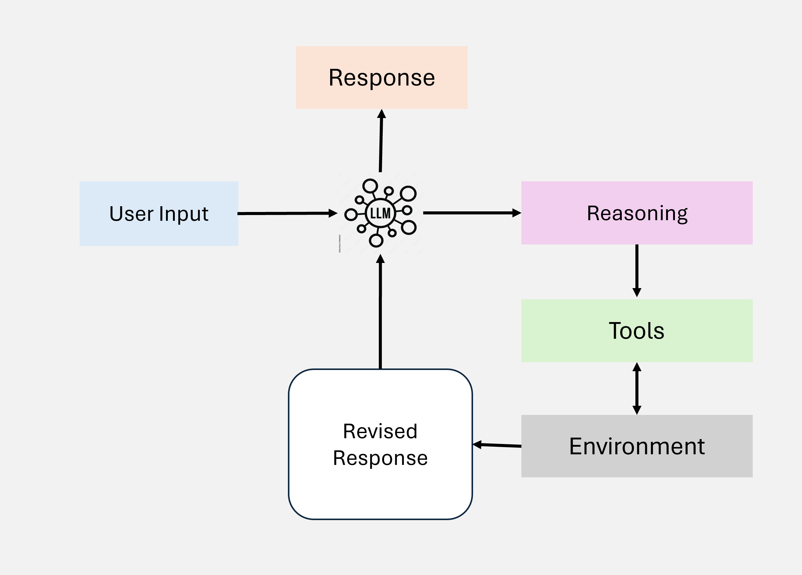

Agent会灵活调用APIs，扩展边界能力，同时调用数据库、数据统计分析工具、可视化工具等。

4. Multi-Agent - 多代理协作模式

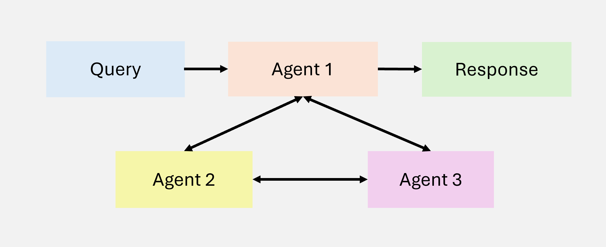

多Agent协作配合，每个Agent负责特定任务，共同完成同一个目标任务。

## Agentic RAG架构类别

### Single-Agent Agentic RAG: Router

Single-Agent架构是最基础的形式，Single-Agent可落地的功能：

- 智能分析用户问题
- 选择最合适的信息源
- 整合多个数据库的内容
- 语义搜索和web搜索
- 推荐系统

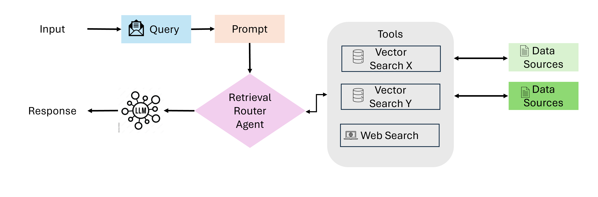

Single-Agent架构的数据整合能力强

### Multi-Agent Agentic RAG

多个Agent有明确分工：

- Agent 1：负责结构化数据查询
- Agent 2：处理语义搜索
- Agent 3：获取实时信息
- Agent 4：负责给结构化数据查询
- Agent 5：负责个性化推荐

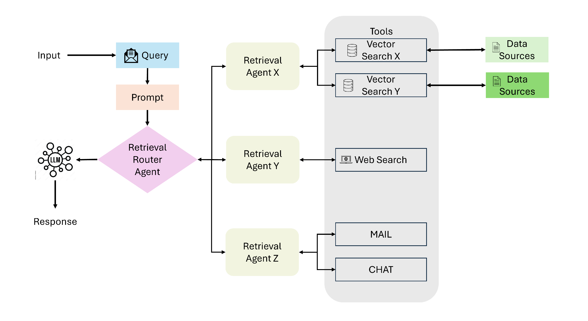

### Hierarchical Agentic RAG Systems

层级式架构类似于企业的组织结构，这种架构特别适合处理复杂的研究任务。

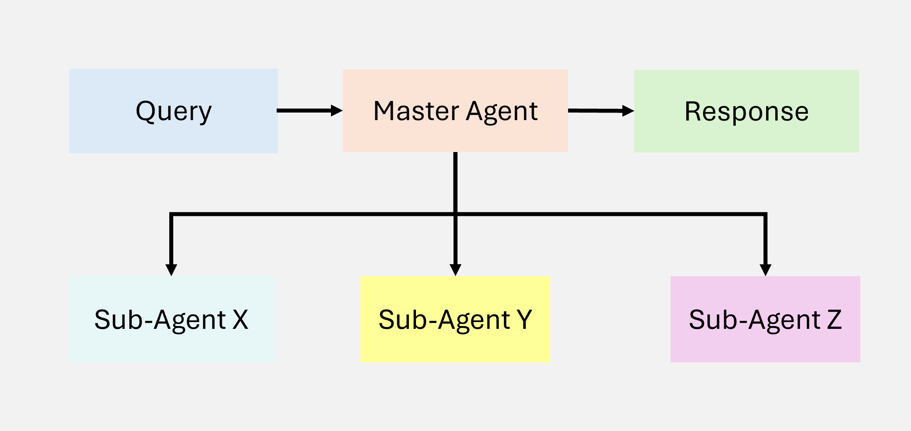

### Agentic Corrective RAG

自纠错架构，该架构引入了智能的质量控制机制。

相关性评估：确保检索内容的准确性

查询优化：动态调整搜索策略

外部知识补充：及时补充缺失信息

响应合成：生成高质量答案

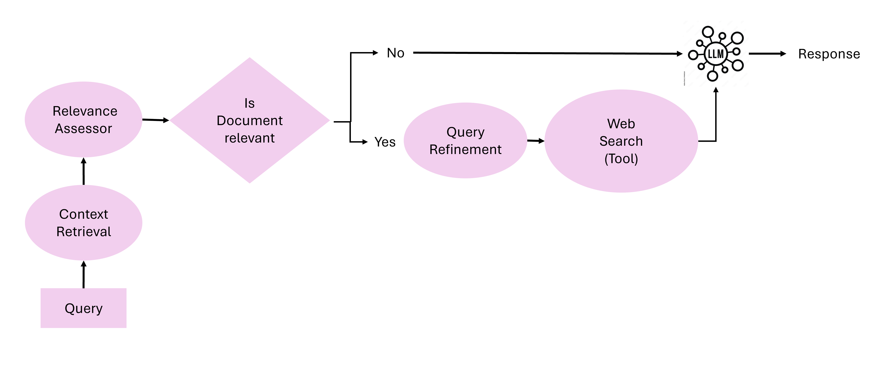

### Adaptive Agentic RAG

自适应架构，该架构能根据问题的复杂度动态调整处理策略

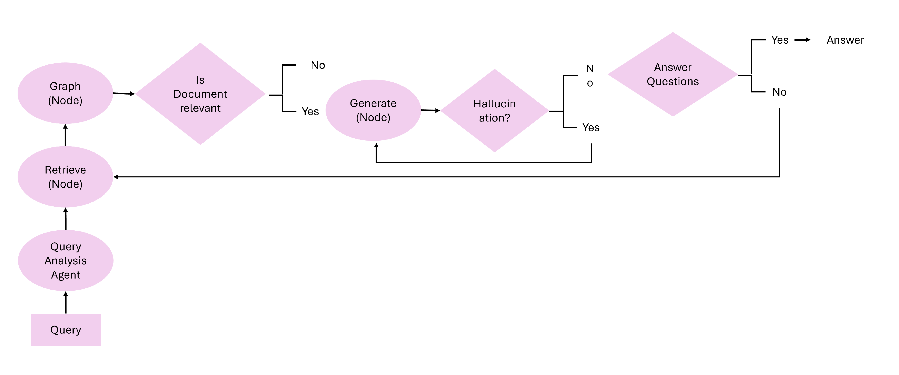

### **Graph-Based Agentic RAG**

将检索增强生成技术与知识图谱结合起来，提升系统的推理能力

理解实体间的复杂关联、支持跨领域知识关联、优化知识组织方式

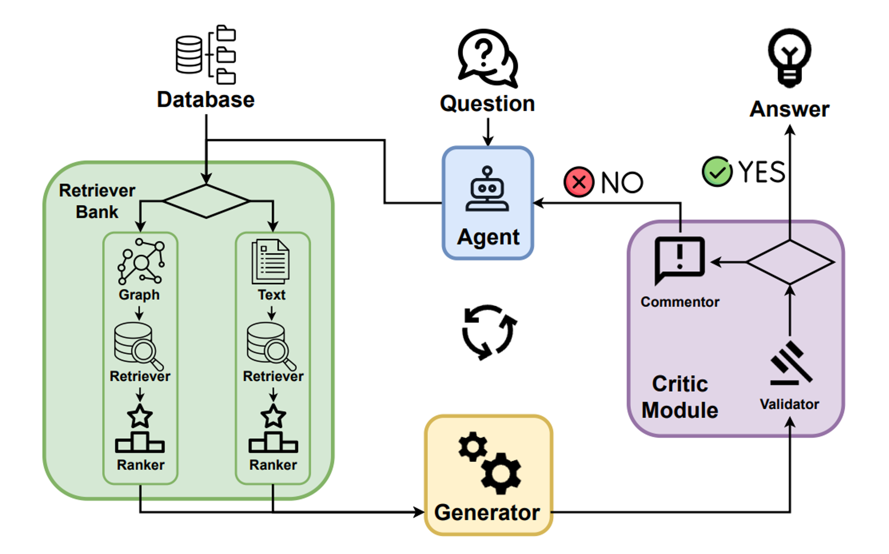

### **Agentic Document Workflows in Agentic RAG**

文档工作流架构是企业级应用的选择

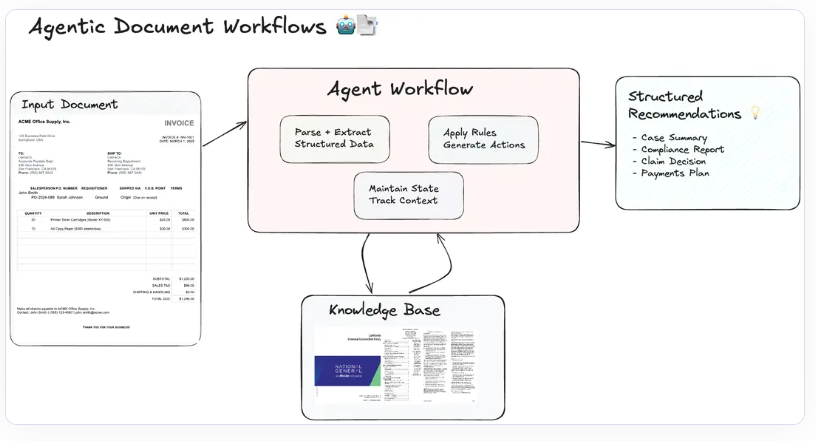

## Tool and FrameWork

- Langchain and LangGraph
- LlamaIndex
- Hugging Face Transformers and Qdrant
- Neo4j and Vector databases

## 落地场景

1. **在教育与个性化学习领域中为不同学习者提供个性化和适应性强的学习体验**。例如设计能够实时检索知识和提供个性化反馈的智能辅导器，根据学生进度和偏好生成定制的教育内容，多智能体系统用于协作学习模拟。
2. **在客户支持与虚拟助手领域提供与客户查询上下文相关且动态的响应。** 例如构建基于人工智能的虚拟助手，用于实时客户支持；自适应系统，通过学习用户反馈改进响应；多智能体编排处理复杂的多查询互动。
3. **在多模态工作流程中增强图的应用程序领域处理需要关系理解和多模态数据集成的任务**。例如，基于图的检索系统，用于连接结构化和非结构化数据；在科学研究、知识管理等领域中增强推理工作流程；将文本、图像和结构化数据的洞察综合起来，以生成可操作的输出。
4. **在以文档为中心的工作流领域自动化涉及文档解析、数据提取和多步骤推理的复杂工作流**。

