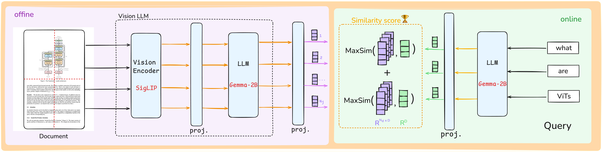
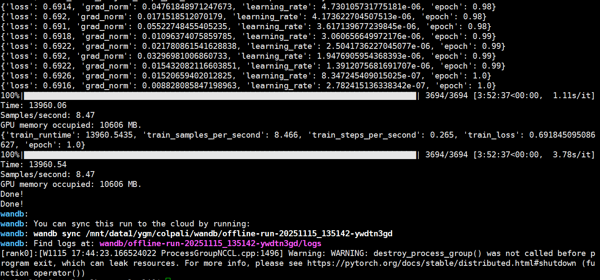
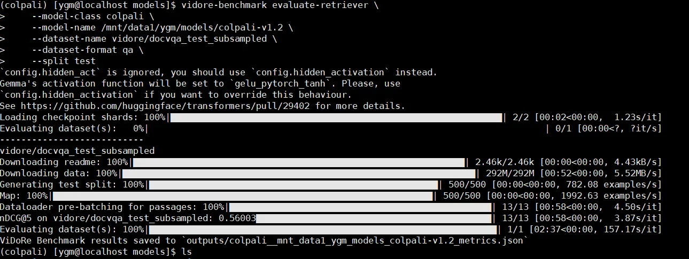

## 写在前面——谈谈我认为的论文复现

绝对不是按着GitHub上READ文件跑一遍，而是仔细去阅读源代码，真正弄清楚代码的设计逻辑》前提是你复现的工作作者非常的良心，譬如这篇colpali工作，基本都很透明。

这篇工作我是真去下功夫去理解复现的，前前后后奖奖将近两周多一点。实验记录我整理的非常详细，每一张架构图、类图都是我通过阅读源代码精心制作的，希望能让大家弄清楚colpali的结构设计。

侯捷老师说过，**天下大事必作于细**。要想好下手并作出修改，仔细阅读源码的功力和锻炼过程比不能少！这样才能避免遇到什么问题就问GPT，GPT修改，再报错，问GPT...周而复始的死循环当中。

## 复刻论文架构图




## 核心环境配置

```shell
# ---- 1️创建虚拟环境 ----
conda create -n colpali python=3.10 -y
conda activate colpali

# ---- 2️安装核心依赖 ----
pip install torch torchvision torchaudio --index-url https://download.pytorch.org/whl/cu121
pip install transformers accelerate datasets sentencepiece bitsandbytes flash-attn faiss-gpu
pip install peft einops omegaconf pytorch-lightning matplotlib tqdm

# ---- 3️配置 Hugging Face 镜像 ----
export HF_ENDPOINT=https://hf-mirror.com
export TRANSFORMERS_OFFLINE=0
export HF_HUB_DISABLE_SYMLINKS_WARNING=1
echo "已设置 Hugging Face 镜像源：$HF_ENDPOINT"

# ---- 4️克隆源码 ----
git clone https://github.com/illuin-tech/colpali.git
cd colpali
pip install -e .
cd ..

# ---- 5️下载模型权重（通过镜像）----
mkdir -p models

# ColPali (PaliGemma-3B)
wget https://hf-mirror.com/illuin-tech/colpali/resolve/main/pytorch_model.bin -O models/colpali/pytorch_model.bin
wget https://hf-mirror.com/illuin-tech/colpali/resolve/main/config.json -O models/colpali/config.json

# ColQwen2-VL-2B
wget https://hf-mirror.com/illuin-tech/colqwen2-vl/resolve/main/pytorch_model.bin -O models/colqwen2/pytorch_model.bin
wget https://hf-mirror.com/illuin-tech/colqwen2-vl/resolve/main/config.json -O models/colqwen2/config.json

# ---- 6️下载 ViDoRe 数据集 ----
mkdir -p data/vidore && cd data/vidore
wget https://hf-mirror.com/datasets/illuin-tech/vidore/resolve/main/vidore.tar.gz
tar -xvzf vidore.tar.gz && rm vidore.tar.gz
cd ../../

echo "环境与数据准备完成，可直接运行评测与源码阅读。"
```


## colqwen2训练

### 前期准备工作

修改train_colqwen2_model.yaml

```yaml
config:
  (): colpali_engine.trainer.colmodel_training.ColModelTrainingConfig
  output_dir: !path /mnt/data1/ygm/models/colqwen2-cesmoothmax-5e-2604
  processor:
    (): colpali_engine.utils.transformers_wrappers.AllPurposeWrapper
    class_to_instanciate: !ext colpali_engine.models.ColQwen2Processor
    pretrained_model_name_or_path:  "/mnt/data1/ygm/models/colqwen2-base"
    max_num_visual_tokens: 1024
    size:
      shortest_edge: 448
      longest_edge: 448

  model:
    (): colpali_engine.utils.transformers_wrappers.AllPurposeWrapper
    class_to_instanciate: !ext colpali_engine.models.ColQwen2
    pretrained_model_name_or_path: "/mnt/data1/ygm/models/colqwen2-base"
    torch_dtype:  !ext torch.bfloat16
    use_cache: false
    attn_implementation: "flash_attention_2"

  train_dataset: 
    (): colpali_engine.utils.dataset_transformation.load_train_set
  eval_dataset: !import ../data/test_data.yaml

  # max_length: 50
  run_eval: false
  loss_func:
    (): colpali_engine.loss.late_interaction_losses.ColbertPairwiseCELoss
  tr_args:
    (): transformers.training_args.TrainingArguments
    output_dir: null
    overwrite_output_dir: true
    num_train_epochs: 1
    per_device_train_batch_size: 16
    gradient_checkpointing: true
    gradient_checkpointing_kwargs: { "use_reentrant": false }
    # 6 x 8 gpus = 48 batch size
    # gradient_accumulation_steps: 4
    per_device_eval_batch_size: 8
    eval_strategy: "steps"
    dataloader_num_workers: 0
    # bf16: true
    save_steps: 500
    logging_steps: 10
    eval_steps: 100
    warmup_steps: 100
    learning_rate: 2e-4
    save_total_limit: 1
    # resume_from_checkpoint: true
    # optim: "paged_adamw_8bit"
    # wandb logging
    # wandb_project: "colqwen2"
    # run_name: "colqwen2-ba32-nolora"
    # report_to: "wandb"


  peft_config:
    (): peft.LoraConfig
    r: 32
    lora_alpha: 32
    lora_dropout: 0.1
    init_lora_weights: "gaussian"
    bias: "none"
    task_type: "FEATURE_EXTRACTION"
    target_modules: '(.*(model).*(down_proj|gate_proj|up_proj|k_proj|q_proj|v_proj|o_proj).*$|.*(custom_text_proj).*$)'
```

修改scripts/configs/data/test_data.yaml

```yaml
syntheticDocQA_energy:
  (): colpali_engine.data.dataset.ColPaliEngineDataset
  pos_target_column_name: "image"
  data:
    (): datasets.load_dataset
    path: "parquet"
    data_files:
      test: /mnt/data1/ygm/colpali/data_dir/syntheticDocQA_energy_test/data/test-00000-of-00001.parquet
    split: "test"

syntheticDocQA_healthcare_industry:
  (): colpali_engine.data.dataset.ColPaliEngineDataset
  pos_target_column_name: "image"
  data:
    (): datasets.load_dataset
    path: "parquet"
    data_files:
      test: /mnt/data1/ygm/colpali/data_dir/syntheticDocQA_healthcare_industry_test/data/test-00000-of-00001.parquet
    split: "test"

syntheticDocQA_artificial_intelligence_test:
  (): colpali_engine.data.dataset.ColPaliEngineDataset
  pos_target_column_name: "image"
  data:
    (): datasets.load_dataset
    path: "parquet"
    data_files:
      test: /mnt/data1/ygm/colpali/data_dir/syntheticDocQA_artificial_intelligence_test/data/test-00000-of-00001.parquet
    split: "test"

syntheticDocQA_government_reports:
  (): colpali_engine.data.dataset.ColPaliEngineDataset
  pos_target_column_name: "image"
  data:
    (): datasets.load_dataset
    path: "parquet"
    data_files:
      test: /mnt/data1/ygm/colpali/data_dir/syntheticDocQA_government_reports_test/data/test-00000-of-00001.parquet
    split: "test"

infovqa_subsampled:
  (): colpali_engine.data.dataset.ColPaliEngineDataset
  pos_target_column_name: "image"
  data:
    (): datasets.load_dataset
    path: "parquet"
    data_files:
      test: /mnt/data1/ygm/colpali/data_dir/infovqa_test_subsampled/data/test-00000-of-00001.parquet
    split: "test"

docvqa_subsampled:
  (): colpali_engine.data.dataset.ColPaliEngineDataset
  pos_target_column_name: "image"
  data:
    (): datasets.load_dataset
    path: "parquet"
    data_files:
      test: /mnt/data1/ygm/colpali/data_dir/docvqa_test_subsampled/data/test-00000-of-00001.parquet
    split: "test"

arxivqa_subsampled:
  (): colpali_engine.data.dataset.ColPaliEngineDataset
  pos_target_column_name: "image"
  data:
    (): datasets.load_dataset
    path: "parquet"
    data_files:
      test: /mnt/data1/ygm/colpali/data_dir/arxivqa_test_subsampled/data/test-00000-of-00001.parquet  # <-- 已修正
    split: "test"

tabfquad_subsampled:
  (): colpali_engine.data.dataset.ColPaliEngineDataset
  pos_target_column_name: "image"
  data:
    (): datasets.load_dataset
    path: "parquet"
    data_files:
      test: /mnt/data1/ygm/colpali/data_dir/tabfquad_test_subsampled/data/test-00000-of-00001.parquet
    split: "test"

tatdqa:
  (): colpali_engine.data.dataset.ColPaliEngineDataset
  pos_target_column_name: "image"
  data:
    (): datasets.load_dataset
    path: "parquet"
    data_files:
      test:
        - /mnt/data1/ygm/colpali/data_dir/tatdqa_test/data/test-00000-of-00002.parquet
        - /mnt/data1/ygm/colpali/data_dir/tatdqa_test/data/test-00001-of-00002.parquet
    split: "test"

shift_project:
  (): colpali_engine.data.dataset.ColPaliEngineDataset
  pos_target_column_name: "image"
  data:
    (): datasets.load_dataset
    path: "parquet"
    data_files:
      test: /mnt/data1/ygm/colpali/data_dir/shiftproject_test/data/test-00000-of-00001.parquet
    split: "test"
```

### 终端训练

```shell
(colpali) [ygm@localhost colpali]$ CUDA_VISIBLE_DEVICES=0,1 accelerate launch scripts/train/train_colbert.py scripts/configs/qwen2/train_colqwen2_model.yaml
```




## 基于训练好的colqwen进行测试

需要提前下载好数据集到本地服务器，下面展示一个数据集测试的例子，10个数据集是同样的操作。

> vidore/docvqa_test_subsampled数据集

```shell
pip install "vidore-benchmark[colpali-engine]"

vidore-benchmark evaluate-retriever \
--model-class colpali \
--model-name /mnt/data1/ygm/models/colqwen2 \
--dataset-name vidore/...-->对应的数据集名称 \
--dataset-format qa \
--split test
```




## Colpali中的Vision LLM

###  PaliGemma骨干

```python
# PaliGemmaModel 部分源代码
class PaliGemmaModel(PaliGemmaPreTrainedModel):
    _checkpoint_conversion_mapping = {"language_model.model": "language_model"}
    # we are filtering the logits/labels so we shouldn't divide the loss based on num_items_in_batch
    accepts_loss_kwargs = False

    def __init__(self, config: PaliGemmaConfig):
        super().__init__(config)
        # siglip_vision_model 作为 Vision Encoder
        self.vision_tower = AutoModel.from_config(config=config.vision_config)
        # PaliGemmaMultiModalProjector：vision encoder 与 LLM 之间的投影层 
        # colpali中VisionLLM中的第一个Proj
        self.multi_model_projector = PaliGemmaMultiModalProjector(config)
        self.vocab_size = config.text_config.vocab_size

        # Gemma-2B 作为 LLM
        language_model = AutoModel.form_config(config=config.text_config)
        self.language_model = language_model

        self.pad_token_id = self.config.pad_token_id if self.config.pad_token_id is not None else -1
        self.text_config_dtype = self.config.get_text_config().dtype or self.dtype
        self.post_init()
```


### 两个Proj层搞清楚

#### 第一个

Vision LLM中的第一个proj是**模态对齐层，**SigLIP 看到的“像素语言”(image_features)是 1152 维的，Gemma 思考的“文本语言”是 2048 维(hidden_states)。这个层的作用就是把“像素语言”(image_features)翻译成 Gemma 能接受的向量维度，让 Gemma 自己读到了文本 Embedding。

#### 第二个

经过Vision LLM的LLM后输出的语义特征需要再经过第二个Proj进行特征压缩，以便后续存储并加速Late interaction的计算，这部分代码体现在/colpali/colpali_engine/models/paligemma/colpali/modeling_colpali.py

#### Online与Offine阶段的不同输入搞清楚

两阶段的输入都是在./colpali_engine/models/paligemma/colpali/modeling_colpali.py中Colpali类中完成的，只是输入时数据不同。

**Offline**：输入inputs_ids(包含图像占位符) + pixel_values -> 融合 -> Gemma -> Proj -> 128维向量

**Online**：仅输入input_ids (纯文本) -> Gemma -> Proj -> 128维向量


## colpali的类继承关系

(点击图片即可放大)通过阅读源代码，根据自己的理解我画出了colpali的类图：


## colqwen2的类继承关系

(点击图片即可放大)通过阅读源代码，根据自己的理解我画出了colqwen2的类图：


