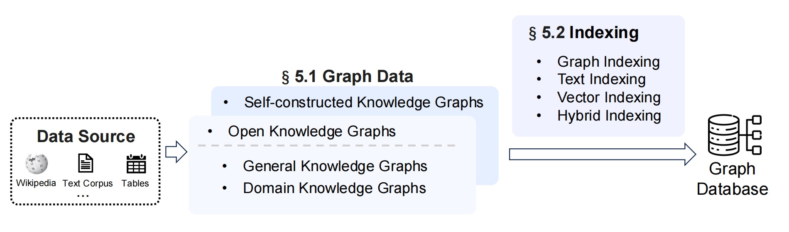
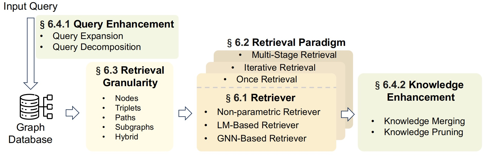
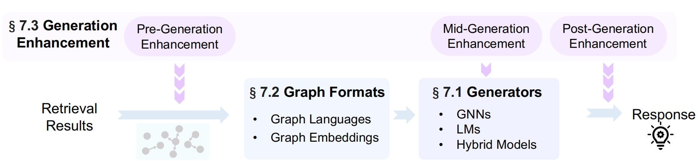
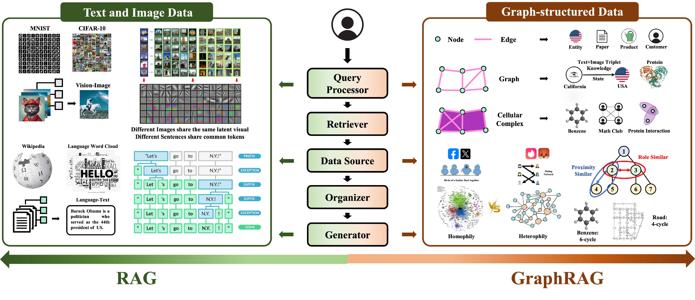
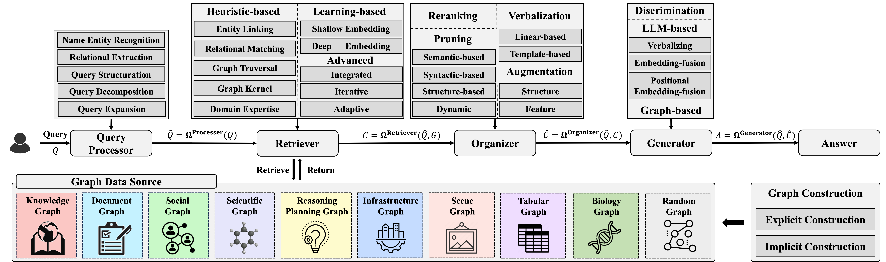

  <h1>Graph Retrieval-Augmented Generation: A Survey</h1>
  https://www.arxiv.org/pdf/2408.08921

论文更多侧重理论概念层面，实践落地过程中需要自行体会各个阶段的实现过程。

## Abstract

通过引用外部知识库，RAG改进了LLM输出，有效地减轻了诸如“幻觉”、缺乏特定领域的知识和过时的信息等问题。但是，**数据库中不同实体之间复杂的关系结构给RAG系统带来了挑战**。

*GraphRAG*利用**跨实体**的结构信息，以实现更精确和全面的检索，捕获关系知识，并促进更准确的、上下文感知的响应。

这篇文章是首次对于GraphRAG方法提供了全面的总结，规范了GraphRAG workflow(包括Graph-Based

Indexing、Graph-Guided Retrieval和Graph-Enhanced Generation)，强调了每一个阶段的核心技术和训练方法。此外，还对下有任务、应用领域、评估方法、工业案例进行阐述。

## 工作流与关键技术

### 工作流程



**Graph-Based Indexing (G-Indexing) -> Graph-Guided Retrieval (G-Retrieval) -> Graph-Enhanced Generation (G-Generation)** 



图索引建立：包括识别或构建与下游任务对齐的图数据库，并在其上建立索引。图数据可以来自开放知识图谱或自建图数据。

图数据检索：从图数据库中提取相关信息以响应用户查询。涉及选择检索器、检索范式、检索粒度和增强技术。

图增强生成：基于检索到的图数据生成有意义的输出。涉及选择生成器、转换图数据格式和生成增强技术。

### 核心技术

- **图数据:** 包括开放知识图谱和自建图数据。开放知识图谱如Wikidata、Freebase等，自建图数据则根据特定任务定制。

- **索引方法:** 包括图索引、文本索引和向量索引。混合索引结合了这些方法的优点。

- **检索器:** 分为非参数检索器、基于LM的检索器和基于GNN的检索器。检索范式包括一次检索、迭代检索和多阶段检索。

- **生成器:** 包括GNNs、LMs和混合模型。生成增强技术包括预生成增强、中生成增强和后生成增强。

**GraphRAG在图索引（G-Indexing）阶段是如何构建和优化图数据库的？**

1. **数据源选择**：图数据库可以来自公共知识图谱（如Wikidata、Freebase、DBpedia等）或自构建的数据源（如文本、其他形式的数据等）。
2. **节点和边属性映射**：将节点和边的属性进行映射，以便于后续的检索和生成操作。
3. **指针建立**：在节点之间建立指针，以便于快速遍历和检索。
4. **数据组织**：组织数据以支持快速遍历和检索操作，确保索引过程的高效性。

**GraphRAG在图增强生成（G-Generation）阶段如何处理和转换检索到的图数据？**

在图增强生成（G-Generation）阶段，GraphRAG需要将检索到的图数据转换为生成器可以处理的格式。具体步骤如下：

1. **数据转换**：将检索到的图数据（如节点、边、路径、子图等）转换为生成器可以理解的格式。常见的转换方法包括邻接表、自然语言描述、代码形式、语法树和节点序列等。
2. **生成器输入**：将转换后的图数据与查询一起作为输入提供给生成器。生成器可以是基于图神经网络（GNNs）的模型、判别式语言模型或生成式语言模型。
3. **生成响应**：生成器根据输入的查询和图数据生成最终的响应。对于生成式语言模型，这通常涉及解码过程，以生成自然语言文本作为响应。

## Future Prospects

### 多模态数据整合

知识图谱中目前存储的仍然是大量文本数据，对于多模态数据的整合仍然是挑战，知识图谱的规模升级是发展GraphRAG的底层刚需。

### 检索机制

当前的检索机制仍然是对于少量文本-实体的知识图谱作检索，而大量实体的复杂检索机制需要被探索。

### 检索上下文的无损失压缩

应用GraphRAG，检索得到信息包含大量的实体和关系，这些信息会被转换为长文本输入序列。但是长文本输入序列包含两个问题：LLMs很难解决长文本序列、对于个人用户而言推理阶段的大量计算是障碍。

因此，无损压缩对于GraphRAG是关键的。

### 落地应用

应用场景：客服服务系统、推荐系统、KBQA(知识问答系统)

## Conclusion

这篇调研文章全面的回顾了GraphRAG技术，系统地分类、组织了它的基本技术，训练方法和应用场景。GraphRAG通过使用从图数据集中派生出的关键知识，解决了传统RAG的关键性限制。

  <h1>Retrieval-Augmented Generation with Graph</h1>
  https://arxiv.org/pdf/2501.00309

论文更多侧重理论概念层面，实践落地过程中需要自行体会各个阶段的实现过程。

## Abstract

与传统RAG相比，检索器、生成器和外部数据源可以做统一嵌入处理；Graph数据结构的独特性，在进行GraphRAG设计时面临着大量的挑战。

论文的主要工作：定义了包含关键组件在内的GraphRAG的总体架构(包括查询处理器、检索器、组织器、生成器和数据源)、总结了**特定领域**的GraphRAG技术、讨论了GraphRAG未来发展方向。

## 图数据结构

内在的节点和边编码组成了大量异构和关系信息，是RAG中的黄金资源。

RAG处理文本和图像数据，这些数据可以统一格式化为1-D序列数据或2-D网格数据。相比之下，**GraphRAG**处理图结构数据，涵盖了多种格式并包含特定领域的关系信息。

## 全面的GraphRAG架构

GraphRAG通过检索和生成技术来增强下游任务的执行，框架的核心在于利用图结构数据的特性，进行信息检索、数据挖掘。

GraphRAG框架的关键组件：

1. **查询处理器（Query Processor）**：负责预处理用户定义的查询，使其能够与图数据源进行交互。
2. **检索器（Retriever）**：根据预处理后的查询从图数据源中检索相关内容。
3. **组织器（Organizer）**：对检索到的内容进行整理和优化，以提高生成器的性能。
4. **生成器（Generator）**：根据组织后的信息生成最终答案。

### Query Processor

Query Processor是一个关键组件，它负责对用户输入的查询进行预处理，以便与图数据源进行交互。

查询处理器主要功能：

- **实体识别**：从查询中识别出实体，并将其与图数据源中的节点相匹配。
- **关系抽取**：识别查询中的关系，并将其与图数据源中的边相匹配。
- **查询结构调整**：将自然语言查询转换为结构化查询，如GQL（Graph Query Language）。
- **查询分解**：将复杂的查询分解为多个子查询，以便进行多步推理。
- **查询扩展**：通过添加相关术语来丰富查询，以提高检索的准确性和相关性。

### Retriever

检索器（Retriever）是负责从图数据源中检索相关信息的关键组件。

检索器主要功能：

**检索内容**：根据预处理后的查询从图数据源中检索相关内容。

**适应图结构数据**：能够处理图结构数据的多样性和复杂性，包括不同格式和来源的信息。

**多跳遍历**：支持多跳遍历，以捕获逻辑上相关的知识。

**领域特定设计**：根据不同领域的特定需求进行设计，以提高检索的准确性和效率。

### Organizer

负责处理检索器检索到的内容，将其与预处理后的查询结合，以生成更适应生成器（Generator）的格式。

主要功能：

**内容优化**：对检索到的内容进行后处理和优化，以提高其质量。

**图结构处理**：处理检索到的图结构数据，包括图剪枝、重排序和图增强。

**文本化**：将检索到的图结构数据转换为文本格式，以便生成器可以处理。

### Generator

**生成器（Generator）**是负责根据查询和检索到的信息生成最终答案的关键组件。生成器的任务是将组织者处理后的信息转化为具体的输出，这些输出可以是文本、图像、数值或其他形式的数据，取决于具体的应用场景。

生成器主要功能：

**生成最终答案**：根据查询和检索到的信息生成具体的输出。

**适应不同任务**：能够处理多种任务，如分类、生成、预测等。

**利用图结构信息**：能够理解和利用图结构数据中的关系和模式。

