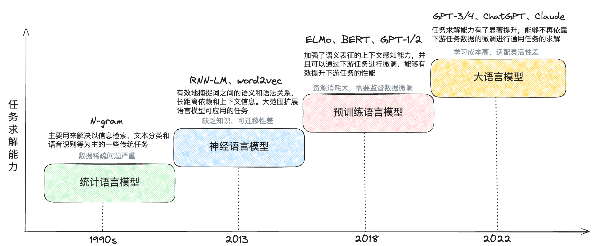

【[面向开发者的LLM教程](https://datawhalechina.github.io/llm-cookbook/#/)】

LLM是通过预测下一个词的的监督学习方式进行训练的。具体来说，首先准备一个包含数百亿甚至更多词的大规模文本数据集。然后，可以从这些文本中提取句子或句子片段作为模型输入。模型会根据当前输入 Context 预测下一个词的概率分布。通过不断比较模型预测和实际的下一个词，并更新模型参数最小化两者差异,语言模型逐步掌握了语言的规律，学会了预测下一个词。

在训练过程中,研究人员会准备大量句子或句子片段作为训练样本,要求模型一次次预测下一个词，通过反复训练促使模型参数收敛，使其预测能力不断提高。经过在海量文本数据集上的训练，语言模型可以达到十分准确地预测下一个词的效果。这种**以预测下一个词为训练目标的方法使得语言模型获得强大的语言生成能力**。


思考：这个和当初**Alpha Go**生成下一步棋的方式是不是有异曲同工之妙？



https://github.com/RUCAIBox/LLMSurvey?tab=readme-ov-file

input (prompt) -> fn{LLM} -> output

## 历史发展

大语言模型发展主要经历了统计语言模型 --> 神经语言模型 --> 预训练语言模型 --> 大语言模型四个阶段

图片引用自[Cleaner 知识库](https://cleaner.love/)

## 基本概念

### Token

Token的概念相当于文字，一个中文文字对应一个token，比如我爱你，对应三个token：我+爱+你；一个英文的字符对应一个token，比如love，而icecream对应两个token：ice+cream。

联系理解，计算机理解数据的形式是**比特流**，那么类比联想理解，LLM理解数据的“字节”就是一个Token。

### 预训练

使用大语言模型在**大规模语料**上进行预训练，大语言模型可以获得通用的语言理解与生成能力，掌握较为广泛的世界知识，具备解决众多下游任务的性能潜力。

预训练大模型类比机器学习的训练模式，其实就是通过算法将模型在训练集上先进行训练

### 微调

指令微调是指使用自然语言形式的数据对预训练后的大语言模型进行**参数微调**，它是增强和激活大语言模型特定能力的重要方法之一。通过使用任务输入与输出的配对数据进行模型训练，可以使语言模型掌握通过问答形式进行任务求解的能力和较强的指令遵循能力，并且能够无需下游任务的训练样本或者示例就可以解决训练中未见过的任务。

### 对齐

经过大规模的预训练和有监督指令微调，大语言模型具备了解决各种任务的通用能力和指令遵循能力，但是同时也可能生成`有偏见的`、`冒犯的`以及`事实错误的`文本内容。这些潜在的有害行为，可能在下游应用中产生严重的影响与危害，进一步被恶意使用者进行放大与利用。因此，在大语言模型的学习过程中，如何确保大语言模型的行为与人类价值观、人类真实意图和社会伦理相一致成为了一个 关键研究问题，通常称这一研究问题为**人类对齐**。

### 泛化

模型泛化是指一些模型可以应用（泛化）到其他场景，通常为采用迁移学习、微调等手段实现泛化。

### 涌现

模型规模达到一定阈值以上后，会在多步算术、大学考试、单词释义等场景的准确性显著提升，称为涌现。

## RAG与微调

目前的大模型都是预训练语言模型 LLaMA、GPT4o、o1-mini

- 互联网公开的海量数据
- 私有化数据

针对互联网数据无法及时更新与专业领域私有化数据的解决方案：

- RAG-检索增强生成：数据（语料）数据大部分是文献资料、文档
- SFT-微调：QA-法律咨询、心理诊断等一问一答数据标签归类，微调出一个适用场景的垂直场景

RAG缺点：

检索出来的文档片段不完整，重排序

对于系统延迟低场景(检索器检索)

Embeding Model-嵌入

将文本转换成一组N维的浮点数，文本向量又叫做Embedings

向量之间可以计算距离，距离的远近对应语义的相似性

以前的工程中，keywords、sql = 精确匹配，使用关系型数据库进行存储。现在文本嵌入、图片嵌入等 = 距离相似度匹配，使用向量数据库存储

原始文档 -》embedded

query  -》embedded

必须使用同一个Embedded model

## 参考学习的资料：

[1] 面向开发者的LLM教程:https://datawhalechina.github.io/llm-cookbook/#/

[2] LLMBOOK:https://github.com/RUCAIBox/LLMSurvey?tab=readme-ov-file

[3] https://developer.aliyun.com/article/1361737
