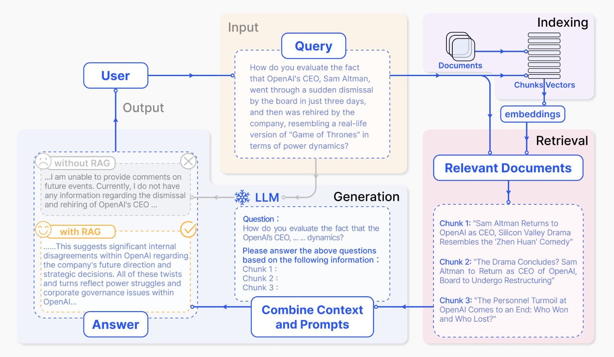
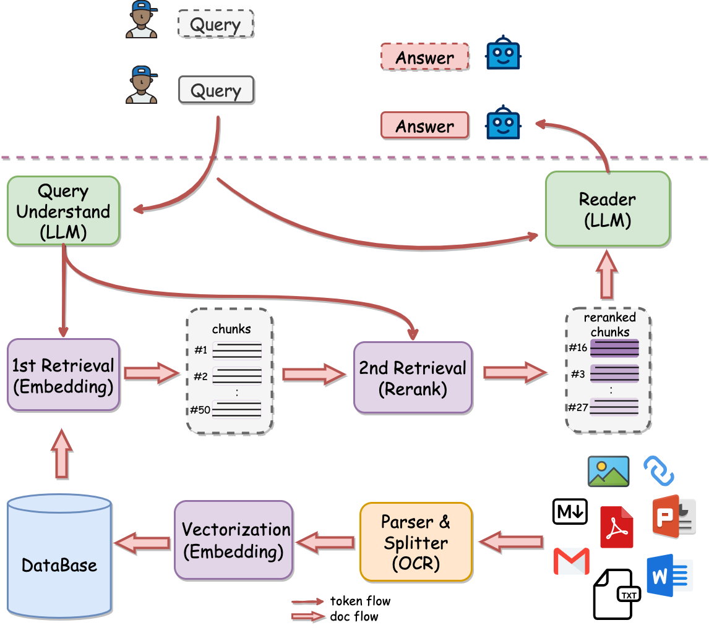

## day01-baseline搭建


首先注册魔塔社区帐号，免费领取魔塔GPU算力资源


新建GPU算力环境，下载相关第三方库与拉取镜像资源

~~~shell
## 拉取git镜像
git lfs install
git clone https://www.modelscope.cn/datasets/Datawhale/AICamp_yuan_baseline.git
## 安装第三方库
pip install streamlit==1.24.0
## 启动demo
streamlit run AICamp_yuan_baseline/Task\ 1：零基础玩转源大模型/web_demo_2b.py --server.address 127.0.0.1 --server.port 6006
~~~

## day02-RAG原理与实践

检索增强生成 **(Retrieval Augmented Generation,RAG)** 是一种使用来自私有或专用数据源的信息来辅助文本生成的技术。它将检索模型(设计用于搜索大型数据集或知识库)和生成模型(例如大型语言模型 (LLM))，此类模型会使用检 索到的信息生成可供阅读的文本回复)结合在一起。

### LLM局限性

[Retrieval-Augmented Generation for Knowledge-Intensive NLP Tasks](https://arxiv.org/pdf/2005.11401.pdf)

这篇文章由来自Facebook AI Research、University College London、New York University三大科研教育机构的12名作者 (Patrick Lewis等)共同完成。文章主要介绍了一种新颖的检索增强生成(RAG)模型，该模型旨在解决预训练语言模型 在知识密集型NLP任务中的局限性，RAG技术被首次提出。

文章中阐述了传统大模型的局限性:传统的大型预训练模型虽然拥有存储大量事实知识的能力，但在 (query accuracy)和更 (knowledge updates)时存在不足。

同样，在实际业务场景中，通用的基础大模型可能存在无法满足我们需求的情况，主要有以下几方面原因：

- 知识局限性：大模型的知识来源于训练数据，而这些数据主要来自于互联网上已经公开的资源，对于一些实时性的或者非公开的，由于大模型没有获取到相关数据，这部分知识也就无法被掌握。

- 数据安全性：为了使得大模型能够具备相应的知识，就需要将数据纳入到训练集进行训练。然而，对于企业来说，数据的安全性至关重要，任何形式的数据泄露都可能对企业构成致命的威胁。

- 大模型幻觉：由于大模型是基于概率统计进行构建的，其输出本质上是一系列数值运算。因此，有时会出现模型“一本正经地胡说八道”的情况，尤其是在大模型不具备的知识或不擅长的场景中。

### RAG基本步骤



- 索引：将文档库分割成较短的 **Chunk**，即文本块或文档片段，然后构建成向量索引。

- 检索：计算问题和 Chunks 的相似度，检索出若干个相关的 Chunk。

- 生成：将检索到的Chunks作为背景信息，生成问题的回答。


### RAG完整链路图



图片来源:(https://github.com/netease-youdao/QAnything/blob/master/docs/images/qanything_arch.png)

用户进行query查询后，RAG会先进行检索，之后将检索到的 **`Chunks`** 和 **`query`** 一并输入到大模型，进而回答用户的问题。

为了完成检索，需要离线将文档（ppt、word、pdf等）经过解析、切割甚至OCR转写，然后进行向量化存入数据库(vector database)中。

### 离线计算

知识库中包含了多种类型的文件，如pdf、word、ppt等，这些 `文档`（Documents）需要提前被解析，然后切割成若干个较短的 `Chunk`，并且进行清洗和去重。

然后，我们会将知识库中的所有 `Chunk` 都转成向量，这一步也称为 `向量化`（Vectorization）或者 `索引`（Indexing）。`向量化` 需要事先构建一个 `向量模型`（Embedding Model），它的作用就是将一段 `Chunk` 转成 `向量`（Embedding）。

随着新知识的不断存储，向量的数量也会不断增加。这就需要将这些向量存储到 `数据库` （DataBase）中进行管理。

### 在线计算

在实际使用RAG系统时，当给定一条用户 `查询`（Query），需要先从知识库中找到所需的知识，这一步称为 `检索`（Retrieval）。在 `检索` 过程中，用户查询首先会经过向量模型得到相应的向量，然后与 `数据库` 中所有 `Chunk` 的向量计算相似度，最简单的例如  `余弦相似度`，然后得到最相近的一系列 `Chunk` 。

由于向量相似度的计算过程需要一定的时间，尤其是 `数据库` 非常大的时候。可以在检索之前进行 `召回`（Recall），即从 `数据库` 中快速获得大量大概率相关的 `Chunk`，然后只有这些 `Chunk` 会参与计算向量相似度。这样，计算的复杂度就从整个知识库降到了非常低。

随着知识库的增大，除了检索的速度变慢外，检索的效果也会出现退化。这是由于 `向量模型` 能力有限，而随着知识库的增大，已经超出了其容量，因此准确性就会下降。在这种情况下，相似度最高的结果可能并不是最优的。

为了解决这一问题，提升RAG效果，研究者提出增加一个二阶段检索——`重排` (Rerank)，即利用 `重排模型`（Reranker），使得越相似的结果排名更靠前。这样就能实现准确率稳定增长，即数据越多，效果越好（如上图中紫线所示）。

通常，为了与 `重排` 进行区分，一阶段检索有时也被称为 `精排` 。而在一些更复杂的系统中，在 `召回` 和 `精排` 之间还会添加一个 `粗排` 步骤，这里不再展开，感兴趣的同学可以自行搜索。综上所述，在整个 `检索` 过程中，计算量的顺序是 `召回` > `精排` > `重排`，而检索效果的顺序则是 `召回` < `精排` < `重排` 。

至此，一个完整的RAG链路就构建完毕了。

### 参考文献

[1] Retrieval-Augmented Generation for Knowledge-Intensive NLP Tasks 

[2] Gao, Yunfan, et al. "Retrieval-augmented generation for large language models: A survey." **arXiv preprint arXiv:2312.10997** (2023).

[3] X. Ma, Y. Gong, P. He, H. Zhao, and N. Duan, “Query rewriting for retrieval-augmented large language models,” **arXiv preprint arXiv:2305.14283**, 2023.

[4] QAnything: https://github.com/netease-youdao/QAnything

[5] When Large Language Models Meet Vector Databases: A Survey https://doi.org/10.48550/arXiv.2402.01763 

## RAG技术实践

前置条件：使用day01搭建好的baseline环境

下载环境所需的任务包：

~~~bash
git lfs install
git clone https://www.modelscope.cn/datasets/Datawhale/AICamp_yuan_baseline.git
cp AICamp_yuan_baseline/Task\ 3：源大模型RAG实战/* .
~~~

双击打开`Task 3：源大模型RAG实战.ipynb`，然后运行所有单元格。

在环境中安装`streamlit`,为了后续进行模型微调以及Demo搭建(day01已经安装完毕)。

### 模型下载

在RAG实战过程中，需要构建一个向量模型。向量模型通常是一个BERT架构，是一个Transformer Encoder。

在本次学习中，选用基于BERT架构的向量模型 `bge-small-zh-v1.5`，它是一个4层的BERT模型，最大输入长度512，输出的向量维度也为512。

向量模型下载：

~~~python
from modelscope import snapshot_download
model_dir = snapshot_download("AI-ModelScope/bge-small-zh-v1.5", cache_dir='.')
~~~

Yuan大模型下载：

~~~python
from modelscope import snapshot_download
model_dir = snapshot_download('IEITYuan/Yuan2-2B-Mars-hf', cache_dir='.')
~~~

### 索引

构造向量索引，分装一个向量模型类EmbeddingModel：

~~~python
# 定义向量模型类
class EmbeddingModel:
    """
    class for EmbeddingModel
    """

    def __init__(self, path: str) -> None:
        self.tokenizer = AutoTokenizer.from_pretrained(path)

        self.model = AutoModel.from_pretrained(path).cuda()
        print(f'Loading EmbeddingModel from {path}.')

    def get_embeddings(self, texts: List) -> List[float]:
        """
        calculate embedding for text list
        """
        encoded_input = self.tokenizer(texts, padding=True, truncation=True, return_tensors='pt')
        encoded_input = {k: v.cuda() for k, v in encoded_input.items()}
        with torch.no_grad():
            model_output = self.model(**encoded_input)
            sentence_embeddings = model_output[0][:, 0]
        sentence_embeddings = torch.nn.functional.normalize(sentence_embeddings, p=2, dim=1)
        return sentence_embeddings.tolist()
~~~


通过传入模型路径，新建一个 `EmbeddingModel` 对象 `embed_model`。初始化时自动加载向量模型的tokenizer和模型参数。

~~~python
print("> Create embedding model...")
embed_model_path = './AI-ModelScope/bge-small-zh-v1___5'
embed_model = EmbeddingModel(embed_model_path)
~~~

`EmbeddingModel` 类还有一个 `get_embeddings()` 函数，它可以获得输入文本的向量表示。

### 检索

为了实现向量检索，定义一个向量库索引类 `VectorStoreIndex`：

~~~python
# 定义向量库索引类
class VectorStoreIndex:
    """
    class for VectorStoreIndex
    """

    def __init__(self, doecment_path: str, embed_model: EmbeddingModel) -> None:
        self.documents = []
        for line in open(doecment_path, 'r', encoding='utf-8'):
            line = line.strip()
            self.documents.append(line)

        self.embed_model = embed_model
        self.vectors = self.embed_model.get_embeddings(self.documents)

        print(f'Loading {len(self.documents)} documents for {doecment_path}.')

    def get_similarity(self, vector1: List[float], vector2: List[float]) -> float:
        """
        calculate cosine similarity between two vectors
        """
        dot_product = np.dot(vector1, vector2)
        magnitude = np.linalg.norm(vector1) * np.linalg.norm(vector2)
        if not magnitude:
            return 0
        return dot_product / magnitude

    def query(self, question: str, k: int = 1) -> List[str]:
        question_vector = self.embed_model.get_embeddings([question])[0]
        result = np.array([self.get_similarity(question_vector, vector) for vector in self.vectors])
        return np.array(self.documents)[result.argsort()[-k:][::-1]].tolist() 
~~~

类似地，通过传入知识库文件路径，新建一个 `VectorStoreIndex` 对象 `index`。初始化时会自动读取知识库的内容，然后传入向量模型，获得向量表示。

~~~python
print("> Create index...")
doecment_path = './knowledge.txt'
index = VectorStoreIndex(doecment_path, embed_model)
~~~

上文提到 `get_embeddings()` 函数支持一次性传入多条文本，但由于GPU的显存有限，输入的文本不宜太多。

所以，如果知识库很大，需要将知识库切分成多个batch，然后分批次送入向量模型。

`VectorStoreIndex` 类还有一个 `get_similarity()` 函数，它用于计算两个向量之间的相似度，这里采用了余弦相似度。`VectorStoreIndex` 类的入口，即查询函数 `query()`。传入用户的提问后，首先会送入向量模型获得其向量表示，然后与知识库中的所有向量计算相似度，最后将 `k` 个最相似的文档按顺序返回，`k`默认为1。

~~~python
question = '介绍一下广州'
print('> Question:', question)

context = index.query(question)
print('> Context:', context)
~~~


### 生成

为了实现基于RAG的生成，我们还需要定义一个大语言模型类 `LLM`：

~~~python
# 定义大语言模型类
class LLM:
    """
    class for Yuan2.0 LLM
    """

    def __init__(self, model_path: str) -> None:
        print("Creat tokenizer...")
        self.tokenizer = AutoTokenizer.from_pretrained(model_path, add_eos_token=False, add_bos_token=False, eos_token='<eod>')
        self.tokenizer.add_tokens(['<sep>', '<pad>', '<mask>', '<predict>', '<FIM_SUFFIX>', '<FIM_PREFIX>', '<FIM_MIDDLE>','<commit_before>','<commit_msg>','<commit_after>','<jupyter_start>','<jupyter_text>','<jupyter_code>','<jupyter_output>','<empty_output>'], special_tokens=True)

        print("Creat model...")
        self.model = AutoModelForCausalLM.from_pretrained(model_path, torch_dtype=torch.bfloat16, trust_remote_code=True).cuda()

        print(f'Loading Yuan2.0 model from {model_path}.')

    def generate(self, question: str, context: List):
        if context:
            prompt = f'背景：{context}\n问题：{question}\n请基于背景，回答问题。'
        else:
            prompt = question

        prompt += "<sep>"
        inputs = self.tokenizer(prompt, return_tensors="pt")["input_ids"].cuda()
        outputs = self.model.generate(inputs, do_sample=False, max_length=1024)
        output = self.tokenizer.decode(outputs[0])

        print(output.split("<sep>")[-1])
~~~

这里我们传入 `Yuan2-2B-Mars` 的模型路径，新建一个 `LLM` 对象 `llm`。初始化时自动加载源大模型的tokenizer和模型参数。

~~~python
print("> Create Yuan2.0 LLM...")
model_path = './IEITYuan/Yuan2-2B-Mars-hf'
llm = LLM(model_path)
~~~

`LLM` 类的入口是生成函数 `generate()`，它有两个参数：

- `question`: 用户提问，是一个str
- `context`: 检索到的上下文信息，是一个List，默认是[]，代表没有使用RAG

~~~python
print('> Without RAG:')
llm.generate(question, [])

print('> With RAG:')
llm.generate(question, context)
~~~

```properties
> Without RAG:
广州大学（Guangzhou University）是广东省内一所综合性大学，位于中国广东省广州市。广州大学成立于1952年，前身为广州工学院，是中华人民共和国成立后创建的第一所高等工科院校。
广州大学坐落在广州市海珠区，占地面积广阔，校园环境优美。学校拥有多个校区，其中主校区位于广州市番禺区，其他校区分布在广州市的其他地区。学校占地面积约4000亩，拥有现代化的教学、实验和生活设施。
广州大学以培养人才为宗旨，注重理论与实践相结合的教学模式。学校开设了多个学院和专业，涵盖了工学、理学、文学、法学、经济学、管理学、艺术学等多个领域。学校现有本科专业近300个，研究生专业涵盖科学、工程、管理、文学、法学、艺术等多个领域。
广州大学注重国际交流与合作，积极推进国际化办学。学校与许多国际知名大学建立了合作关系，开展学术交流和合作研究。此外，学校还鼓励学生参与国际交流项目，提供海外实习和留学机会，提升学生的国际视野和能力。
广州大学一直以来致力于为学生提供优质的教育环境和丰富的学习资源。学校拥有先进的教学设施和实验室，以及图书馆、体育场馆、艺术工作室等丰富的学生课外活动设施。
广州大学以其优秀的教学质量、领先的科研水平和培养优秀学生的能力而闻名。学校致力于培养具有创新精神和社会责任感的高素质人才，为地方经济发展和社会进步做出贡献。<eod>
> With RAG:
广州大学是一所位于广东省广州市的全日制普通高等学校，实行省市共建、以市为主的办学体制。学校的办学历史可以追溯到1927年创办的私立广州大学，后来在1951年并入华南联合大学。1984年定名为广州大学。2000年，广州大学经过教育部批准，与广州教育学院、广州师范学院、华南建设学院西院、广州高等师范专科学校合并组建新的广州大学。<eod>
```

## day03-微调技术原理与实践

模型微调也被称为指令微调（Instruction Tuning）或者有监督微调（Supervised Fine-tuning, SFT），该方法利用成对的任务输入与预期输出数据，训练模型学会以问答的形式解答问题，从而解锁其任务解决潜能。经过指令微调后，大语言模型能够展现出较强的指令遵循能力，可以通过零样本学习的方式解决多种下游任务。

指令微调并非无中生有地传授新知，而是更多地扮演着催化剂的角色，激活模型内在的潜在能力，而非单纯地灌输信息。

相较于预训练所需的海量数据，指令微调所需数据量显著减少，从几十万到上百万条不等的数据，均可有效激发模型的通用任务解决能力。

### 轻量化微调

由于大模型的参数量巨大， 进行全量参数微调需要消耗非常多的算力。为了解决这一问题，研究者提出了参数高效微调（Parameter-efficient Fine-tuning），也称为轻量化微调 （Lightweight Fine-tuning），这些方法通过训练极少的模型参数，同时保证微调后的模型表现可以与全量微调相媲美。

常用的轻量化微调技术有`LoRA`、`Adapter` 和 `Prompt Tuning`。

LoRA:https://arxiv.org/pdf/2106.09685

大模型轻量级微调（LoRA）：训练速度、显存占用分析:https://zhuanlan.zhihu.com/p/666000885

~~~python
#模型下载
from modelscope import snapshot_download
model_dir = snapshot_download('IEITYuan/Yuan2-2B-Mars-hf', cache_dir='.')
# 导入环境
import torch
import pandas as pd
from datasets import Dataset
from transformers import AutoTokenizer, AutoModelForCausalLM, DataCollatorForSeq2Seq, TrainingArguments, Trainer
# 读取数据
df = pd.read_json('./data.json')
ds = Dataset.from_pandas(df)
# 加载 tokenizer
path = './IEITYuan/Yuan2-2B-Mars-hf'

tokenizer = AutoTokenizer.from_pretrained(path, add_eos_token=False, add_bos_token=False, eos_token='<eod>')
tokenizer.add_tokens(['<sep>', '<pad>', '<mask>', '<predict>', '<FIM_SUFFIX>', '<FIM_PREFIX>', '<FIM_MIDDLE>','<commit_before>','<commit_msg>','<commit_after>','<jupyter_start>','<jupyter_text>','<jupyter_code>','<jupyter_output>','<empty_output>'], special_tokens=True)
tokenizer.pad_token = tokenizer.eos_token
# 定义数据处理函数
def process_func(example):
    MAX_LENGTH = 384    # Llama分词器会将一个中文字切分为多个token，因此需要放开一些最大长度，保证数据的完整性

    instruction = tokenizer(f"{example['input']}<sep>")
    response = tokenizer(f"{example['output']}<eod>")
    input_ids = instruction["input_ids"] + response["input_ids"]
    attention_mask = [1] * len(input_ids) 
    labels = [-100] * len(instruction["input_ids"]) + response["input_ids"] # instruction 不计算loss

    if len(input_ids) > MAX_LENGTH:  # 做一个截断
        input_ids = input_ids[:MAX_LENGTH]
        attention_mask = attention_mask[:MAX_LENGTH]
        labels = labels[:MAX_LENGTH]

    return {
        "input_ids": input_ids,
        "attention_mask": attention_mask,
        "labels": labels
    }
# 处理数据集
tokenized_id = ds.map(process_func, remove_columns=ds.column_names)
tokenized_id
# 数据检查
tokenizer.decode(tokenized_id[0]['input_ids'])
tokenizer.decode(list(filter(lambda x: x != -100, tokenized_id[0]["labels"])))
# 模型加载
model = AutoModelForCausalLM.from_pretrained(path, device_map="auto", torch_dtype=torch.bfloat16, trust_remote_code=True)
model
model.enable_input_require_grads() # 开启gradient_checkpointing时，要执行该方法
# 配置Lora
from peft import LoraConfig, TaskType, get_peft_model

config = LoraConfig(
    task_type=TaskType.CAUSAL_LM, 
    target_modules=["q_proj", "k_proj", "v_proj", "o_proj", "gate_proj", "up_proj", "down_proj"],
    inference_mode=False, # 训练模式
    r=8, # Lora 秩
    lora_alpha=32, # Lora alaph，具体作用参见 Lora 原理
    lora_dropout=0.1# Dropout 比例
)
config
# 构建PeftModel
model = get_peft_model(model, config)
model
# 设置训练参数
args = TrainingArguments(
    output_dir="./output/Yuan2.0-2B_lora_bf16",
    per_device_train_batch_size=12,
    gradient_accumulation_steps=1,
    logging_steps=1,
    save_strategy="epoch",
    num_train_epochs=3,
    learning_rate=5e-5,
    save_on_each_node=True,
    gradient_checkpointing=True,
    bf16=True
)
# 初始化Trainer
trainer = Trainer(
    model=model,
    args=args,
    train_dataset=tokenized_id,
    data_collator=DataCollatorForSeq2Seq(tokenizer=tokenizer, padding=True),
)
# 模型训练
trainer.train()
# 定义生成函数
def generate(prompt):
    prompt = prompt + "<sep>"
    inputs = tokenizer(prompt, return_tensors="pt")["input_ids"].cuda()
    outputs = model.generate(inputs, do_sample=False, max_length=256)
    output = tokenizer.decode(outputs[0])
    print(output.split("<sep>")[-1])
input_str = '张三，汉族，金融学硕士。'
prompt = template.replace('input_str', input_str).strip()
generate(prompt)
{"姓名": ["张三"], "国籍": ["汉族"], "职位": ["金融学硕士"]}
~~~


