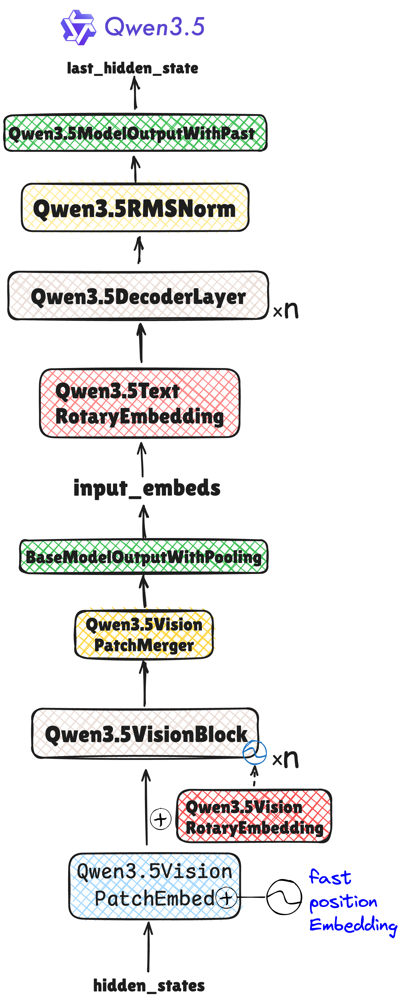
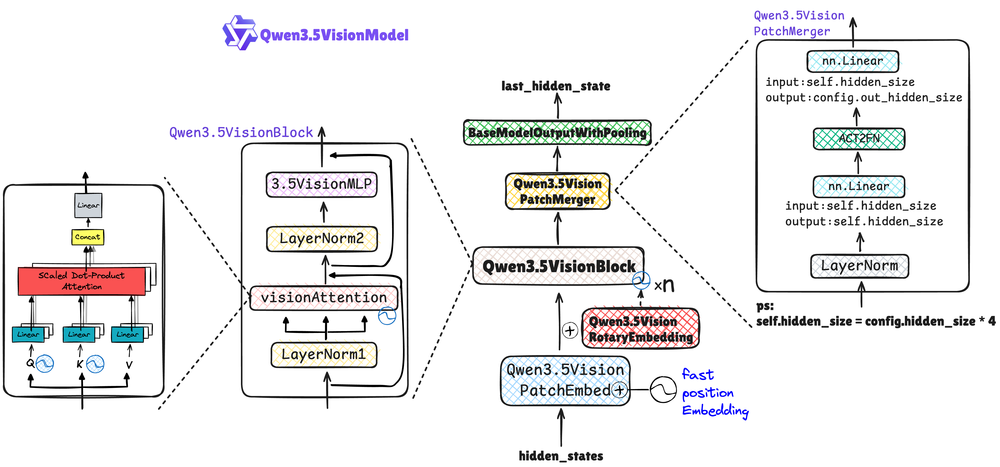
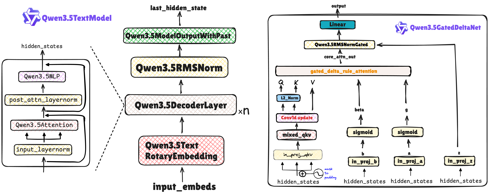
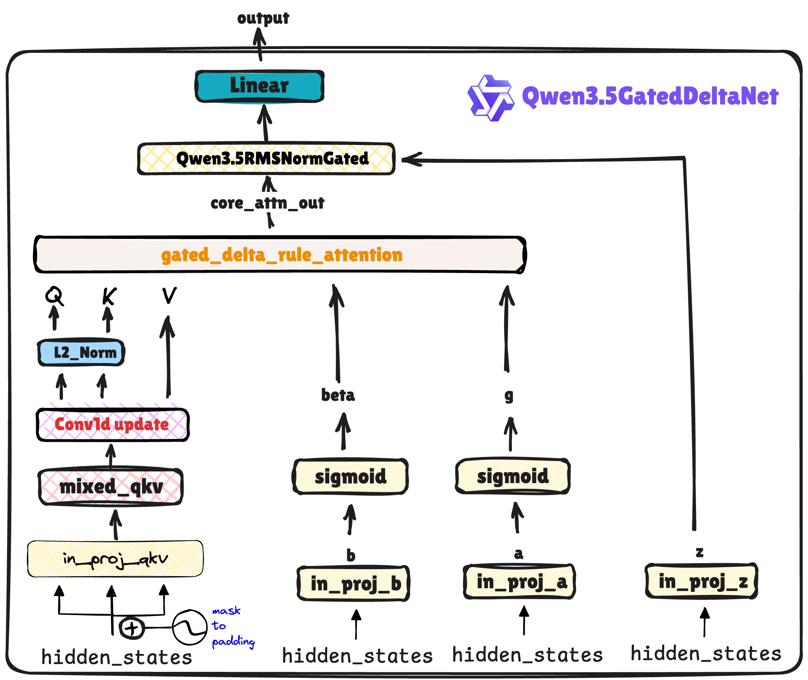

# Qwen3.5架构剖析

## Qwen3.5架构创新点

Qwen3.5: Towards Native Multimodal Agents

### 注意力机制

Qwen2.5-VL / Qwen3-VL主要依赖纯粹的稠密 Transformer (Dense Transformer) 架构，全局注意力机制导致长上下文的 KV Cache 呈 O(N)线性甚至 $O(N^2)$增长，推理极其昂贵。

Qwen3.5**引入门控 Delta 网络**，结合了 Mamba 的因果卷积与基于“Delta Rule”的快速权重编程。将超长历史信息压缩进恒定大小的隐状态中，实现了 `O(1)` 的推理显存占用。

### 视觉编码

Qwen2.5-VL / Qwen3-VL引入了动态分辨率和 MRoPE，但在处理视频时，本质上还是把视频抽帧成一张张独立的 2D 图片去处理。

Qwen3.5在 PatchEmbed 阶段直接使用 3D 卷积核，融合了绝对位置插值与 RoPE，在视觉特征送入 LLM 前，通过 2x2 空间合并与 MLP 投影，将多模态 Token 数量降至 1/4，释放了 LLM 的上下文窗口空间。

### 模态融合

Qwen3.5视觉和文本数据从一开始就进入统一的架构中进行联合训练，彻底打破了模态壁垒。

## 图解Qwen3.5架构

### Qwen3.5架构总览

### Qwen3.5视觉编码器

### Qwen3.5文本编码器

### Qwen3.5 Gated Delta Network

