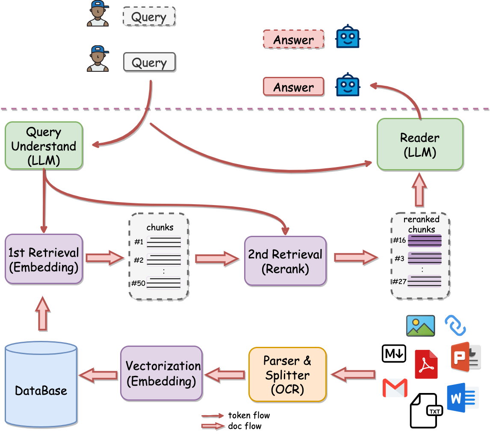

# RAG for  LLM - A survey

论文题目：

Retrieval-Augmented Generation for Large Language Models: A Survey

论文链接：

https://arxiv.org/abs/2312.10997

翻译：

https://baoyu.io/translations/ai-paper/2312.10997-retrieval-augmented-generation-for-large-language-models-a-survey

## 摘要

在LLM得到广泛应用的同时，对于LLM 幻觉、过时知识、不透明/不可追踪的推理过程仍然面临巨大挑战。

可行的解决方式：RAG-检索生成增强

方式：连接外部数据库- RAG synergistically merges LLMs' intrinsic knowledge with the vast, dynamic repositories of external databases.

RAG paradigms（RAG三大范式）：

- Naive RAG
- Advanced RAG
- Modular RAG

文章重点强调了嵌入在RAG系统中的关键组件，提高了对RAG系统的理解。此外，文章也给出了对于RAG系统的最新评估标准和框架。

## Introduction-RAG在大模型阶段的发展轨迹

RAG技术最初与Transformer架构相吻合，通过增加外部知识库，在早期阶段用于细化预训练技术（pre-training）。

随着ChatGPT的兴起，大语言模型在长上下文的理解中展现出了强大能力。

RAG研究转向在推理阶段为LLM提供更好的信息，以回答更复杂和知识密集型的任务，导致RAG研究的快速发展。

后续随着研究进一步深入，RAG技术不再局限于推理阶段而是开始更多的和微调技术相结合。

总结：预训练-推理-微调

RAG技术本身经历了快速发展，但是目前仍然没有对RAG系统发展的清楚阐述，这篇文章的写作目的之一就是填补这一空白，去为读者绘制RAG发展路径并评估他未来的发展路径。

文章旨在阐明检索增强技术的演变，评估各种方法在各自上下文中的优点和缺点，并推测即将到来的趋势和创新。

本文的主要贡献：

- 系统性回顾了RAG最新的方法、技术，描述了RAG三大范式的演变，将RAG研究置于LLM前景中
- 识别并阐明了RAG的三大核心技术：Retrieval、Generation、Augmentation，阐明了这些组件如何协同形成有效的RAG框架
- 总结了RAG的当前评估方法，涵盖了26个任务，近50个数据集，概述了评估目标和指标，以及当前的评估基准和工具。预计RAG的未来方向，强调应对当前挑战的潜在增强。

通过认真阅读、分析原文后，应该可以对本文的三大贡献进行连贯复述。

## SectionII-RAG三大范式

### Naive RAG

Indexing

索引编排阶段会将所有类型的文档（PDF、HTML、Word、Markdown）转换为统一的文本格式。之后，为了使用语言模型的文本限制，“格式化”后的文本会被切分成chunks，使用嵌入模型，这些chunks会被转换为向量存储在向量数据库中。

Retrieval

RAG系统会将用户请求(query)转换为一个向量表示，然后通过计算查询向量和chunks向量之间的相似度来检索与query最相近的top k个chunks。

Generation

将用户提出的查询和所选文档合成为一个连贯的提示，大型语言模型的任务是制定响应。在正在进行的对话情况下，任何现有的历史都会可以集成到提示中，是模型能够有效参与多轮对话交互。

检索阶段的挑战：准确率和召回率；导致错误或不相关的chunk，以及缺少关键信息。

生成阶段的困难：出现幻觉

增强阶段的障碍：检索信息与不同任务结合可能具有挑战性，有时会导致输出不连贯。对于复杂需求，基于最初查询的单一检索并不足以获取足够的上下文信息。

### Advanced RAG

相比于Naive RAG，Advanced RAG专注于提高检索质量，运用了pre-retrieval 和 post-retrieval策略。

pre-retrieval重点关注优化索引结构和原始查询，优化索引的目标是提高被索引的内容的质量。

post-retrieval阶段主要是整合有效查询，主要的方法包括chunks重排和上下文压缩。重新排序检索到的信息以将最相关的内容重新定位到提示的边缘是关键策略。

### Modular RAG

相比于前两种范式，模块化RAG的适应性和多功能性得到提高。

方法：添加一个搜索模块进行相似度搜索，并通过微调细化检索器。重组RAG模块+重排RAG管道来解决目前新的挑战，引入额外组件提高检索和处理能力。

创新：

Rewrite-Retrieve-Read Model 利用LLM的能力通过重写模块和LM反馈机制来改进检索查询，以更新重写模型。，提高任务性能。

Generate-Read 用LLM生成的内容替换传统的检索

ReciteRead 强调从模型权重中检索，增强了模型处理知识密集型任务的能力

子查询和假设文档嵌入 (HyDE)旨在通过关注生成答案和真实文档之间的嵌入相似性来提高检索相关性

调整：Demonstrate-Search-Predict(DSP)框架和迭代的Retrieve-Read-Retrieve-Read流使用增强了模块的协同复杂理解。

### RAG与微调

RAG通过提供实时知识更新和有效利用具有高可解释性的知识源，在动态环境中表现出色。然而，在检索方面有更高的延迟和伦理考虑。

RAG 和 微调技术之间的选择取决于应用程序上下文中数据动态、定制和计算能力的具体需求。RAG 和 微调技术不是互斥的，可以相互补充，增强了模型在不同层次上的能力。在某些情况下，它们的组合使用可能会导致最佳性能。涉及RAG和微调技术的优化过程可能需要多次迭代才能获得满意的结果。

## 检索-RETTRIEVAL

### 数据结构

#### Semi-structured data

特别关注对于**半结构化数据**的处理分析。典型的半结构化数据例如PDF包括文本和表信息。

有两大原因导致传统RAG系统在处理半结构化数据时面临挑战：

1. 文本的切分会不经意地拆分表格，导致检索过程中的数据损坏
2. 表与数据的结合会使语义相似度检索变得更加复杂

目前，处理半结构化数据的方法是**利用LLM的编码能力在数据库表上执行Text-2-SQL**[Zha, Liangyu, et al. TableGPT: Towards Unifying Tables, Nature Language and Commands into One GPT.]查询，或者**将表格转化为文本格式**[Luo, Ziyang, et al. Augmented Large Language Models with Parametric Knowledge Guiding.]，使用基于文本的处理方法进行分析。

所有的方法目前都不是最优的，该领域还有大量的研究机会。

关注北航关于Text-2-SQL的最新成果

#### Structured data

图检索使GNN神经网络、LLM与RAG相结合，通过LLM的软提示来增强图形理解和问答能力，并使用Prize-Collecting Steiner Tree进行优化图检索的结果。

#### LLMs-Generated Content

LLM 生成的上下文通常包含更准确的答案，因为其与因果语言建模的预训练目标能更好地对齐。

### Retrieval Granularity

粗粒度检索单元理论上可以为问题提供更多相关信息，但它们也可能包含冗余内容，这可能会分散下游任务中的检索器和语言模型。

另一方面，细粒度检索单元粒度增加了检索的负担，不能保证语义完整性并满足所需的知识。

选择恰当的检索粒度是一个简单的策略用来提高检索和下游任务的表现。

检索粒度从粗到细包括：Token, Phrase, Sentence, Proposition, Chunks, Document。将Propositions作为检索单元可以提高检索的相关性和精准度。

知识图谱的检索粒度包括：Entity, Triplet, and sub-Graph.

### 索引优化

在索引阶段，文档将被处理、分割并转换为要存储在向量数据库中的嵌入。索引的构造质量决定了是否可以在检索阶段获取正确的上下文。

#### 分块策略

分块常用的方法是将文档分为不同的标记的chunks。

分块需要在语义完整性和上下文长度之间进行trade-off。更长的块会包含更长的上下文，但是噪声会增加、处理时间也会增加；短块包含的噪声小，但是能包含的上下文信息也更少。

于是后面提出了以句子作为检索单元，前后句被提供作为LLM的上下文内容。

#### 元数据附加

在检索过程中为文档时间戳分配不同的权重可以实现时间感知的RAG，确保知识的新鲜度并避免过时的信息。

元数据也可以被人工构建(添加段落摘要以及引入假设问题)。具体来说，使用 LLM 生成文档可以回答的问题，然后计算检索过程中原始问题和假设问题之间的相似度，以减少问题和答案之间的语义差距。

#### 结构化索引

层次索引结构和知识图谱都可以提高信息检索的准确率。

### 查询优化

问题本身的复杂性、语义模糊性都是查询过程中遇到的困难。

查询优化的方法主要有三大类：

1.查询扩展

- 多路查询
- 子查询
- Chain-of-Verification(CoVe)

2.查询转换-查询重写

3.查询路由

### 嵌入-Embedding

怎么理解嵌入？

Embedding 是将离散的非结构化数据(图片、视频、音频、文本)通过Embedding Model转换为连续的向量表示的技术。

Embedding 常常用于将文本数据中的单词、句子或文档映射为固定长度的实数向量，使得文本数据能够在计算机中被更好地处理和理解。通过 Embedding，每个单词或句子都可以用一个实数向量来表示，这个向量中包含了该单词或句子的语义信息。

RAG系统中，检索是通过计算嵌入问题和文档块之间的相似度实现的。

没有最好的答案去回答“要使用哪一个嵌入模型”，然而，对于不同的问题可以有不同的方法。

### 适配器

Luo, Ziyang, et al. Augmented Large Language Models with Parametric Knowledge Guiding.

这篇文章介绍了一种通过指令微调将知识集成到白盒模型中的创新方法。检索器模块直接替换为根据查询生成相关文档。这种方法有助于解决微调过程中遇到的困难并提高模型性能。

## 增强-AUGMENTATION PROCESS IN RAG

增强的过程主要侧重于优化检索的过程，这一部分介绍了三大检索增强的过程：迭代式检索、递归式检索、自适应检索。

迭代检索涉及检索和生成之间交替，允许在每一步从知识库中更丰富、更有针对性的上下文。递归检索涉及逐步细化用户查询并将问题分解为子问题，然后通过检索和生成不断解决复杂问题。自适应检索侧重于使 RAG 系统能够自主确定外部知识检索是否必要以及何时停止检索和生成，通常使用 LLM 生成的特殊标记来控制。

## 生成-GENERATION

在检索后，将所有检索到的信息直接输入到LLM中回答问题并不是一个好的实践。

### 上下文配置

过长的上下文信息会导致LLM“忽视中间段落”，与人类一样，LLM 往往只关注长文本的开头和结尾，同时忘记中间部分。因此，在 RAG 系统中，我们通常需要进一步处理检索到的内容。

重排：从根本上重新排序对文档(chunks)块进行重新排序以首先突出最相关的结果，有效地减少整体文档池，在信息检索中切断双重目的，充当增强器和过滤器，为更精确的语言模型处理提供细化的输入。

上下文选择/压缩：对RAG过程的一个误解是相信尽可能多地检索相关文档并用长检索提示包含他们是有好处的。然而，大量的信息也会带来大量的干扰，削弱大语言模型对于关键信息的敏锐度。

压缩方法包括检测并移除不重要的tokens，将上下文转化为人类很难理解但是LLM很好理解的形式。

小语言模型SLM用作过滤器，大语言模型LLM用作重排代理。在信息抽取任务中，指导LLM去重组被SLM识别的挑战性样本会导致效果显著提升。

### LLM微调

当LLM缺少特定领域的数据的时候，外部知识可以被提供通过微调技术。

微调的另一个好处是可以控制模型的输入和输出。它可以让LLM适应特定的数据格式和按照指示以特定风格生成响应。

通过强化学习将LLM输出与人类或检索器偏好对齐是一种潜在的方法。除了与人类偏好对齐外，还可以与微调模型和检索器的偏好保持一致。

当环境防止访问强大的专有模型或更大的参数开源模型时，一种简单有效的方法是提取更强大的模型（例如 GPT-4）。

## 下游任务与评估

### 下游任务

RAG的核心任务仍然是**问答**(QA)，QA包括传统的单步/多步问答、多项选择、特定领域问答、长文本场景问答。

RAG也不断扩展到多个下游任务，如信息提取(IE)、对话生成、代码搜索等。

### 评估

上下文相关性和噪声鲁棒性对于评估检索质量很重要，而答案忠实度、答案相关性、负拒绝、信息集成和反事实鲁棒性对于评估生成质量很重要。

## RAG面临主要挑战和未来前景

### RAG VS 长上下文

目前，LLM 可以毫不费力地管理超过 200,000 个标记的上下文。这也引发了关于当LLM不受上下文限制的时候是否还需要RAG的讨论。

对于RAG过程，整个检索和推理过程是可观察的，而仅依靠长上下文生成仍然是一个黑匣子。在超长上下文的背景下开发新的 RAG 方法是未来研究趋势之一。

### RAG鲁棒性

检索过程中噪声或矛盾信息的存在会对RAG的输出质量产生不利影响。这种情况被比喻地称为“Misinformation 可以比根本没有信息更糟糕”。

提高RAG对这种对抗性或反事实输入的抵抗力正在获得研究势头，已成为一个关键的性能指标。

The Power of Noise: Redefining Retrieval for RAG Systems.研究结果表明，包含不相关的文档可能会意外地提高准确性超过 30%，这与质量降低的初始假设相矛盾。

结果强调了开发专门的策略将检索与语言生成模型集成的重要性，强调了进一步研究和探索对 RAG 鲁棒性的必要性。

### 混合方法

将RAG与微调技术相结合正在成为领先策略，确定RAG与微调最佳整合取决于是顺序、交替还是端到端的训练。

另一个趋势是将特殊功能的小语言模型SLM引入RAG，并通过RAG系统进行微调。

### scaling laws of RAG

基于RAG的端到端模型和预训练模型仍然是当前研究人员的重点之一。

Kaplan, Jared, et al. “Scaling Laws for Neural Language Models.” arXiv: Learning,arXiv: Learning, Jan. 2020.

缩放规律已经被建立对LLM，但是应用目前尚未确定。

### Production-Ready RAG

然而，提高检索效率，提高大型知识库的文档召回率，保证数据安全，例如防止LLM中元数据和文档来源的无意披露，是仍然有待解决的挑战。

RAG技术在特殊方向的趋势：1.特定需求的定制化。2.降低最初的学习曲线来简化RAG使用。3.优化RAG来更好的服务生产环境。

### 多模态RAG

RAG在图像、音频视频、编码领域的应用。

## 个人阅读总结

### 通原理

对于RAG技术栈的原理自己在脑海中应该有了一定的轮廓，接下来就是重点学习一些技术细节，比如**微调技术、嵌入技术**，更多去关注下游任务实践与部署应用。

读完论文后要动手去尝试去实现一下RAG技术，通过动手实践真正对这门技术有一个具体的认识，而不是仅仅漂浮于理论上。练实践带动并反作用于学习，真正从实践中体会部署技术、微调技术、训练技术。

### 知趋势

读完论文后要对RAG的未来发展趋势自己心里要有一定的认知。这项技术已经做了解决了哪些问题？还能解决哪些问题？哪些方面还需提高或面临困难？对于上面三个问题，通过后期继续学习后要有清楚的认识。起步阶段不要着急，刚刚读了这个方向的一篇文章而已。

同样更重要的就是，了解趋势与发现问题后，如何去解决？如何转换为自己Idea，这也是关键。

### 着力点

多模态RAG(Multi-modal RAG)、半结构化数据检索(处理半结构化数据的方法优化)、鲁棒性(RAG的对抗性或反事实输入的抵抗力)

对于半结构化数据的最新研究成果主要参考北京航空航天大学：https://arxiv.org/pdf/2408.16991

目前，处理半结构化数据的方法是**利用LLM的编码能力在数据库表上执行Text-2-SQL**[Zha, Liangyu, et al. TableGPT: Towards Unifying Tables, Nature Language and Commands into One GPT.]查询，或者**将表格转化为文本格式**[Luo, Ziyang, et al. Augmented Large Language Models with Parametric Knowledge Guiding.]，使用基于文本的处理方法进行分析。

LLM编码能力在数据库表上执行SQL和将表格转化为文本都不是最好的处理方法，所以对于LLM处理半结构化数据时，探索最优化方法仍然是趋势。

