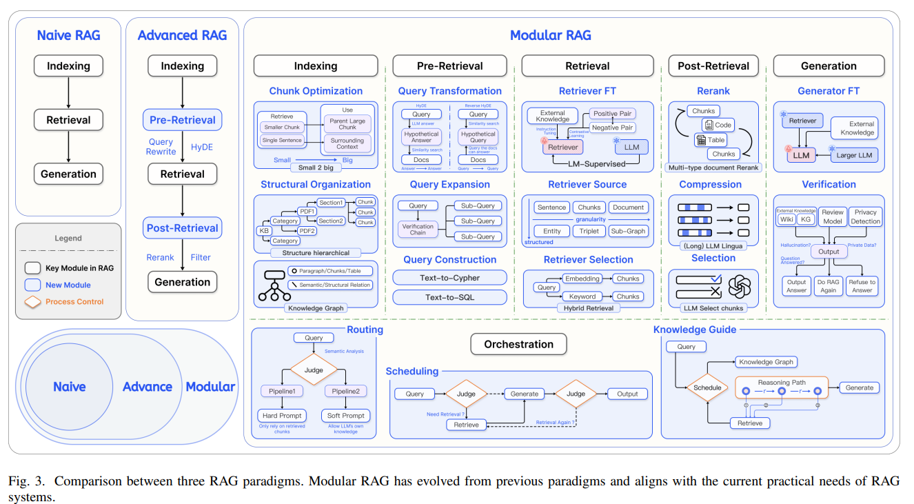

参考文章：https://mp.weixin.qq.com/s/lbeeblGYvb1JeC0gW4AE9g

2025.02.23的自我批评：其实这篇综述文章早就应该写出来，但是就是一直拖着，结果一直到现在才想着去完善。最主要的原因是因为DataWhale发布了一篇推文，全面的梳理了RAG范式发展，与当初自己的思路不谋而合。所以，这学期一定不要拖延，想的事情就赶紧去做！！！

## 三篇关键的综述

[1] ZHAO P, ZHANG H, YU Q, 等. Retrieval-Augmented Generation for AI-Generated Content: A Survey[A/OL]. arXiv, 2024[2024-06-21]. http://arxiv.org/abs/2402.19473.　

[2] GAO Y, XIONG Y, GAO X, 等. Retrieval-Augmented Generation for Large Language Models: A Survey[A/OL]. arXiv, 2024[2024-03-27]. http://arxiv.org/abs/2312.10997.

[3] FAN W, DING Y, NING L, 等. A Survey on RAG Meeting LLMs: Towards Retrieval-Augmented Large Language Models[A/OL]. arXiv, 2024[2024-06-17]. http://arxiv.org/abs/2405.06211. 

三篇综述把RAG的三个基本范式，**朴素RAG**、**高级RAG**、**模块化RAG**介绍的非常清楚明了。

## 范式发展



Naive RAG -》Advanced RAG -》 Modular RAG -》Graph RAG -》 Agentic RAG



RAG技术起源于论文：LEWIS P, PEREZ E, PIKTUS A, 等. Retrieval-Augmented Generation for Knowledge-Intensive NLP Tasks[A/OL]. arXiv, 2021[2025-01-27]. http://arxiv.org/abs/2005.11401；RAG首先被用于LLMs的预训练阶段来增强语言模型，随后被用于微调与推理任务中。

### 三范式阶段

三种基本范式的演化历程是：NaiveRAG -》AdvancedRAG -〉 ModularRAG，2024年微软开源的GraphRAG开启了RAG的第四种范式，融合了知识图谱；在2024年下半年AgenticRAG出现，是前四种范式的集大成者，且具有自适应性。

NaiveRAG主要由三部分组成:索引、检索和生成。AdvancedRAG围绕检索前和检索后提出了多种优化策略，其过程与朴素RAG相似，仍然遵循链状结构。ModularRAG继承和发展了以前的范式，整体上展示了更大的灵活性。

- Advanced RAG代表作：http://arxiv.org/abs/2405.13576，提出了一个高效、模块化的开源工具包FlashRAG，工具包实现了 12 种先进的 RAG 方法，并收集和整理了 32 个基准数据集。

- Modular RAG代表作：http://arxiv.org/abs/2407.21059，将复杂的RAG系统分解为独立的模块和专门的操作符，形成一个高度可重配置的框架。

### Graph RAG

图本身具有 "**节点由边连接** "的特性，可以编码大量的异构和关系信息，使其成为 RAG 在大量实际应用中的丰富资源。

针对LLMs在缺乏特定领域知识、实时更新信息和专有知识时遇到的问题，提出了GraphRAG作为一种解决上述问题的框架，通过结合**图数据库**中的结构化信息来增强LLMs的输出。

- LIANG L, SUN M, GUI Z, 等. **KAG: Boosting LLMs in Professional Domains via Knowledge Augmented Generation**. arXiv, 2024[2024-11-12]. https://arxiv.org/abs/2409.13731.

论文引入了一个专业领域知识服务框架，称为知识增强生成（KAG）。为了充分发挥**知识图谱（KG）\**和\**向量检索**的优势，通过五个关键方面双向增强大型语言模型（LLM）和知识图谱（KG），从而提高生成和推理性能：（1）LLM友好的知识表示；（2）知识图谱和原始块之间的相互索引；（3）逻辑形式引导的混合推理引擎；（4）知识与语义推理的对齐；（5）KAG的模型能力增强。

一个专为大型语言模型（LLM）设计的友好型知识表示框架。LLMFriSPG将实例与概念区分开来，通过概念实现与 LLMs 的对接。SPG 的属性被划分为知识区和信息区，也就是静态区和动态区，分别与具有严格模式约束的决策专业知识以及具有开放信息表示的文档检索索引知识相兼容。

### Agentic RAG

Agentic RAG 将 ReACT 的推理能力与 Agent 的任务执行能力相结合，创建一个动态和自适应的系统。与遵循固定管道的传统 RAG 不同，Agentic RAG 通过使用 ReACT 根据用户查询的上下文动态协调 Agent，引入了灵活性。

- SINGH A, EHTESHAM A, KUMAR S, 等. Agentic Retrieval-Augmented Generation: A Survey on Agentic RAG[A/OL]. arXiv, 2025[2025-01-26]. http://arxiv.org/abs/2501.09136.

论文从RAG范式演化与基础原则开始，提供了一个对于Agentic RAG的全面探索。文章总结出了Agentic工作流的四个核心模式与七大Agentic-RAG架构。

