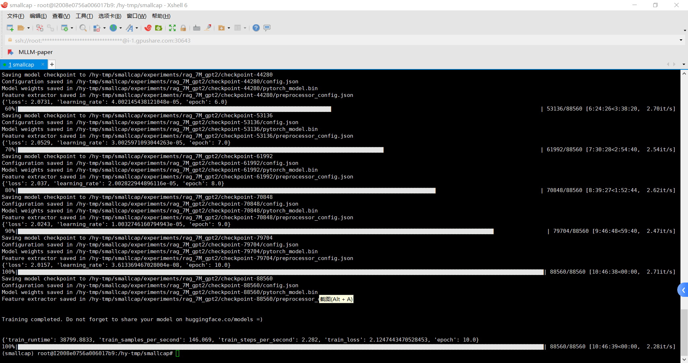
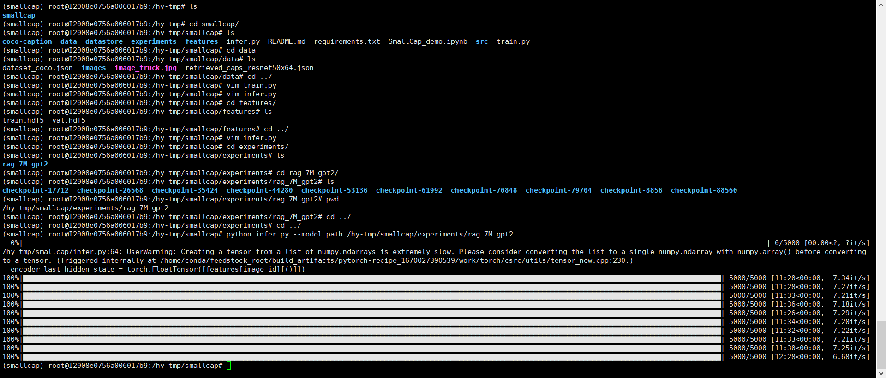
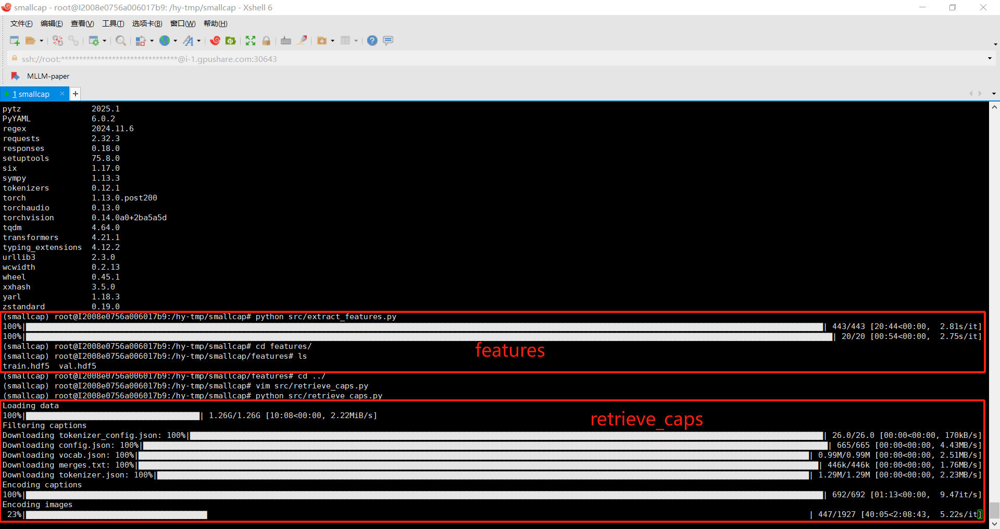

2025年3月15日，星期六，雨夹雪，第54篇博客。三一五打假日～

# SmallCap复现与代码设计细节分析——基于Cursor Claude3.7-sonnet

项目源代码：https://github.com/RitaRamo/smallcap

## 项目结构

~~~markdown
smallcap/
├── .DS_Store
├── .gitignore
├── README.md
├── SmallCap_demo.ipynb        # 模型演示笔记本
├── coco-caption/              # 模型评估工具目录
├── data/                      # 数据目录
├── infer.py                   # 模型推理脚本
├── requirements.txt           # 项目依赖包
├── src/                       # 核心源代码目录
└── train.py                   # 模型训练脚本

核心代码：
src/
├── __init__.py
├── extract_features.py        # 特征提取工具
├── get_indexed_caps.py        # 描述索引处理工具
├── gpt2.py                    # GPT-2模型实现
├── opt.py                     # OPT模型实现
├── retrieve_caps.py           # 检索增强功能实现
├── template.txt               # 检索提示模板
├── utils.py                   # 通用工具函数
├── vision_encoder_decoder.py  # 视觉-文本模型架构
└── xglm.py                    # XGLM模型实现

模型评估工具目录：
coco-caption/
├── README.md
├── annotations/               # 评估标准描述
├── cocoEvalCapDemo.ipynb      # 评估演示笔记本
├── get_stanford_models.sh     # Stanford模型下载脚本
├── license.txt
├── pycocoevalcap/             # 评估指标实现
├── pycocotools/               # COCO工具集
└── run_eval.py                # 评估主脚本

数据目录：
data/
└── image_truck.jpg            # 示例图像
~~~

## 依赖流

### 训练过程

train.py → src/utils.py → src/vision_encoder_decoder.py → 语言模型(gpt2.py/opt.py/xglm.py)

### 推理过程

infer.py → src/utils.py → src/vision_encoder_decoder.py → 语言模型

### 检索增强流

src/retrieve_caps.py → src/get_indexed_caps.py → 训练/推理流程

### 评估流 

infer.py(生成描述) → coco-caption/run_eval.py(计算指标)

## 关键功能

~~~markdown
| 文件 | 功能 |

|------|------|

| train.py | 训练主脚本，包含参数配置和训练逻辑 |

| infer.py | 推理主脚本，载入模型并生成描述 |

| src/vision_encoder_decoder.py | 核心模型架构，结合视觉编码器和文本解码器 |

| src/retrieve_caps.py | 实现检索相似图像描述功能 |

| src/extract_features.py | 提取和缓存图像特征 |

| src/utils.py | 数据处理和辅助函数 |

| SmallCap_demo.ipynb | 演示模型使用方法和效果 |

| coco-caption/run_eval.py | 评估生成描述质量 |
~~~

## BUG

1. numpy版本与pandas版本不匹配导致错误，适配与4090的Pytorch版本： 
   - numpy              1.21.6
   - pandas             1.3.5

1. 执行`python src/retrieve_caps.py`时要现在`src/`下面创建好`datastore/`子文件夹，以方便faiss即使向其中写入索引文件。否则执行到最后会报错**can't write**的BUG！
   
2. /hy-tmp/smallcap/datastore/coco_index：coco_index折了两次，索引会自动生成coco_index不需要自己创建。

