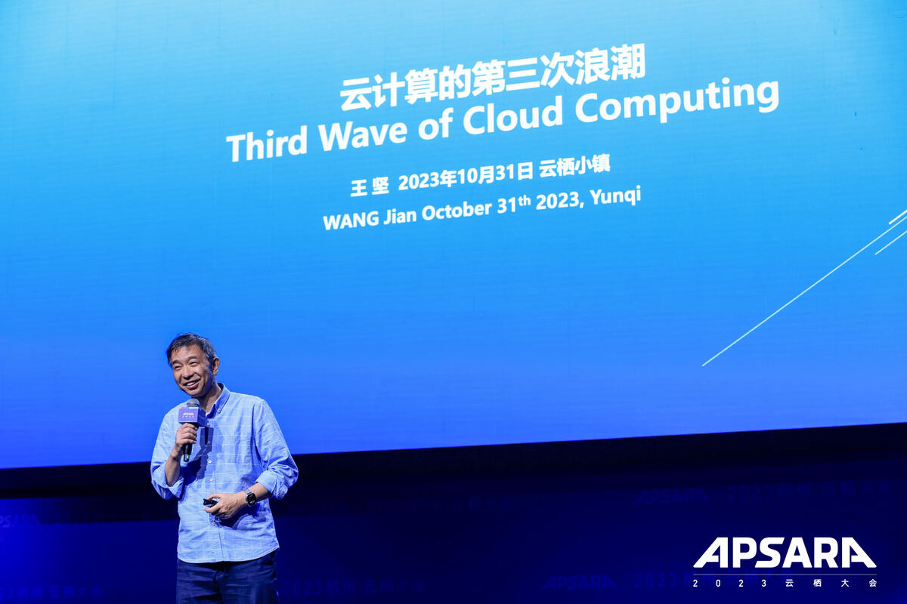



王坚院士《在线》书摘与读书笔记——互联网、数据和计算

我们很幸运，生活在一个创造决定未来的时代。但是创造能否决定未来取决于我们的信念和坚持，坚持相信的，相信坚持的。

计算，为了无法计算的价值



## 榜样-王坚

**王坚**（1962年10月—），中国信息技术专家、心理学家，阿里巴巴集团首席技术官，中国工程院院士，阿里云的创始人。曾主持研发中国唯一自研的云操作系统飞天。

## 云计算的三次浪潮

第一次浪潮中，云计算改变了今天全球互联网，奈飞、米哈游为代表的企业从第一天起100%完完整整就在云上。

第二次浪潮中，“传统企业”开始使用云计算。最标志性的事件是2022年北京冬奥会上，云计算第一次承载了赛事的核心系统。

人工智能和云计算的一次结合，这是云计算的第三次浪潮。

云计算的第三次浪潮，王坚认为，2023年人工智能和云计算有了一次集中的体现和爆发，GPT模型的出现使得计算机对科技创新的革命产生了非常重要的影响。云计算和GPT的关系就是电和电动机的关系。未来事实上云计算的算力都是会被这些在智能时代的电动机，就是被模型消耗掉。

## 数据与计算

原子比特化，比特在线化

到底什么是**在线**？从思维发展与技术发展的角度来说，在线就是连接的属性，必须先连接起来才有在线这回事。从改变行业与生活的角度来说，连接就是在线的结果，在线后才能连接渗透社会生活的各个方面。

就像我们每天喝水、用电一样，计算也在逐步成为了一种新的公共服务。

**去IOE**：摆脱企业对IBM小型机、Oracle数据库、EMC存储系统的依赖，拥抱云计算，拥抱互联网。

“**大数据**”这个词搞错了，数据不是因为大而产生的价值，而是因为在线上而产生了价值，因为数据从此可以在更大范围流动它产生的价值，这是真正的数据带来的巨大变化。

## 在线定律

定律一：每一个比特都在互联网上

定律二：每个比特都可以在互联网上流动

定律三：比特所代表的每个对象在互联网上都是可以计算的

## 谈对技术的热爱

当我们谈对技术的热爱时，大家并没有真正意识到，我们要为之付出什么。一个不太恰当的比喻就是，我们与技术的关系就是农夫与蛇的关系。

什么是对技术的热爱？你真的相信技术会改变很多东西吗？有没有足够的自信和热爱，去捂暖这条蛇，哪怕它苏醒后会反咬你一口？当你真正热爱一个东西时，你很难预料最终的结果。当你把这条蛇揣在怀里时，你面对的最大考验是对你心脏的考验。你不知道这条蛇醒来以后是否会反咬你一口，也许你的身体足够强大，可以抵抗。

## 人工智能、城市大脑——下一个10年的登月计划

世界上有三种智能：人的智能、机器的智能、动物的智能。

多数人谈及人工智能，考虑的都是人会不会被人工智能所取代，这是一个奇怪的逻辑。人们在让狗去寻找毒品的时候从来没有说过人类的鼻子被狗的鼻子取代了。人类要对机器有足够的尊重，要尊重机器在某些方面已经超过了人类。

互联网发展到今天，我们要做的，使用机器解决人类解决不了的问题。

今天，世界各国城市的可持续发展都面临着重大的挑战，这些挑战也到来了一个难得的机遇，就是用机器智能解决城市发展过程中产生的许多问题。

城市大脑要做的就是以互联网为基础设施，利用丰富的城市数据资源，对城市进行全局的实时分析，解决今天无法靠人脑解决的问题。

