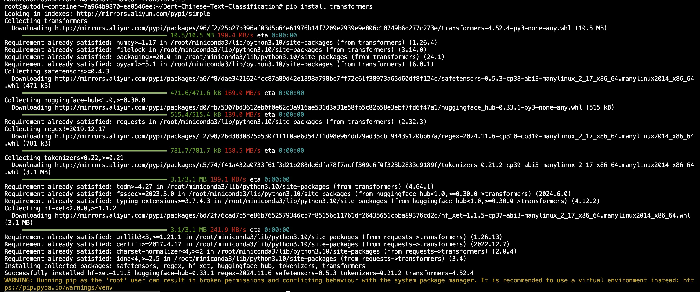
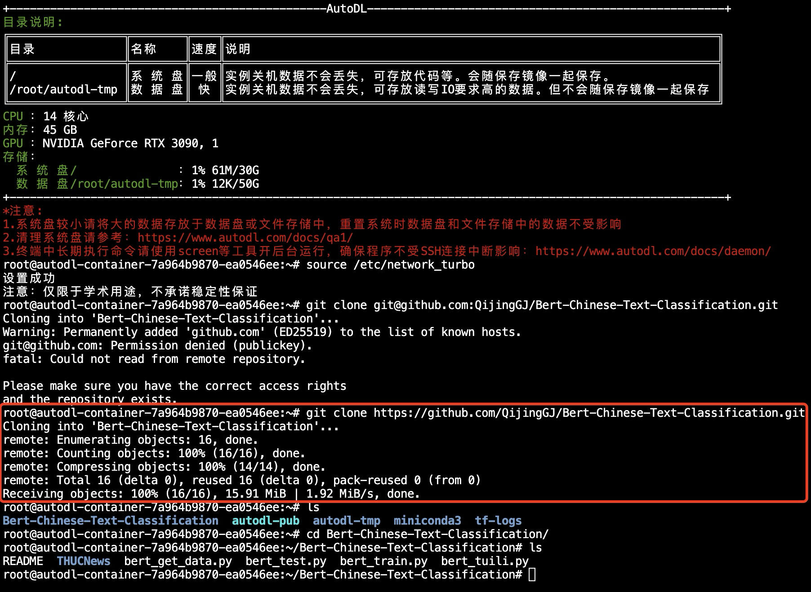
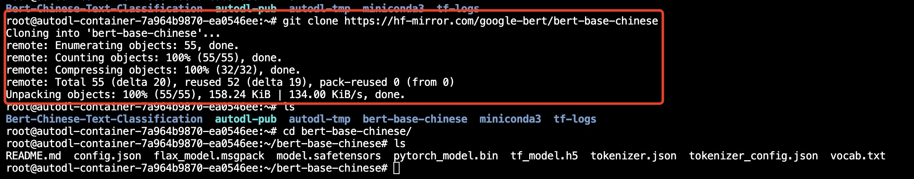
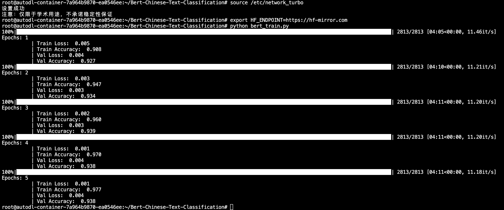
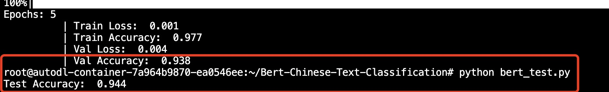
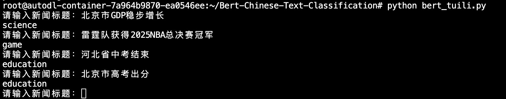

# 基于Bert-base-chinese的中文文本分类

BERT: Pre-training of Deep Bidirectional Transformers for Language Understanding：https://arxiv.org/pdf/1810.04805

## 安装必要的第三方库

```bash
root@autodl-container-7a964b9870-ea0546ee:~# pip install pandas transformers
```




## 加载代码与数据集

使用git从GitHub拉取镜像仓库

```bash
root@autodl-container-7a964b9870-ea0546ee:~# git clone https://github.com/QijingGJ/Bert-Chinese-Text-Classification.git
root@autodl-container-7a964b9870-ea0546ee:~# ls
Bert-Chinese-Text-Classification  autodl-pub  autodl-tmp  miniconda3  tf-logs
```



## 下载google-bert/bert-base-chinese模型

```bash
root@autodl-container-7a964b9870-ea0546ee:~# git clone https://hf-mirror.com/google-bert/bert-base-chinese
root@autodl-container-7a964b9870-ea0546ee:~/bert-base-chinese# ls
README.md  config.json  flax_model.msgpack  model.safetensors  pytorch_model.bin  tf_model.h5  tokenizer.json  tokenizer_config.json  vocab.txt
```



## 修改数据参数

修改必要参数路径前，先把模型文件整合一下，并创建好`bert_checkpoint`文件夹：

```bash
root@autodl-container-7a964b9870-ea0546ee:~/bert-base-chinese# cd ../
root@autodl-container-7a964b9870-ea0546ee:~# ls
Bert-Chinese-Text-Classification  autodl-pub  autodl-tmp  bert-base-chinese  miniconda3  tf-logs

root@autodl-container-7a964b9870-ea0546ee:~# mv bert-base-chinese/ Bert-Chinese-Text-Classification/

root@autodl-container-7a964b9870-ea0546ee:~# ls
Bert-Chinese-Text-Classification  autodl-pub  autodl-tmp  miniconda3  tf-logs

root@autodl-container-7a964b9870-ea0546ee:~# cd Bert-Chinese-Text-Classification/
root@autodl-container-7a964b9870-ea0546ee:~/Bert-Chinese-Text-Classification# ls
README  THUCNews  bert-base-chinese  bert_get_data.py  bert_test.py  bert_train.py  bert_tuili.py

root@autodl-container-7a964b9870-ea0546ee:~/Bert-Chinese-Text-Classification# mkdir -p bert_checkpoint

root@autodl-container-7a964b9870-ea0546ee:~/Bert-Chinese-Text-Classification# ls
README  THUCNews  bert-base-chinese  bert_checkpoint  bert_get_data.py  bert_test.py  bert_train.py  bert_tuili.py
```

### bert_get_data.py

```python
#修改位置1:
bert_name = '/root/Bert-Chinese-Text-Classification/bert-base-chinese'
tokenizer = BertTokenizer.from_pretrained(bert_name)

#修改位置2:
def GenerateData(mode):
    train_data_path = '/root/Bert-Chinese-Text-Classification/THUCNews/data/train.txt'
    dev_data_path = '/root/Bert-Chinese-Text-Classification/THUCNews/data/dev.txt'
    test_data_path = '/root/Bert-Chinese-Text-Classification/THUCNews/data/test.txt'

    ...代码逻辑保持不变
```

### bert_train.py与bert_test.py

```python
#修改位置：
save_path = '/root/Bert-Chinese-Text-Classification/bert_checkpoint'
```

### bert_tuili.py

```python
bert_name = '/root/Bert-Chinese-Text-Classification/bert-base-chinese'
tokenizer = BertTokenizer.from_pretrained(bert_name)
device = torch.device("cuda:0" if torch.cuda.is_available() else "cpu")

save_path = '/root/Bert-Chinese-Text-Classification/bert_checkpoint'
model = BertClassifier()
model.load_state_dict(torch.load(os.path.join(save_path, 'best.pt')))
model = model.to(device)
model.eval()

real_labels = []
with open('/root/Bert-Chinese-Text-Classification/THUCNews/data/class.txt', 'r') as f:
    ...代码逻辑保持不变
```

## 模型训练



## 模型测试



## 模型推理


