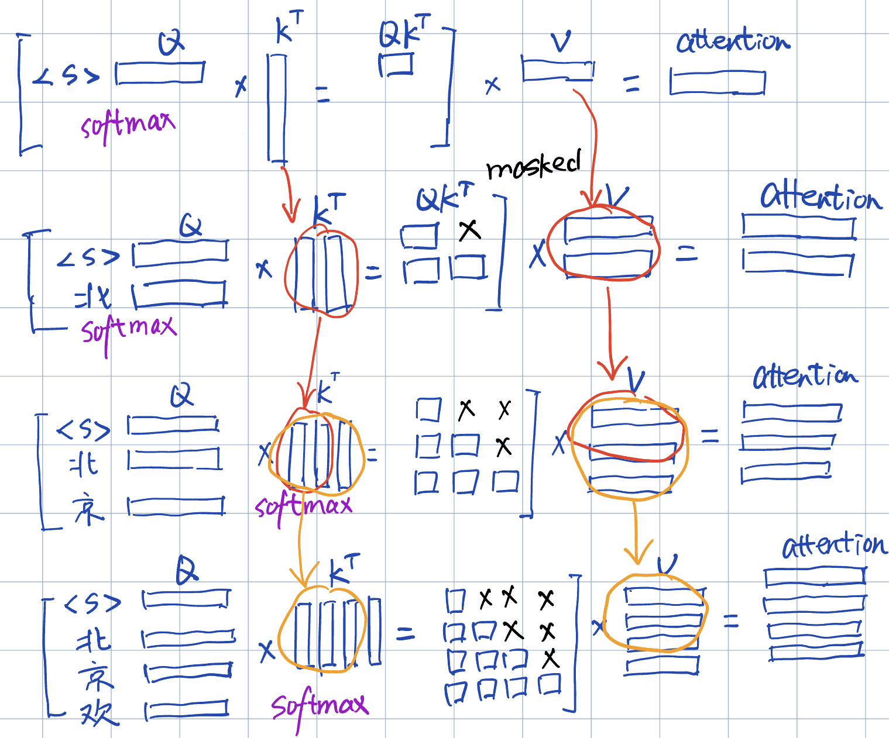
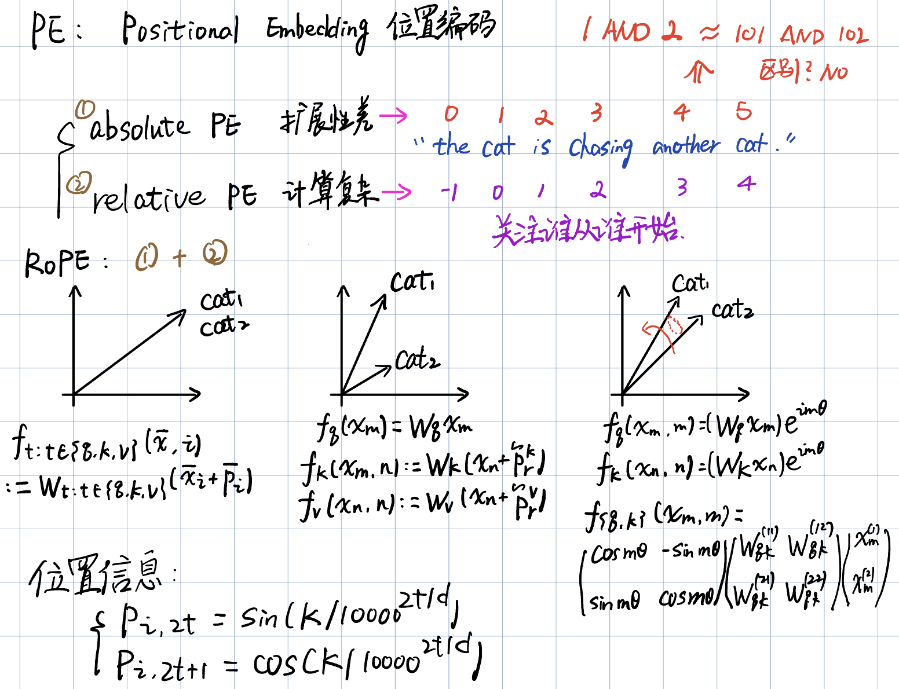
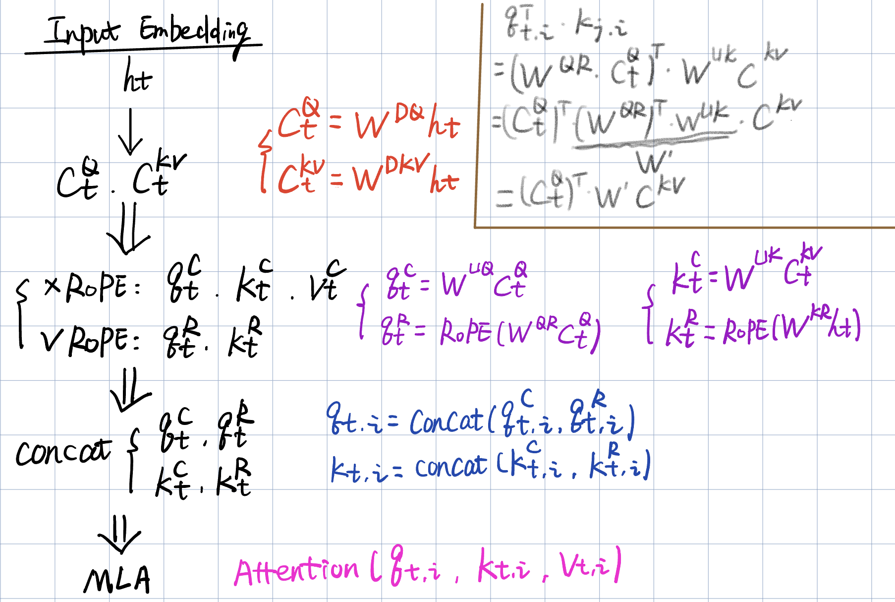

# DeepSeek-V3

DeepSeek-V3 Technical Report：https://arxiv.org/pdf/2412.19437

## KV Cache

由于是自回归语言模型，下一步的输出结果依赖于当前状态(及以前的状态)的结果，采用空间换时间的思想，将当前状态(及以前的状态)计算好的K和V存储到GPU中，加速下一步attention的计算。

手绘了一下KV Cache的缓存流程如下：

如上图所示，KV Cache在执行过程中会造成GPU大量的空间消耗，使得GPU memory消耗非常大。

两大流派解决空间消耗问题：1. quantization；2. 减小K和V大小

## Positional Embedding

Positional Embedding主要包括两大类：

- Absolute positional embedding - 绝对位置编码 

- Relative positional embedding - 相对位置编码

绝对位置编码是指在输入序列经过词嵌入后的第𝑘个token向量中加入位置向量p_k，相对位置编码并不是直接建模每个输入token的位置信息，而是在计算注意力矩阵时考虑当前向量与待交互向量的位置的相对距离。

Rotary positional embedding - 旋转位置编码

RoPE通过绝对位置编码的方式实现相对位置编码，综合了绝对位置编码和相对位置编码的优点。主要就是对attention中的q, k向量注入了绝对位置信息，然后用更新的q,k向量做attention中的内积就会引入相对位置信息了。

  

## MLA

  

### MLA的设计动机

对于拥有数千亿参数的超大规模模型,推理过程中的主要挑战之一是巨大的KV缓存(KV Cache)。在自回归生成文本时，模型需要缓存先前所有词元的键(Key)和值(Value)向量，以便后续词元的生成能够关注到历史上下文。

### 基本思想与方法

核心方法是矩阵的**低秩分解**。

设计一个低维度的向量或者矩阵去取代最原始的KV Cache里面的K和V。GPU不在直接缓存K和V，而是去缓存一个低维度的矩阵$\mathbf{c}_{t}^{Q}$。

K和V可以通过 $\mathbf{c}_{t}^{KV}$ 乘以对应的参数矩阵进行还原：

$$
\mathbf{c} = \mathbf{W}^{DK}\mathbf{h}_{t}
$$

$$
\mathbf{K} = \mathbf{W}^{UK}\mathbf{c}
$$

所以只需要把$\mathbf{c}_{t}^{KV}$进行cache即可。

只引入 $\mathbf{c}_{t}$ 无法对输入嵌入进行位置编码，后续便会引入Rotary Positional Embedding(RoPE)问题。

MLA解决思路就是引入了额外的head。如上图所示，在Attention中引入一些额外的multi-head，使这些head做最原始的attention流程($\mathbf{q}_{t}^{C}$)，之后再将其与经过RoPE编码后的向量进行拼接。

以下是对于MLA的推导梳理过程如下：

## MoE

MoE是一个经济实惠的架构，因为训练的时候无需所有的Experts参与训练。

DeepSeek对于MoE架构的改进如下所示：

- Fine-Grained Expert Segmentation：把之前大的expert变成更小的expert，把少量的大expert变成更多的小expert。
- Shared Expert Isolation：单独设立一些共享的expert，存储common knowledge，解决不同问题时会使用到(应对不同任务时都会用到的)。Shared Expert相当于通才，Routed expert相当于专才。 

 每一个expert由两个MLP层组成，deepseekMoE做法是把这两个MLP中间层维度缩小，使得MLP整体参数量减少，但是增加了其数量，使得参数总量不变的前提下，增加了expert数量，相当于model ensemble降低variance。

💡前面的KV Cache是空间换时间的思想，这里的MoE架构则是数量换质量的思想。

科学研究的思路选取方法：极端折中法。对于MoE架构而言，一些paper选择做FFN，一些paper选择做MoE；那么比较好的想法是按照DeepSeek这样折中的办法——Shared Expert。

