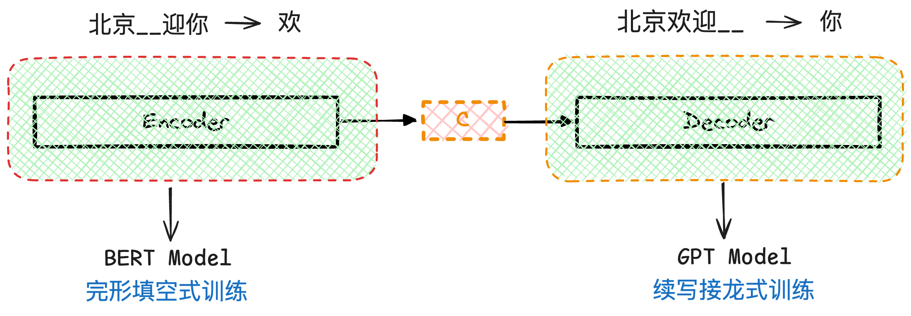
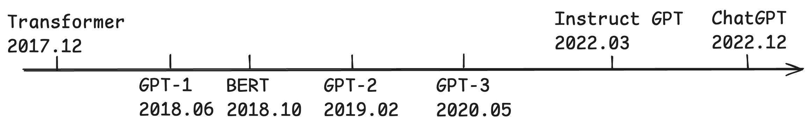
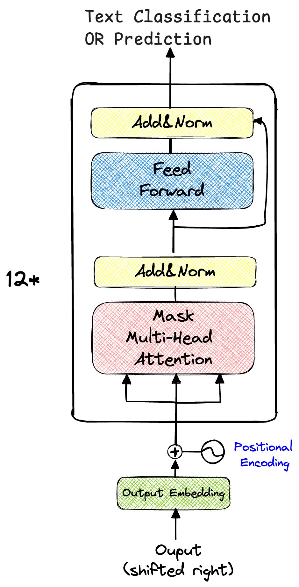
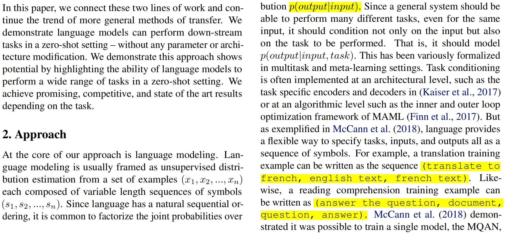
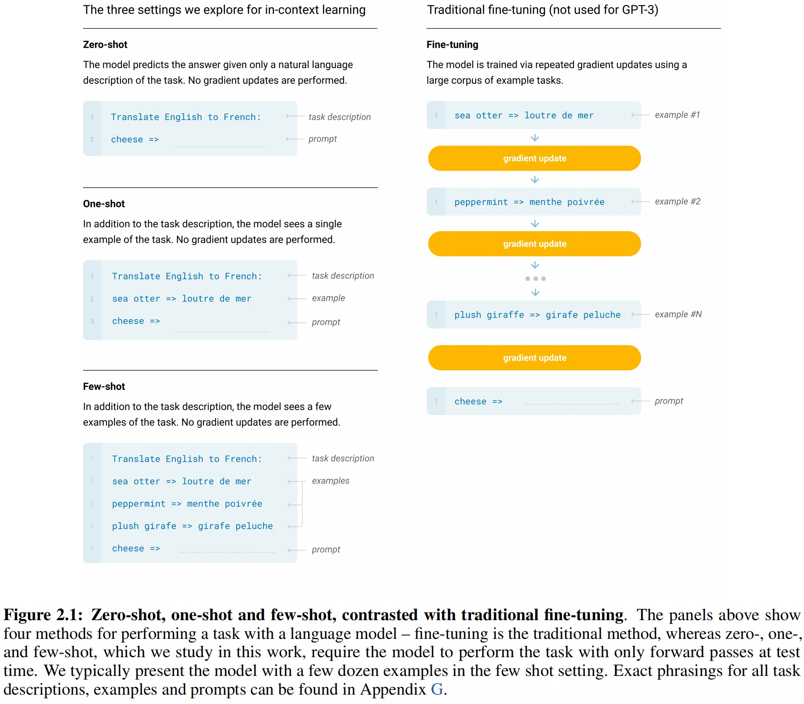
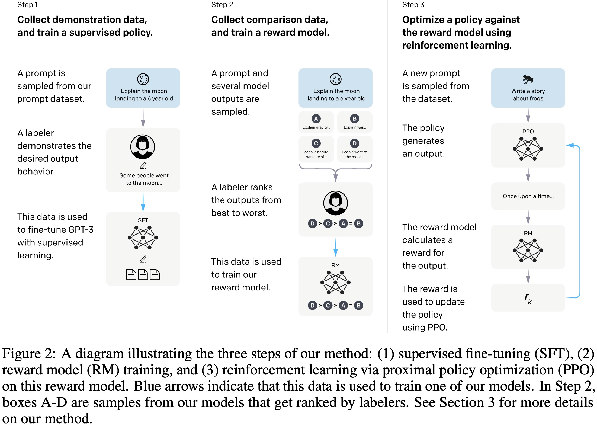



学习知识就像是水流一样，一定要找到知识的源头和知识的流向；也就是说，不仅仅要关注当前这篇文章的创新点，同时也要关注当前的这篇文章前期工作有什么，思路是从哪些文章延伸过来的；而流向就是基于现有知识作出的创新。



## 为什么现在的大语言模型都是Transformer架构？



Transformer模型本身里面的`inductive bias`比较小。



### NLP与CV领域模型的演进历程

NLP：human rule - statistical model - RNN - Transformer

CV：hard-crafed + SVM  - CNN - Vision Transformer(ViT)

CV和NLP领域的发展最终都不约而同的满满发展到了Transformer架构。因为随着数据量的增长，计算量也随之变大。CNN和RNN架构在数据量和计算量增大后会遇到性能上的瓶颈，但是Transformer模型随着数据量和计算量的增大性能会进一步提高，鲜有出现性能瓶颈的问题。

--》  这背后的主要原因是`inductive bias`。

如何理解`inductive bias`？其实就是人类给出计算机先验知识的过程。

人类主动注入一些对于某一领域事物的特征偏见，使得计算机利用这些特征偏见去做识别、分类任务。这里就包含比较多的`inductive bias`。

如果是一个现成的领域数据集，比如ImageNet，里面已经包含了多种分类任务所需要的特征，这里面就包含比较少的`inductive bias`。

经典例子就是我们考试不知道如何复习？之后我们就会去问助教，助教会给我们考试范围和几篇往年的复习真题，这里的考试范围和几篇往年的复习真题其实就是人类的`inductive bias`。我们最后突击的时候，就会利用这个`inductive bias`使得复习更简单。但是助教给出的`inductive bias`也不一定完全正确，因为老师很可能会出一些范围以外的题目，所以对于学习最好的方式就是不要去看助教给出的范围，而是多花时间和精力去系统完整地学习所有的知识。

### Trade off

CNN和RNN就是一类`inductive bias`比较强的模型，因为人类设计这类模型的时候就已经注入了大量的先验知识。以分类任务为例：模型在训练的时候，构建的数据集基本上都是带有标签数据，在构建好的数据集上进行监督训练，之后在测试集上进行测试验证，计算损失反向传播更新模型的权重参数。

Transformer模型的本质其实是一个`Attention + MLP`架构，比起CNN和RNN，Transformer模型训练里面的`inductive bias`更小。相比于神经网络的训练，Transformer模型设计之初是用来完成机器翻译任务而非分类任务。其训练过程更像是非监督学习，随意输入给模型一个文本，通过注意力机制计算文本中词与词之间的Correlation，通过Encoder-Decoder架构完成序列转换，序列的转换过程就是通过注意力机制计算得来的。

所以，对比两种模型可以发现，相比于CNN和RNN网络，Transformer模型训练过程中数据的`inductive bias`是更小的。

## 为什么大语言模型领域会反复强调scale up？

The Bitter lesson by Rich Sutton：https://www.cs.utexas.edu/~eunsol/courses/data/bitter_lesson.pdf

Rich Sutton观点：Search和Learning是人工智能研究中使用大量计算的两种最重要的方法，越general的方法越容易scale up，从而会带来模型性能上的提高。核心思想是开发的方法是没有使用人类的`inductive bias`知识，然后将这种方法加单粗暴的scale up从而大幅度提高模型的性能。

Rich Sutton想法提出的原因是因为摩尔定律对于单位计算成本持续呈现指数级别的下降，并且human-knowledge的方法不太适合去利用好计算的`general methods`。

**The Bitter lesson**基于的历史观察：

- AI researchers总是尝试去在他们的智能系统中建立知识
- 建立知识在短期是起作用的，但是长远来看是停滞的
- 突破性进展往往是基于搜索和学习的计算方法来实现

从the bitter lesson中吸取的教训：可用计算量增大的同时，通用方法会随着计算量的增加而扩展，搜索和学习是可以任意扩展的两种方法；心智是极其复杂的，与其探索复杂性，构建捕获复杂性的元方法更为重要。(有些深奥了昂。。。)

## GPT发展史



预训练-监督微调 -> 无监督训练 -> 上下文学习 -> RLHF



大模型架构发展之初的三个流派(如下图所示)：Enc-only、Enc-Dec、Dec-only

Enc-only代表：BERT

Dec-only代表：GPT

GPT模型最初的灵感来源是OpenAI的研究员Radford，他使用爬虫抓取了一些网络数据。利用这些数据，将Transformer模型的Decoder训练成了一个简易QA系统。之后Ilya觉着这种方法非常有前景，就在这个基于Transformer-Decoder架构之上，进一步改进成了GPT模型。

总结BERT和GPT训练的不同点：BERT是完形填空、GPT是续写接龙，具体区别见下图：

梳理GPT模型的发展路线：

结合上文的scale up部分，梳理一下GPT模型训练时慢慢“变大”的过程：

GPT-1：117M｜1GB

GPT-2：1542M｜40GB

GPT-3：175B｜580GB

PaLM：540B

DeepSeek LLM：67B

DeepSeek Math：145B

DeepSeekV2：236B

DeepSeekV3：671B

### GPT

**Improving Language Understanding by Generative Pre-Training**：https://cdn.openai.com/research-covers/language-unsupervised/language_understanding_paper.pdf

GPT在微调时会根据任务特性对输入进行特定的转换，同时网络结构仅需微小的更改。对所有参数进行微调以后即可将GPT应用于不用的下游任务。通过这种预训练-微调方式，无须大量与特定任务相关的结构更改，便可以快速适应于各种NLP任务。

由于没有编码器，GPT去掉了原始Transformer解码器中交叉多头注意力，仅保留了带掩码的多头自注意力和前馈神经网络。

GPT模型架构图如下：

  

在预训练阶段，GPT使用了标准的语言模型目标函数。给定序列的前i-1个词元，去预测第i个词元。给定无标注预料中的文本序列：
$$
U=\{u_1,u_2,...u_n\}
$$
语言模型的目标函数极大化似然函数为：
$$
\mathcal{L}(\mathcal{U})=\sum_{i}logP(u_{i}|u_{i-k},...,u_{i-1};\theta)
$$

###  GPT-2

**Language Models are Unsupervised Multitask Learners**：https://cdn.openai.com/better-language-models/language_models_are_unsupervised_multitask_learners.pdf

对于GPT的核心改进思想：通过语言模型的框架，使用无监督模型直接去实现各种下游的有监督任务，将任务的相关信息也作为语言模型的输入。

GPT模型虽然可以通过预训练-微调框架在多种下游任务中取得好的效果，但是微调阶段仍然需要收集特定的数据集并对模型进行监督训练。为了实现真正的通用NLP模型，GPT-2实现了无须微调直接利用**无监督训练**的模型去做各种不同的下游任务(多任务的无监督学习)。在训练时，输入构建成类`Question-Answer`的形式，并扩大数据集继续Scaling Up。

P(output | input) -> P(output | input, task)

### GPT-3

**Language Models are Few-Shot Learners**：https://arxiv.org/pdf/2005.14165

对于GPT-2改进：进一步增加语料集数量和模型参数量、使用上下文学习方式提高处理不同任务的通用型。

上下文学习，指使用自然语言的任务提示(**prompt**)和少量演示示例，来学习对不同任务的处理。

上下文学习与微调的最大区别在于，微调需要利用大量下游任务数据对模型进行训练，更新模型参数；而上下文学习无需大量下游任务数据，也不需要进行梯度更新。

- 小样本学习(few-shot learning)：在输入文本中，向模型提供描述任务的自然语言提示，以及**一些**任务相关的示例演示。
- 单样本学习(one-shot learning)：在输入文本中，除了向模型提供描述任务的自然语言提示，仅提供**一个**任务相关的示例演示。
- 零样本学习(zero-shot learning)：在输入文本中，只向模型提供描述任务的自然语言提示，**不提供**任务相关的示例演示。

### InstructGPT

**Training language models to follow instructions with human feedback**：https://arxiv.org/pdf/2203.02155

Open AI发现，在GPT-3的基础上直接扩大模型规模(Scaling Up)并不一定能让模型达到更好的效果。如果用户的问题是数据集中没有包含的，那么大模型无法给出正确的答案。

InstructGPT使用了基于人类反馈的强化学习(Reinforcement Learning from Human Feedback, RLHF)技术，使InstructGPT的输出结果贴近人类习惯。

RLHF三阶段：

1. 监督微调(Supervised fine-tuning)：使用人工给出的示范性数据，监督训练模型。人工标注问题的答案，然后将问题的回答拼接形成`Q-A`形式，收集大量对话文本数据集作为提示数据集，问题将作为模型的提示信息，回答是人工写的，作为模型期望输出。->微调的目的是让GPT-3学习到什么样的回答更加符合人类习惯。
2. Human Feedback：使用人工排序的对比性数据，训练奖励模型。人工讲SFT阶段得到的回答进行排序，将排序数据整理为一个数据集用于训练奖励模型。->奖励模型输入是问题和回答的文本，优化目标是让奖励模型判断的分数排序后要接近人工顺序。
3. Reinforcement Learning：使用奖励模型，通过强化学习训练模型。用第二步生成的奖励模型对有SFT模型的输出结果进行评估，通过强化学习训练后，使模型的输出结果的奖励尽量高。

## 从零构建大语言模型

参见文章《从零构建大模型》

## 参考资料

- Build A Large Language Model (From Scratch), Sebastian Raschka, https://github.com/rasbt/LLMs-from-scratch

- EZencoder. DeepSeek-R1 论文详解 part 3：GPT发展史 | scaling law | 训练范式 | 涌现, https://www.bilibili.com/video/BV1bUA8eYEHJ/?spm_id_from=333.1007.top_right_bar_window_history.content.click&vd_source=f093c3d64ba399e149cbffa6cd31a7b0
