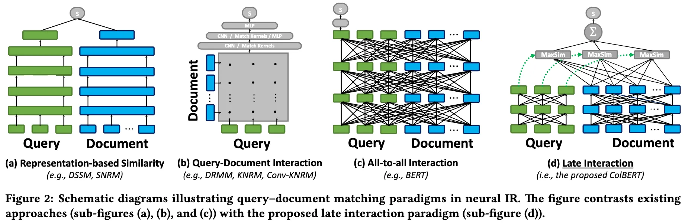
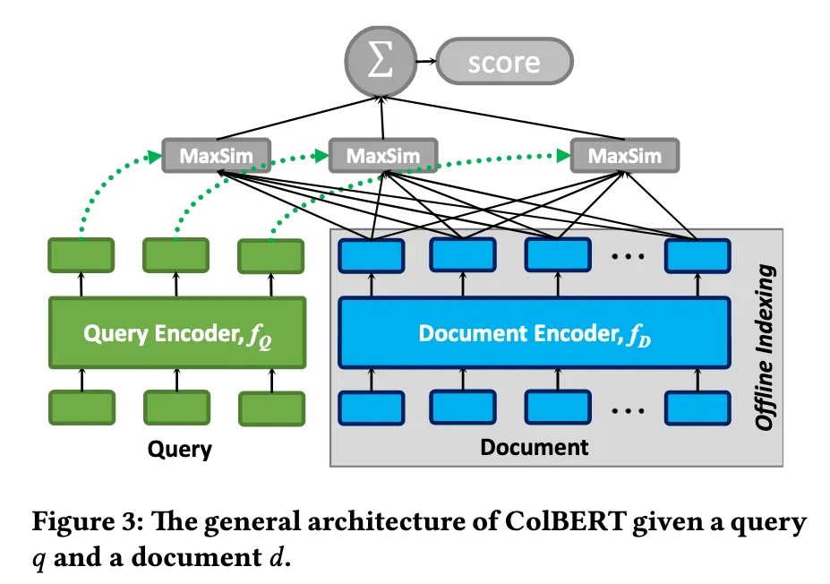


从ColBERT到Colpali，唯一不变的核心本质是**Late interaction**——晚交互机制。


## 理解Late interaction

梳理一下Late interaction之前所有的“Query-Document”交互方式：

- **双塔结构**：将query和文档各自编码为一个向量，然后通过简单的点积或余弦相似度计算分数。

>  缺点：强行将长文档中丰富的信息压缩到一个定长的向量中，导致大量细节丢失

- **交叉编码**：将 Query 和 Document 拼接在一起输入到 BERT 中，让 Query 的词和 Document 的词在每一层网络中都进行的交互。

> 缺点：Document 的编码依赖于 Query ，无法预先计算文档向量。而且对于每一个查询，都要把全部的候选文档重新跑一遍 BERT，计算成本非常大

- **全对全交互/all-to-all**：Query 和 Document 分别编码，保留所有 Token 向量。然后构建一个交互矩阵去计算 Query 中每个词和 Document 中每个词的相似度。最后通过一个可学习的深层网络去学习这个矩阵，提取匹配特征，最后输出一个分数。

> 缺点：交互矩阵占大量内存空间，相似度是通过构建的深层网络学出来的，很难利用现有的向量检索引擎进行索引加速

**Late interaction**：Query 和 Document 分别通过 BERT，但**不压缩**成单独的一个向量，而是保留所有 Token 的 Embedding 列表。将BERT模型输出的 Embedding 通过MaxSim 操作进行细粒度匹配。

模型输入：query 和 Document

模型输出：一个MaxSim Score，query与每个文档都计算出一个文档分数，根据这个分数从大到小排序，分数最高的就是最相关的结果。 


[例子] query = “苹果 价格”  Document A = "红 苹果 好吃" Document B = "香蕉 便宜"


假设BERT已经跑完拿到了以下的Embedding结果(得到query和Document的Token级编码)：

q1(苹果): [1.0, 2.0]

q2(价格): [-1.0, 1.0]

Document A

d1a(红): [0.5, 0.5]

d2a(苹果): [1.0, 2.1] 

d3a(好吃): [-0.5, 0.5]

Document B

d1b(香蕉): [2.0, -1.0]

d2b(便宜): [0.0, 0.1]

-----------

计算query与Document A分数：

q1(苹果)·d1a(红) = 1.5

q1(苹果)·d2a(苹果) = 5.2

q1(苹果)·d3a(好吃) = 0.5

q2(价格)·d1a(红) = 0

q2(价格)·d2a(苹果) = 1.1

q2(价格)·d3a(好吃) = 1.0

Score(query,Document A) = 5.2 + 1.1 = 6.3

---------------------

计算query与Document B分数：

q1(苹果)·d1b(香蕉) = 0

q1(苹果)·d2b(便宜) = 0.2

q2(价格)·d1b(香蕉) = -3.0

q2(价格)·d2b(便宜) = 0.1

Score(query,Document B) = 0.2 + 0.1 = 0.3 

---------------------------------

排序结果：

1. Document A
2. Document B
