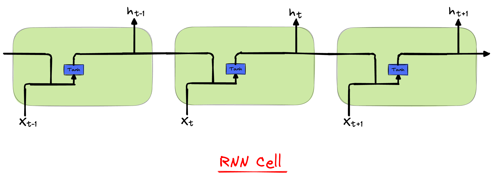
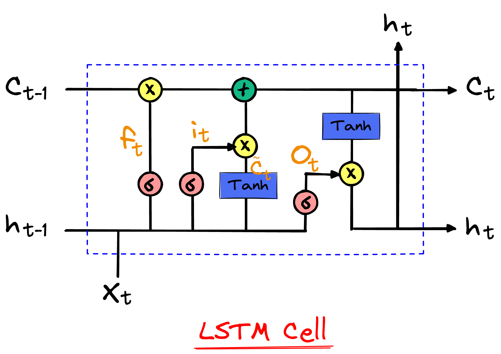

由于pytorch已经将三个循环神经网络、LSTM进行了高度的封装，所以本节不再去关注网络结构的设计和复现，而是重点关注如何在自己设计的网络结构中将RNN和LSTM融入进去以实现特等的任务。

卷积神经网络是借鉴人类视觉的思想，教会计算机识别东西；从循环神经网络开始，我们的核心任务就是教会计算机理解序列数据。

人类并不是每时每刻都从头开始思考。 当我们阅读这篇文章时，会根据对前面单词的理解来理解每个单词。

## 循环神经网络-RNN

循环神经网络是神经网络的一种，为什么取名字要叫做循环呢？

就是因为它的神经元输出会在下一个时间步作为反馈进行输入，使整个网络具有处理**序列数据**的能力。

一个复杂的系统包含若干的最小单元组件，每个最小单元组件都会重复自身动作从而构成整个系统的运转，“循环”变应运而生。

普通的神经网络处理的是独立同分布数据，层与层之间就是简单的前馈链接关系，输入和输出长度是固定的。

而循环神经网络具有记忆能力，这种记忆能力体现在上层神经元的输出会作为下层神经元的输入，可以处理时序数据，而且输入输出长度不固定。
$$
h_{t}=tanh(h_{t-1}W_{h}+x_{t}W_{x}+b)
$$
$$
= tanh(h_{t-1}W_{hh}+b_{hh}+x_{t}W_{ih}+b_{ih})
$$

模型输入：input_size,hidden_size

模型输出：output_size,ht

~~~python
class RNNLayer(nn.Module):
    def __init__(self,input_size, hidden_size, num_layers=1, batch_first=True):
        self.hidden_size = hidden_size
        self.num_layers = num_layers
        self.input_size = input_size
        self.bidirectional = False
        super().__init__()
        self.W_ih = nn.Parameter(torch.rand(self.input_size, self.hidden_size))
        self.W_hh = nn.Parameter(torch.rand(self.hidden_size, self.hidden_size))
        self.b_ih = nn.Parameter(torch.zeros(self.hidden_size))
        self.b_hh = nn.Parameter(torch.zeros(self.hidden_size))
        
    #前向传播的两个参数分别为x_t(输入变量)和h_prev(隐藏变量)
    def forward(self,x_t,h_prev=None):
        # part 1: torch.matmul(x_t, self.W_ih)
        # x_t包含多个时间步，形状为[batch_size, time_steps_num, input_dim]
        # W_ih形状为[input_dim, hidden_size]
        # torch.matmul(x_t, self.W_ih) 输出矩阵形状为[batch_size, time_steps_num, hidden_size]
        # part 2: torch.matmul(h_prev, self.W_hh)
        # h_prev 形状为[batch_size, time_steps_num, hidden_size]
        # W_hh形状为[hidden_size, hidden_size]
        # torch.matmul(h_prev, self.W_hh) 输出矩阵形状为[batch_size, time_steps_num, hidden_size]
        if h_prev == None:
             h_prev = torch.zeros( x_t.size(0), self.hidden_size)
        output = torch.tanh(torch.matmul(x_t, self.W_ih) + self.b_ih + torch.matmul(h_prev, self.W_hh) + self.b_hh)
        return output,output[:,-1,:].unsqueeze(0)
~~~


RNN的梯度消失/爆炸


RNN的梯度消失或爆炸问题主要体现在“循环”过程中隐藏变量的迭代计算过程中。

- 隐藏变量的参数>1: 每迭代一次都会呈现幂律型增长，经过ReLU激活后会趋向于正无穷
- 隐藏变量的参数<1: 每迭代一次都会呈现幂律型衰退，经过ReLU激活后始终等于0

## 长短期记忆网络-LSTM

网络的输入：隐藏变量H、记忆C、输入序列X

网络的输出：输出序列Y、隐藏变量H、新的记忆C

参数初始化：

~~~python
def init_paramaters(vocab_size,hidden_units):
    std = 0.01
    input_units = output_units = vocab_size
    
    #正态分布
    def normal(shape):
        return torch.randn(size=shape) * std
    
    #LSTM_cell_weights
    forget_gate_weights = normal((input_units + hidden_units,hidden_units))
    input_gate_weights = normal((input_units+hidden_units,hidden_units))
    output_gate_weights = normal((input_units + hidden_units,hidden_units))
    c_tilda_gate_weights = normal((input_units + hidden_units,hidden_units))
    
    # 偏置项
    forget_gate_bias = torch.zeros((1, hidden_units))
    input_gate_bias = torch.zeros((1, hidden_units))
    output_gate_bias = torch.zeros((1, hidden_units))
    c_tilda_gate_bias = torch.zeros((1, hidden_units))
    
    #输出层参数
    hidden_output_weights = normal((hidden_units, output_units))
    output_bias = torch.zeros((1, output_units))
    
    # 将所有参数添加到字典
    paramaters = {
        'fgw': forget_gate_weights,
        'igw': input_gate_weights,
        'ogw': output_gate_weights,
        'cgw': c_tilda_gate_weights,
        'fgb': forget_gate_bias,
        'igb': input_gate_bias,
        'ogb': output_gate_bias,
        'cgb': c_tilda_gate_bias,
        'how': hidden_output_weights,
        'ob': output_bias
    }
    
    # 设置 requires_grad=True 以启用梯度计算
    # 确保所有参数在反向传播中能够计算梯度
    for para in paramaters.values():
        para.requires_grad_(True)
    
    return paramaters
~~~

网络结构定义：

~~~python
def LSTM(inputs,state,params):
    [W_xi, W_hi, b_i, W_xf, W_hf, b_f, W_xo, W_ho, b_o, W_xc, W_hc, b_c,
     W_hq, b_q] = params #各个门的参数
    (H,C) = state #隐藏参数和记忆参数
    outputs = []
    for x in inputs:
        I = torch.sigmoid((x @ W_xi) + (H @ W_hi) + b_i) #输入门
        F = torch.sigmoid((x @ W_xf) + (H @ W_hf) + b_f) #遗忘门
        O = torch.sigmoid((x @ W_xo) + (H @ W_ho) + b_o) #输出门
        C_tilda = torch.tanh((x @ W_xc) + (H @ W_hc) + b_c) #候选记忆
        C = F * C + I * C_tilda
        H = O * torch.tanh(C)
        Y = (H @ W_hq) + b_q
        outputs.append(Y)
    return torch.cat(outputs,dim=0),(H,C)
~~~

对于每个LSTM门，它的输出是通过如下方式计算的：

- 假设当前的输入向量为 xt=[x1,x2,x3,x4]（维度是 `input_units = 4`），上一时刻的隐藏状态为 $h_{t-1} = [h_1, h_2, h_3]$（维度是 `hidden_units = 3`）。
- 我们将这两个向量拼接起来，得到一个向量 [x1,x2,x3,x4,h1,h2,h3]，维度是7。
- 然后，我们将这个7维的向量与权重矩阵相乘，得到一个维度为3的向量（即隐藏状态的维度）。这个3维的向量就是该门的输出（例如，遗忘门的输出），它会被用来更新LSTM的状态。

## GRU

传统的循环神经网络（RNN）在处理长序列数据时常常遇到梯度消失或梯度爆炸的问题，这限制了它们捕捉长期依赖关系的能力。为了解决这些问题，长短期记忆网络（LSTM）被提出，它通过引入门控机制来控制信息的流动，从而有效缓解了梯度消失问题。GRU模型则是在LSTM的基础上进一步简化和发展的，它由Cho等人在2014年提出，旨在简化LSTM的结构，同时保持类似的性能。

GRU通过合并LSTM中的遗忘门和输入门为更新门，并引入重置门，同时合并单元状态和隐藏状态，使得模型更为简洁，训练速度更快。这种结构上的简化并没有牺牲性能，GRU在很多任务中的表现与LSTM相当，甚至在某些情况下更优。因此，GRU因其高效和简洁的特性，在自然语言处理、语音识别、时间序列预测等多个领域得到了广泛的应用。

参数初始化：

~~~python
def get_params(vocab_size, num_hiddens, device):
    num_inputs = num_outputs = vocab_size

    def normal(shape):
        return torch.randn(size=shape, device=device)*0.01

    def three():
        return (normal((num_inputs, num_hiddens)),
                normal((num_hiddens, num_hiddens)),
                torch.zeros(num_hiddens, device=device))

    W_xz, W_hz, b_z = three()  # 更新门参数
    W_xr, W_hr, b_r = three()  # 重置门参数
    W_xh, W_hh, b_h = three()  # 候选隐状态参数
    # 输出层参数
    W_hq = normal((num_hiddens, num_outputs))
    b_q = torch.zeros(num_outputs, device=device)
    # 附加梯度
    params = [W_xz, W_hz, b_z, W_xr, W_hr, b_r, W_xh, W_hh, b_h, W_hq, b_q]
    for param in params:
        param.requires_grad_(True)
    return params
~~~

模型定义：

~~~python
def gru(inputs,state,params):
    W_xr,W_xz,W_xh,b_z,b_h,b_r,W_hr,W_hz,W_hh,W_hq,b_q = params
    H, = state
    outputs = []
    for X in inputs:
        Z = torch.sigmoid((X @ W_xz) + (H @ W_hz) + b_z)
        R = torch.sigmoid((X @ W_xr) + (H @ W_hr) + b_r)
        H_tilda = torch.tanh((X @ W_xh) + ((R * H)@W_hh) + b_h)
        H = Z * H + (1 - Z) * H_tilda
        Y = H @ W_hq + b_q
        outputs.append(Y)
    return torch.cat(outputs,dim=0),(H,)
~~~

