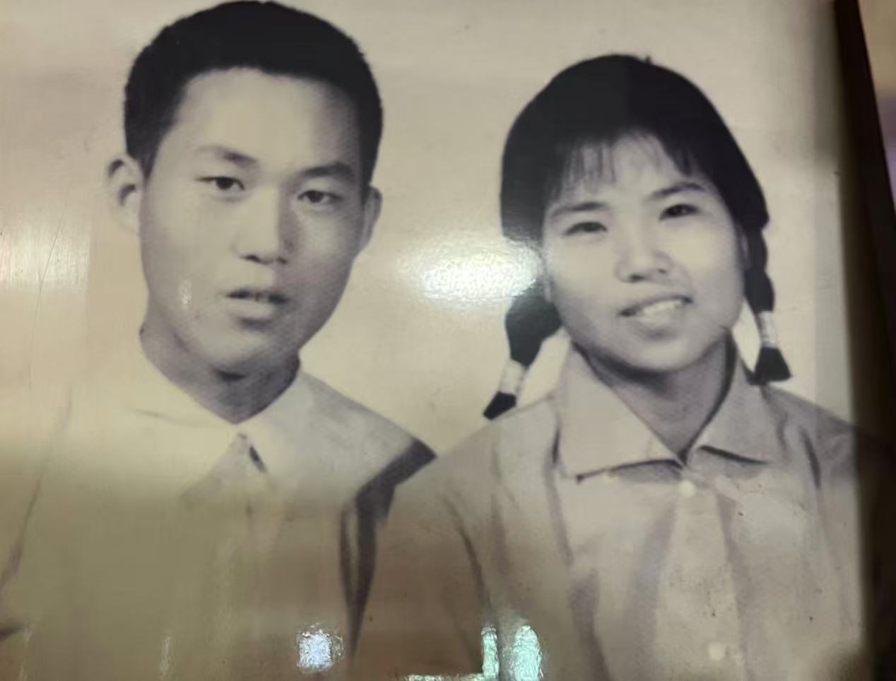

照片中的帅哥是我的姥爷，姓名刘增才，今年69岁，是河北省沧州市-----村人。照片中的美女是我的姥姥，姓名邵长芬，今年72岁，是河北省沧州市河间市-----村人。

为什么要写他们两个呢？因为今天晚上我们仨人在一起吃晚饭，聊起来很多很多的往事，这顿晚饭大概吃了40多分钟，期间我听到了很多过去的事，这些事有些我小的时候经历过，有些是他们小时候的事，这种陌生与好奇的感觉不禁让我想要赶紧动手记下来。

我从上幼儿园以来，我妈就把我放在了镇上的姥姥家，我从这是读完了小学、初中、高中；可以说，我人生前24年陪伴最多的人就是我的姥姥姥爷，对他们的感情也是最深厚的。今天晚饭，他们和我讲了很多很多往事，我之间没有听说过的事，我想记下来，因为我觉着这对我而言是一笔财富。只有清楚地了解我家庭的过去，才能更有勇气走好未来的漫漫人生路。五千年前的事情我们心里门儿清，但是五十年前的事情我们一无所知。

今天的记录是客观的，客观在就是原原本本的记录；可能某些往事尚未盖棺定论，写在里面显得敏感突兀，但是我觉着不能避之不谈。我记录的不是这件事、那件事的真相，我记录的只是从她们口中最原汁原味的表述。

---------------

我：小时候你们俩都是什么“学历”啊？

姥爷：我那时候是高小毕业，放到现在应该算是初中毕业。那时候我在班里是体育委员，我脑子挺好使的，就是没赶上高考。

姥姥：我小学毕业，考上初中了，但是上初中需要去隔壁镇上上学，家里都说女孩子家没有出村上学的，索性我也不上了；虽然我小学毕业，但是我认字、识字不少，不是文盲，当年背毛主席语录顶数我背的最快。

我：小时候你们是不是都当红卫兵啊？

姥爷：当，那时候天天运动。

姥姥：别提了，那时候真是太热闹了。我们那时候白天踢正步、伏地行进、跑步训练；到了晚上，只要一听到号声，甭管几点必须起来跑操，一跑操就是几里地远，可折腾人了。当年地主们都挨批斗，那些年轻的男红卫兵们半夜把人家关在一间黑屋子里，当着我们面，用新长出来的木条抽人家，抽的人家浑身衣服包着血丝。我记得有一个我们村的地主，最后实在忍不了，用皮带在自己屋子上吊死了。给人家带高帽子，那帽子有近一米长，脖子上挂着大牌子，整体拉着全村游行。那地主家的女的都裹小脚，感觉小脚支撑不住身体，走路都一晃一晃的。

我：那你们家庭没受影响吗？

姥爷：我们是下中农，没影响。

姥姥：我爷爷当年管粮食，但是我们家不是富农，是上中农，没受影响。当年赶集去，路口都有红卫兵看着，当面让你背毛主席语录，背不出来不让赶集。我当年背的最快记得最准，但是因为我们家是上中农，我评优秀红小兵的时候不能参选。

我：这老哥几个不容易啊！

姥姥：这一辈子可算是吃过苦过来的啊！

姥爷：我兄弟四个，这里面最有文化的是我大哥、你大姥爷。他年轻的时候教书，之后在镇上乡镇企业站当站长，管理全镇上的国有企业，因为有文化，外号叫“刘罗锅”。毛笔字写得好，懂风水生辰八字，会看时辰；你这名字就是你大姥爷给你起的。

姥姥：二姥爷年轻的时候在北京杀猪卖猪肉，当时在北京回来赚了钱在镇上开了第一家信用社，当年你妈妈不上学了就在里面当会计。这一大家子里面，就是三姥爷家婆媳关系一直不和，总是闹矛盾，现在也不说话，哎没法说。你以后得记着，不管怎么样，首先要家和，要不什么也干不好。

我：当年是怎么一步步闯过来的？

姥爷：我毕业以后在国品厂当会计，给供销社送货，一天挣一块五。后面在种子站卖种子、农药，后来种子站就没了。再往后，塑料在咱们这兴起来了，就开始和你大舅舅一起卖塑料原料，这一干就是一辈子。

姥姥：那些年受的苦别提了，但是我这辈子最骄傲的事就是培养了你和你老舅这两位大学生，走到哪我都特别有面子。

----------

**历史知识补充：**

- 1951年10月中央人民政府政务院公布《关于改革学制的决定》，全日制小学学制未改动，增加了对成人实施小学教育的“工农速成初等学校”、“业余初等学校”和识字学校。1959年3月中共中央、国务院关于试验改革学制，即“学制要缩短、教育要革命”“开门办学”，从1960年开始，部分地区实施了小学五年一贯制、中学五年一贯制、中小学十年一贯制或初中小学九年一贯制、高中再分文理科等，这一时期由于小学师资普及，基本取消了初小、高小划分，普及了完全小学。[wiki百科]
- **红卫兵**，是中华人民共和国在文化大革命时期对部分特殊人群的一种称呼，红卫兵在文革中所扮演的角色并不相同。总体而言，红卫兵是受极左思潮影响下成立的群众组织，也指其成员。[wiki百科]
- **乡镇企业**是在乡镇举办的，以农村集体经济组织或者农民投资为主的企业。在中华人民共和国，乡镇企业由原来的社队企业发展而来。[wiki百科]

