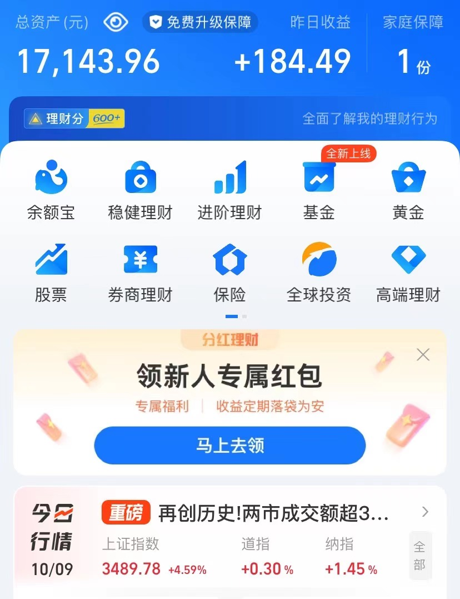
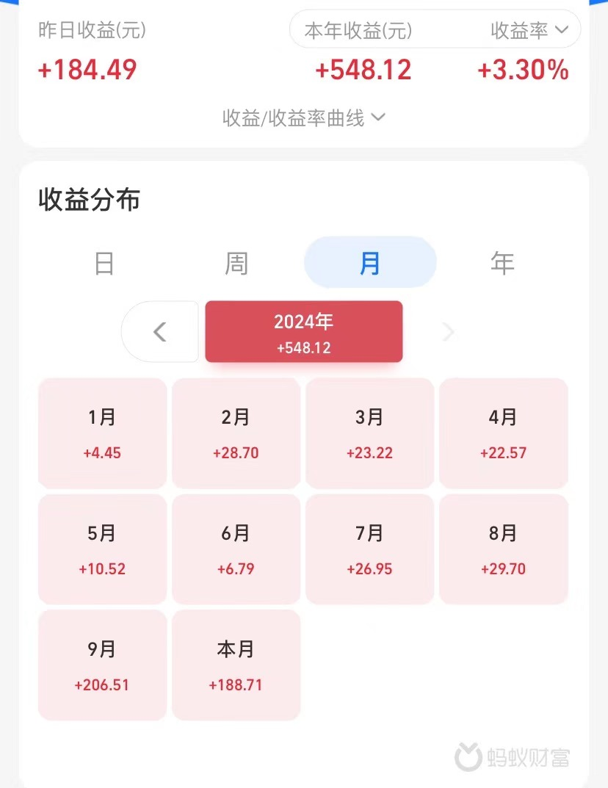
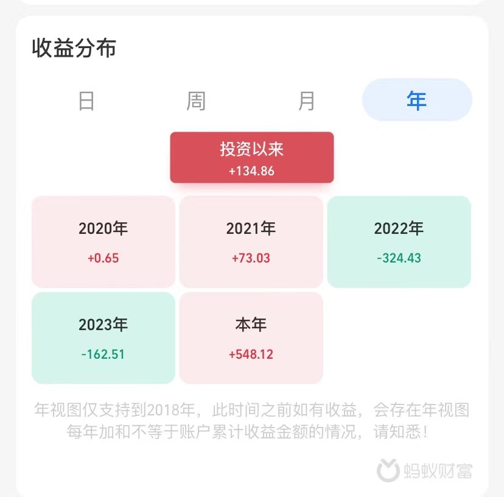
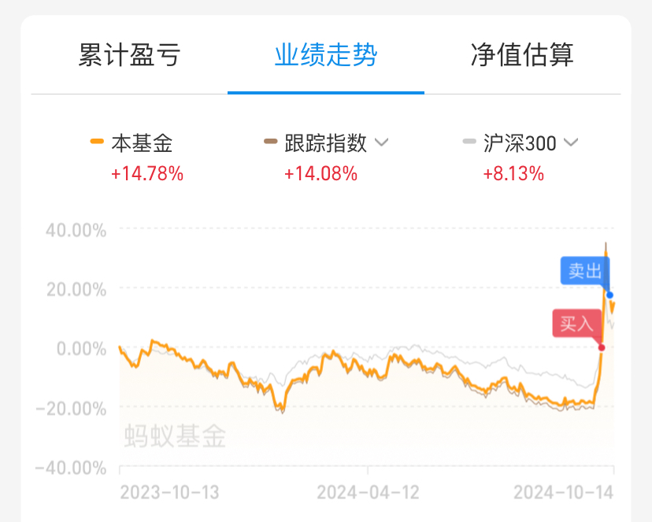
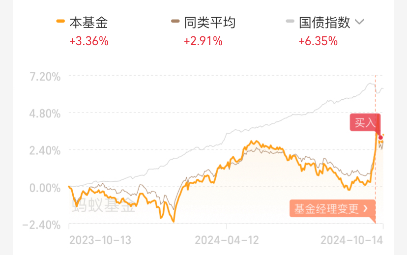
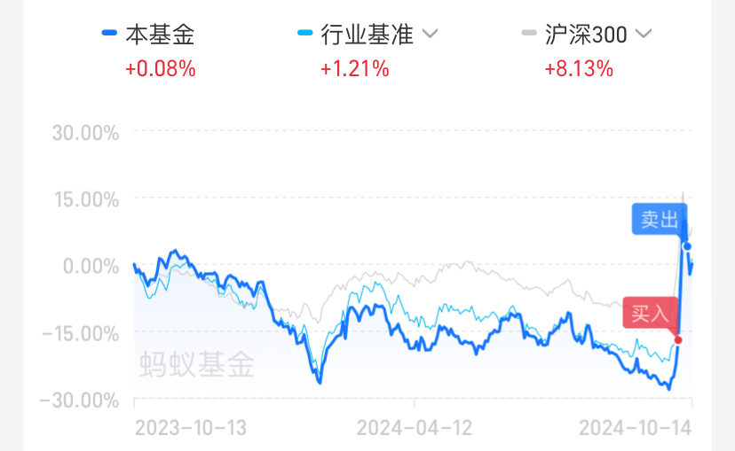



别人恐惧时你要贪婪，别人贪婪时你要恐惧—沃伦·巴菲特



## 对JJ要有信心—做时间的朋友、长期主义

今年总体是赚钱的，见好就收，还有两个月过年，猥琐发育，坚持住✊！今年的机会也差不多就到这了，没那么多心思去关注了，学习快跟不上了哈哈哈～

国庆节后，心情就是过山车。。。最重要的原因就是因为**ZB市场**的起起伏伏。

（当时心想，我要是有100个w，一周的操作足以半生衣食无忧，人在市场面前还是好渺小。。。）

当年明月在《明朝那些事儿》里说的非常好，**我们这个古老的民族，五千多年生生不息，只要自己人不折腾自己人，日子肯定会愈过愈好。**

都说这几年大环境不好、jj不好，但是实话实讲，今年开始，只要动机正有耐心，还是慢慢能赚到钱的。

直到上周，才真正体会到了老舅前一阵子的感慨：压力最大的不是下跌你陪了多少进去，而是疯涨的时候你不知道什么时候收手，人性都是贪婪的，而且是常态。

我是国庆节前的一个周五下午，看了zzj会议释放的信号，和微博、水木社区的某些评论，决定赌一把，想着投机赚一笔。雷总说的好：“**机会来了，猪都能飞啊**！”。真是第一次感到市场的力量，无形的手，指数级增长的魅力。

## 理性：多数情况你只是运气好，不要觉着自己有很强能力，也别辜负好运气——实事求是

三年多了，感谢国家让我体会到了什么叫**指数级增长**，一颗小草根伴随着时代的飓风呼啸而过。

斐波那契数列真不是吹的！

### 创业板

涨的最疯狂的板块，说实话，**不懂，赚钱纯靠投机**。所以到年底，**抽出来，别被套进去，见好就收**。后期无论再怎么疯狂，都首先观望，不着急入手，维持在500以下**求稳定长期回报**。

### 永利债券

目前为止，持有时间最长的一支基金，也是体会到了时间的朋友。这波高潮没有赶上，在高潮结束后，市场情绪稳定后，我决定加码永利。毕竟债券的风险要低与股票型基金，只有长期持有，才有回报的可能，被总想着挣快钱。

### 芯片半导体

我个人长期**看好芯片半导体**，毕竟现在自己从事AI相关的行当。但是具体规则目前还没学明白，未来趋势看不清，我想买未来，但是风险难把握。所以，高潮小赚一笔过后，抽离，维持在500以下**求稳定长期回报**。

今天JF军对湾湾进行联合利剑-2024B JS演习，军工大涨，对于这种机会就属于转瞬即逝，想抓住很难。

# 日益增长的对美好生活的需求，同不充分、不平衡发展之间的矛盾

现在愈来愈对这句话感同身受，能总结出这句话来的人真是牛逼！

从本科开始试水理财，加上疫情两年多消费不大，而且也没谈对象，自己还是在支付宝上攒下了一笔钱。时至今天回头再看，当初的这个攒钱决策时正确的，因为能给今天带来很大的自由空间。那么下一步就是要思考，如何在一个更好的平台上去发现更多的资源，创造更多的财富。注意，这里说的是财富，不是钱。

ZB市场起起伏伏，恰如生活一样，都是**波动的**，事事如你所愿，很多时候是异想天开。唯一能做的也只是把握好能把握住的：真诚待人、踏实工作、精进技能、爱自己的家人和爱的人、锻炼好身体、保持好心态；能做到上述这些的，已是凤毛麟角。

