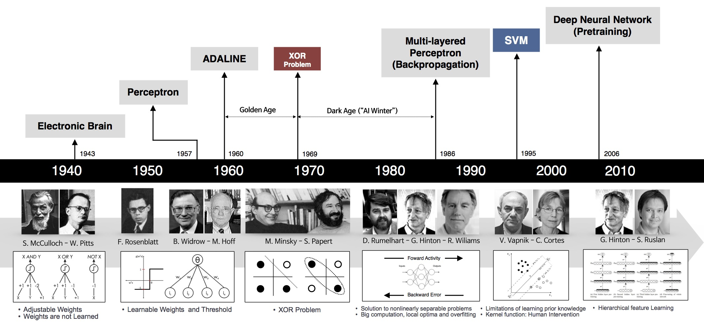
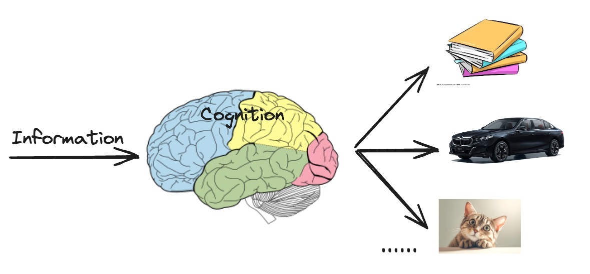
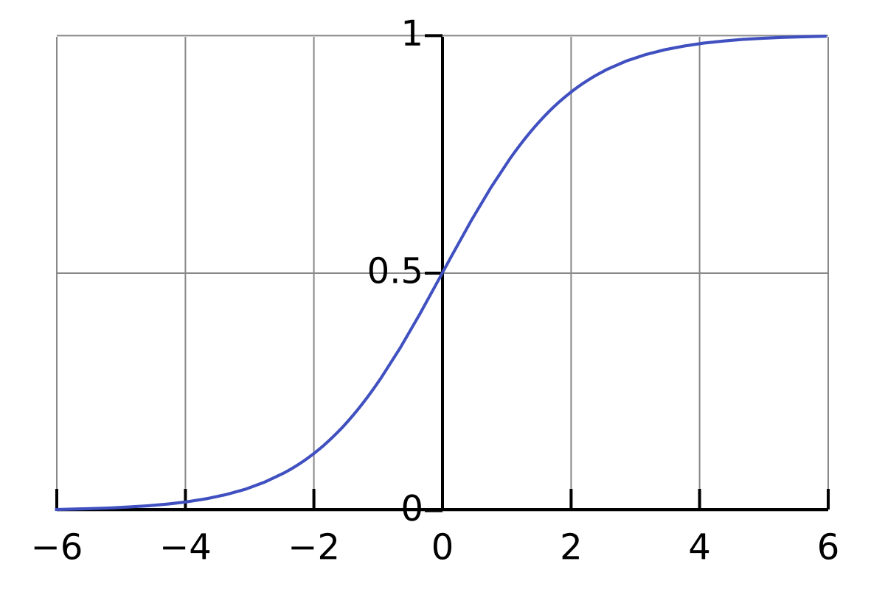
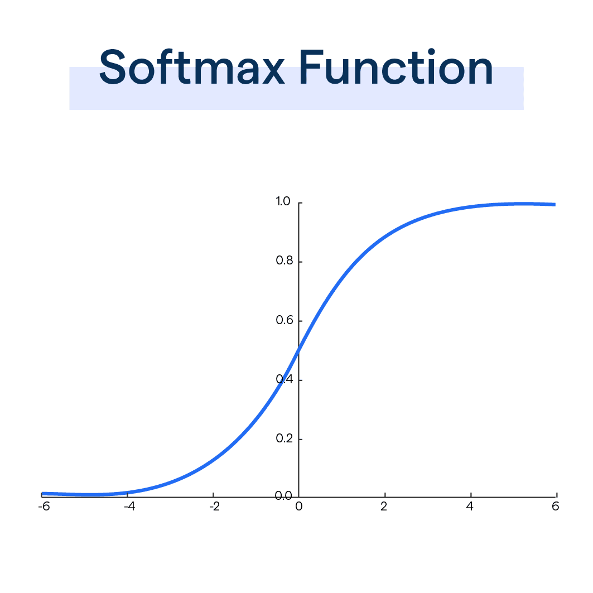
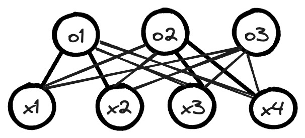
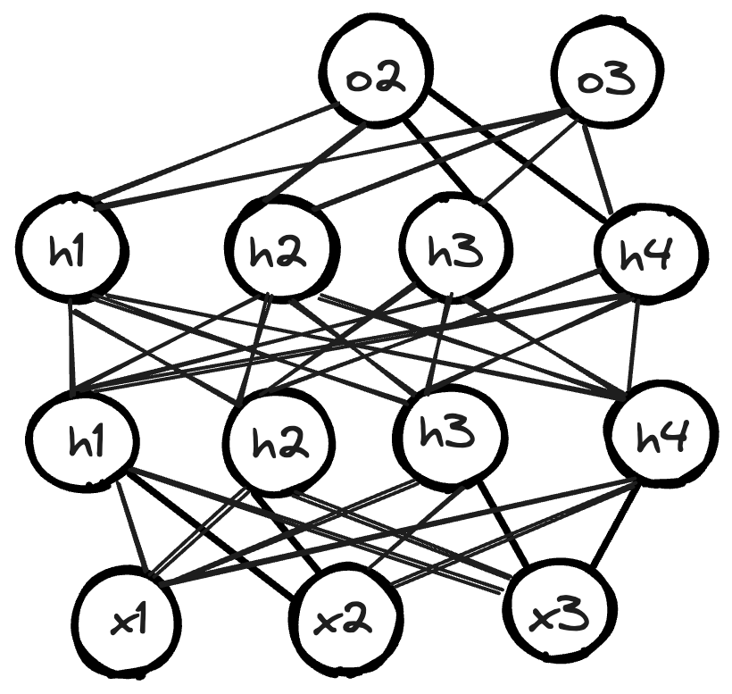
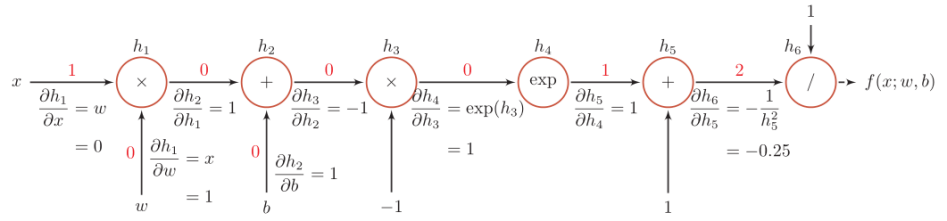
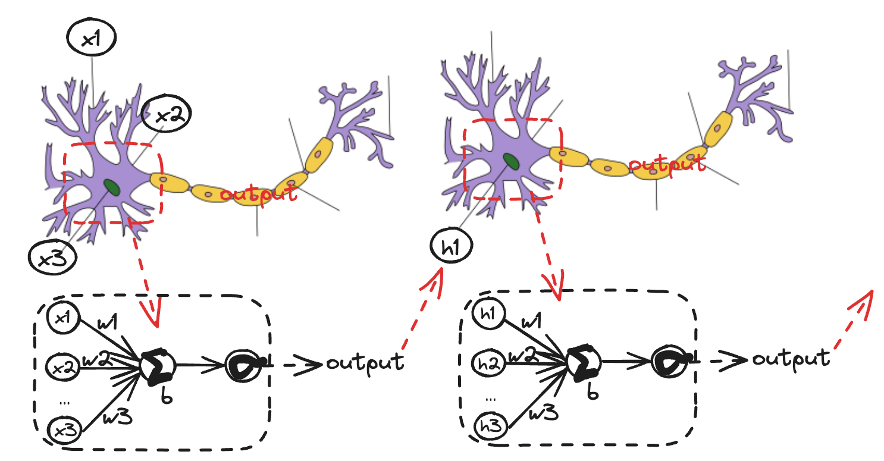


写代码和写情书是一样的，得多练 ——杨力祥


## 写在前面

杨力祥老师上节课讲了，之所以自己职业生涯在很早的时候投入到AI领域，包括复现Alpho Go；在弄清楚机器是如何学习的同时，也想知道人自身是怎么学习的？

**关联、体系**是学习的关键，不要被一些看似“懂得多”、“行家”某些人忽悠。学东西，任何一门东西，都要有体系的去学、有结构的去学。不要想玩沙子一样，看似懂得很多、知道的很多，但是只要一追问、深究，或者问问A和那个B之间有啥联系，他便说不上来了。

力祥哲学(把程序写成东西—面向对象思想的精髓)同样适合用于学习人工神经网络的体系架构与技术细节。

按着**把程序写成东西**的思路，思考如何学习CNN、RNN、GAN呢？——还是去找“像什么”？每一层的具体细节可能有所差别，但是层与层之间的结构可以抽取共性。于是可以**抽象出Layer类**，基于Layer类去做派生，实现不同层本身之间的差异。

图片引自$^{[2]}$

## 学习方法

杨老师上课一直在无形地传授给我们如何学习？如何思考？

但是自己一直想不明白，于是昨天晚上下课，去找杨老师交流了一下他的学习方法。（2024.11.04）

杨老师和我说，他小时候正赶上“文革”时期，和我爷爷奶奶姥姥姥爷差不多，小时候没有书可看，所以很多时候就靠想，想不出来也要想。

按着把程序写成东西的思想，切入到一个新领域，要从这个领域内最基础的例子出发，也就是说，往这件事的根上倒。杨老师带团队做操作系统，一开始就是找的Linux内核v0.01版本，Linux内核最古老最原始的一版本；和女儿学人工智能的时候，咨询了业内的大佬，也是从书写数字识别开始入手的。问题导向，而且是可以揭示这个领域内最本质的问题出发开始往后面派生。

最后，杨老师还问了我一个问题：**人为什么会问问题？**老师让我把这个问题整明白，这个问题思考清楚了，怎么学习也就差不多快弄明白了。而且老师还举了个例子，人类在教黑猩猩说话的过程中，花费大量的时间确实教会了黑猩猩哑语，但是这个过程中黑猩猩始终没有提问题，想想这是为什么？

想要快速切入进一个领域应该做到：

1. 想，人家能想出来，你也可以；只是你的大脑从来就没有经过“想”的训练过程
2. 案例导向，往根上倒，找最基本最经典的案例做切入点
3. 能发现并且会提出切入领域内的问题，会提问

## 认知-人与机器

认知科学、认知心理学

杨老师说，咱们的祖先从猿猴进化为人类，其中学会的一个最重要的技能就是学会了**分类**。在课堂上，讲到面向对象的核心思想的时候，杨老师也是按照分类的思想，引申出类和对象的关系。分类本质上就是一颗二叉树/多叉树，在实际思考时，是自下而上(树的层次结构)**抽取共性**，抽象就是脱离形式提取共性，但写的时候从上到下派生(树的层次结构)。

好了，上面介绍了人类认知的起源过程。OK，那么机器实现分类靠的是什么？机器如果学会了分类是不是就可以慢慢地开始学习人类的所有的思维模式呢？

初学机器学习，我们就学了回归和分类。回归可以用于预测*多少*的问题，但是分类问题不是问你“多少”，而是问你“哪一个”。

回归方法中最基础的方法就是线性回归，分类问题中最基础的方法就是softmax。

通常，机器学习实践者用*分类*这个词来描述两个有微妙差别的问题： 

1. 我们只对样本的“硬性”类别感兴趣，即属于哪个类别； 
2. 我们希望得到“软性”类别，即得到属于每个类别的概率。 这两者的界限往往很模糊。其中的一个原因是：即使我们只关心硬类别，我们仍然使用软类别的模型。$^{[1]}$


能搞明白**怎么去分类**，就可以慢慢地学着和人类一样去学习了。


### Sigmod

Sigmoid 函数常用于`二分类问题`的激活函数。

函数的定义域为所有实数，通常输出范围为 **0 到 1**，但某些变体（如[双曲正切](https://en.wikipedia.org/wiki/Hyperbolic_functions)）的输出值介于 -1 和 1 之间。

$$
\sigma(x) = \frac{1}{1 + e^{-x}}
$$

### Softmax-归一化指数函数

本质上是一个`多分类`激活函数
$$
\text{softmax}(z_i) = \frac{e^{z_i}}{\sum_{j=1}^{n} e^{z_j}}
$$

 softmax 函数通常用于**分类任务**的`神经网络模型`的**最后一层**，它通过取每个输出的指数并通过除以所有指数的总和来标准化这些值，`将原始输出分数（也称为 logits）转换为概率`。此过程可确保输出值在 (0,1) 范围内且总和为 1，使其可解释为概率。

神经网络的输出格式通常为one-hot格式，one-hot是一个向量，它的分量和类别一样多。 类别对应的分量设置为1，其他所有分量设置为0。（神经网络的输出格式）

Softmax的作用是可以将输入转换为概率分布，确保所有输出的总和为1

### Softmax函数和Sigmoid函数有何区别？

单看函数图像，貌似Softmax函数和Sigmoid函数没有任何区别呀！

Softmax函数适用于**多分类**问题，将多个类别的概率进行归一化；而Sigmoid函数主要应用于**二分类**问题，将实数映射到0到1之间的概率。

#### 二分类情况下

Softmax 和 Sigmoid 实际上是等价的，它们的图像几乎完全相同。

#### 多分类状况下

- Softmax 考虑所有类别之间的关系，每个类别的概率受到其他类别的影响。
- Sigmoid 则是独立计算每个类别的概率，不保证概率和为 1。

## 脑科学

[引自weibo博主blog：**indigo**]

推荐最近读过的最棒的一本书《A Brief History of Intelligence》，作者 Max Bennett 不是学者和生物学专家，而是一位创业者和 AI 专家，他联合创办了估值过十亿美金的 AI 公司 Bluecore。 这本“智能简史”我认为可以和 Yuval Harari 的《人类简史》比肩，从地球生物视角纵览了智能的演化，全书建立一个描述生物大脑进化的新框架，作者称其为“五次突破”，这对现在 AI 与具身智能的研究有巨大的参考价值。

**关联**的学习方法很符合大脑结构，**神经元之间的连接**正好反映出了这种关联关系。

下面这部分，结合大脑的结构，我们从最简单的线性神经网络、感知机开始本次“元学习”之旅～

### 线性神经网络

通过softmax回归构建出单层线性神经网络：
$$
o_1 =x_1w_{11}+x_2w_{12}+x_3w_{13}+x_4w_{14}+b_1 \\
$$

$$
o_2 =x_1w_{21}+x_2w_{22}+x_3w_{23}+x_4w_{24}+b_2 \\
$$

$$
o_3 =x_1w_{31}+x_2w_{32}+x_3w_{33}+x_4w_{34}+b_3 \\
$$

$$
\mathbf{O}=\mathbf{X}·\mathbf{W}+\mathbf{b} \\
$$

$$
\hat{\mathbf{Y}}=\mathrm{softmax}(\mathbf{O})=\frac{\exp(o_j)}{\sum_k\exp(o_k)} \\
$$

尽管softmax是一个非线性函数，但softmax回归的输出仍然由输入特征的**仿射**变换决定。 因此，softmax回归是一个*线性模型*。

### 计算图和感知机


感知器（英语：Perceptron）是 Frank Rosenblatt 在 1957 年就职于 Cornell 航空实验室时所发明的一种人工神经网络。它可以被视为一种最简单形式的前馈神经网络，是一种二元线性分类器。



#### 感知机

感知机是神经网络的原型，顾名思义，一种具有感知能力的机器。

有感知这件事可不一般吧，有感知以后，当接受到外界刺激后，便会对刺激产生反应了。

老师上课点名，听到名字后会立即喊“到”（如果不翘课的话嘿嘿），触摸到尖锐的物体或高温热水，会下意识的缩手；都是反应和感知。

在深度学习领域，感知机的本质其实是一种运用**Logistic回归**的二分类模型。它只能处理二分类问题而且必须是线性可分的问题。

由简单的线性回归网络过渡延伸到多层感知机，本质上就是网络中间的隐藏层的层数增加了。

 

#### 计算图

Sigmod函数的计算图过程：

## 人工神经网络

>  建立一个体系，将知识建立起联系：**softmax**、**sigmod**、**感知机**、**计算图**、**激活函数**、**反向传播**

我们是怎么学习的？始终不要忘记这个任务主线。

那么，我是怎么认识的呢？

反正我最初是被家大人带着认识东西的。

就我个人而言，从我出生，就是大人们带着我认识各种东西。一个典型的例子，刚出生没多久，学说话。老妈就对我说：“叫妈妈”、老爸就对我说：“叫爸爸”。从小开始，就学着认识人、认识各种东西。如果将我这个“婴儿”比作一个机器人（有点抽象哈哈），那么，父母带着我识人识物的过程不就是对我的一个训练过程吗？！

随着我慢慢长大，我在最初的被人带着学（学会了一些东西、认识了一些人和东西）的基础之上，我开始自学主动去探索、认识更多的东西。这期间我也会犯错，但是，每犯错一次，都会加深我的印象，纠正的我之前的想法与认识。

慢慢地，随着我认识的越多、学到的东西越多、对事物的分类也愈来愈清晰以后，我逐渐会自己学习、自己产出、自己创造生成了。

别人问我：“1+1=？”，我不仅可以准确的告诉她答案，我也会不由自主的**联想**到“1*1”、“1/1”、“1-1”。


错误的认识或分类，会作为一个刺激信号在大脑皮层中进行一次**反向传播**，调整参数，然后让我们更新认知，纠正错误。

这是我理解的人的学习方式，抛开基于统计，对于“机器学习的过程”，我猜亦如此



~~~c++
class MyNet
{
public:
  MyNet();
  ~MyNet();
  virtual void InintInput(int nodes);
  virtual void InitOutput(int nodes);
  FunctionChoice(string s);
  Back();
  Build(vector<float> x,vector<float> w,vector<float> b);
private:
  vector<float> w;
  vector<float> b;
};
~~~

### 剖析神经元结构

 

输入：自变量/参数 x列向量

激活函数:在计算网络中， 一个节点的**激活函数**定义了该节点在给定的输入或输入的集合下的输出。$^{[WiKi]}$

参数：w,b向量

输出：output列向量

### OO思想看神经网络


神经元网络能看成东西吗？用面向对象思想怎么玩？—本质上还是在**搭积木**

高级思考：设计好的网络结构内存开哪？每一层要不要自己开内存？每层开内存也是共性



用带参数的构造函数初始化一个小网络，宽度、层数

1.动手写sin函数-泰勒展开，精度多少看rn项/误差项0.000001

生成式最先淘汰的就是程序员，因为程序员最会训练程序员。

GitHub是黑窝。

操作系统和编译器能不能变成面向对象的方法写呢？

### 学习的动机-提出好问题


怎么才能提出高水平的问题？



### 反向传播-Back Propagation

反向传播的思想就是网络结构一般以随机参数开始，伴随着不尽如人意的初始效果，通过“学习”（反向传播）赋予网络“穿越”的能力，使其自身不断自我更新，从而达到一个理想的结果。$^{[4]}$

以实际正确类别与预测类别的损失为基础，以终为始，反向更新权重参数。



做题做错了，对答案，将错题的正解记录到错题本上，下次再遇见条件反射出错题本上的正确解题步骤修正自己之前的惯性错误方法。



**C++复现反向传播函数：**

## CNN-卷积神经网络

参见文章《经典卷积神经网路的复现》

## RNN-循环神经网络

参见文章《都手学循环神经网络》

## Attention is all you Need

参见文章《Transformer复现》

思考：注意力机制为什么没有和神经网络语言模型和概率统计模型没有关联关系？

注意力机制就是一个加权求和机制，应用非常灵活，应用面非常之广

参见文章《Transformer复现》

可以尝试复现Transformer，大作业之一

出题：填空、简答之类的概念性；设计题（应用）

文本匹配任务的建模方法：孪生网络和交互聚合

序列标注任务的建模方法

## 参考文献与资料

[1]动手学深度学习：https://zh.d2l.ai/

[2]动手实践机器学习：https://aibydoing.com/

[3]**中国科学院大学.杨力祥老师课程《C++面向对象程序设计》**

[4]耿直哥随笔.[反向传播的深入理解](https://gengzhige-essay.readthedocs.io/docs/03%20%E6%84%9F%E7%9F%A5%E6%9C%BA/3-3%20%E5%8F%8D%E5%90%91%E4%BC%A0%E6%92%AD%E7%9A%84%E6%B7%B1%E5%85%A5%E7%90%86%E8%A7%A3.html)

[5] [邱锡鹏](https://xpqiu.github.io/)，神经网络与深度学习，机械工业出版社，https://nndl.github.io/, 2020.


记住特征-学会分类-类别中抽取共性-共性中总结概念-概念指导解决问题-解决问题过程中总结方法-方法加深特征印象


