#  Machine Learning-Notebook

<center>Andrew Ng-吴恩达&copy;</center>
<center>Standford ONLINE & DeepLearning.AI</center>
<center>Mungeryang-杨桂淼总结</center>


## Introduction

“Field of study that gives computers the ability to learn without being explicitly programmed.”——Arthur Samuel(1995)

  Practical advice for applying learning algorithm

## Basic conception cookbook

Data set:数据集包括训练集+测试集

Training set: 用于模型训练的数据集

Test set: 用于模型测试的数据集

Cost function: 衡量模型预测结果与真实结果之间的差异或误差

Gradient: 方向导数；梯度的大小将表示函数在某一方向上的变化率

Gradient descent:  一种最优化的算法，找到函数的局部最小值

Accurate : 所有分类（无论是正类还是负类）正确分类的比例。TP + TN / TP+FP+TN+FN

Recall(also known as sensitivity): the fraction of relevant instances that were retrieved；所有实际正例被正确分类为正例的比例。TP/TP+FN

Precision(also called positive predictive value) : the fraction of relevant instances among the retrieved instances;模型所有正分类分类中实际正分类的比例。TP/TP+FP

F1: F1值 = 正确率 * 召回率 * 2 / (正确率 + 召回率)；F1值的范围在0和1之间，值越接近1表示模型的性能越好。F1值越大表示分类器在识别正例样本时取得了更好的平衡。

A `confusion matrix` to show it:

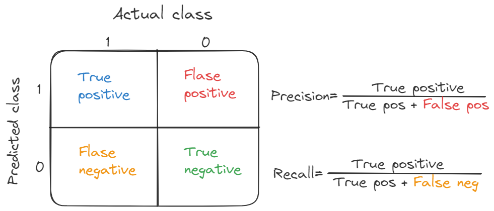

## Supervised learning-监督学习


 Learns from being given “**right answers**(labels)”


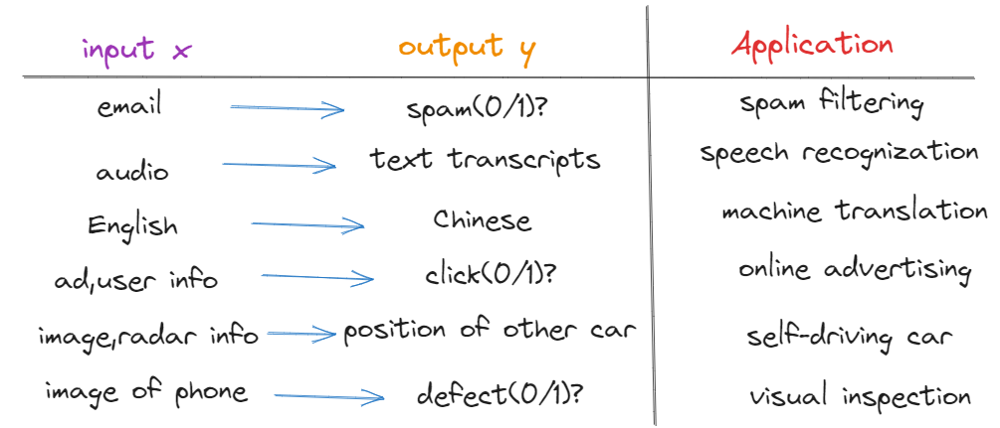


In all of these applications, we will first train our model with examples of inputs **x** and right answers, that is the labels **y**. After the model has learned from these input, output, or x and y pairs, they can take a brand new input x, something it has never seen before, and try to produce the appropriate corresponding output y.  


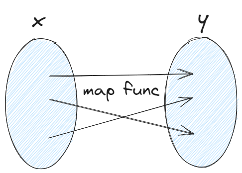


  The task of the supervised learning algorithm is to produce more of these right answers based on labels.  

Classification is to predict categories,Regression is to predict a number. 


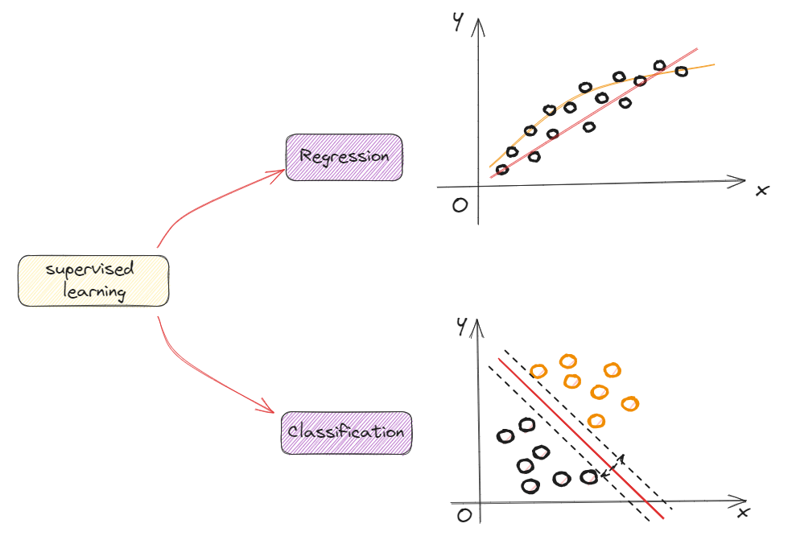


## Unsupervised learning-无监督学习


Learns from being given “**no-right answers**(unlabeled data)”, data only comes with inputs x, but not output labels y. Algorithm has to find structure automatically in the data and automatically figure out whether the major types of individuals.


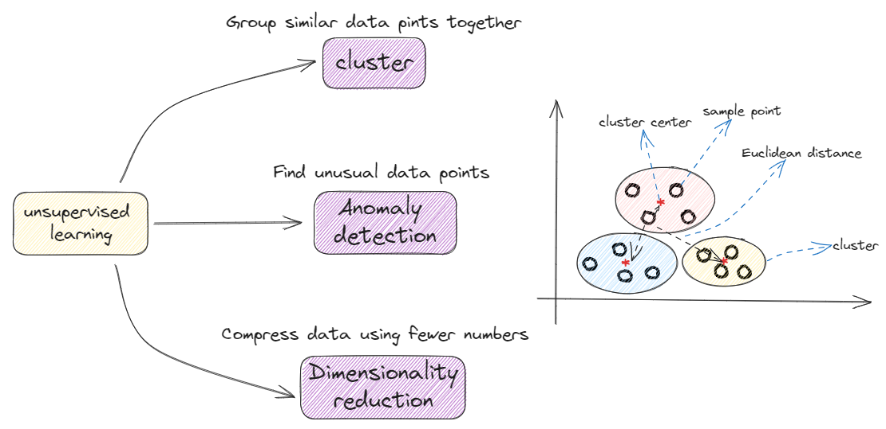


##  Linear Regression with one variable

### Definition

Linear regression means fitting a `straight line` to the data. ->linear regression  

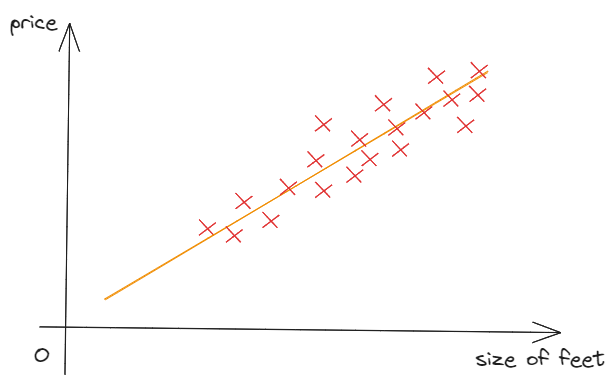

Regression model is to predict numbers

Classification model is to predicts categories

### **Terminology in ML**

`Training dataset`->data used to train the model

$x=$“input”variables feature

$y=$“output ”variables or “target”variables

$(x,y)=$single training example

$(x^{(i)},y^{(i)})=i^{th}$ training example not exponent

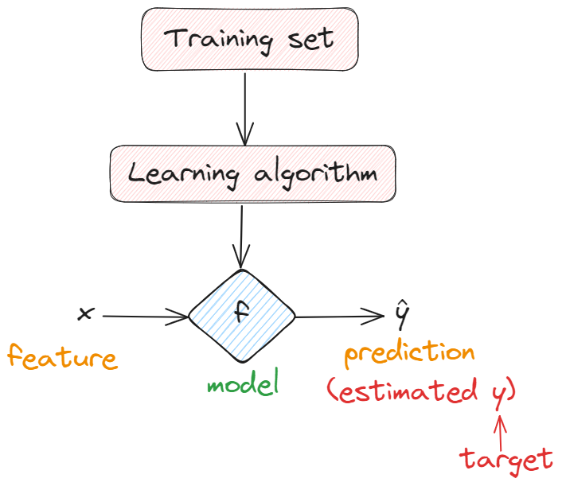

In the linear regression, we instantly believe the function is a linear function as follow:
$$
f_{w,b}(X)=wX+b \\
f(X)=wX+b
$$
when we give a “x”as a input variable, we can get a “y-hat”variable as a result.

### :triangular_ruler:Cost function

squared error
$$
\underset{i=1}{\overset{m}{\varSigma}}\left( \hat{y}^{\left( i \right)}-y^{\left( i \right)} \right) ^2
$$
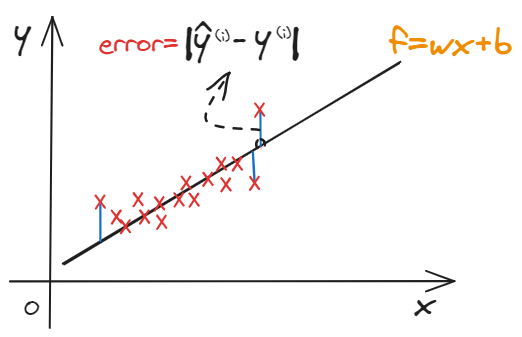

Model: $f_{w,b}(X)=wX+b$.	$w(slope),b(intersects)$ are parameters.
$$
J_{\left( w,b \right)}=\frac{1}{2m}\underset{i=1}{\overset{m}{\varSigma}}\left( \hat{y}^{\left( i \right)}-y^{\left( i \right)} \right) ^2=\frac{1}{2m}\underset{i=1}{\overset{m}{\varSigma}}\left( f_{w.b}\left( x^{\left( i \right)} \right) -y^{\left( i \right)} \right) ^2 \\ 
=\frac{1}{2m}\underset{i=1}{\overset{m}{\varSigma}}\left( wx^{\left( i \right)}+b-y^{\left( i \right)} \right) ^2
$$
Our goal is to minimize the parameters to fit the model:
$$
\underset{w.b}{\min}J\left( w,b \right)
$$

```python
#define cost function
def compute_cost(x,y,w,b):
    m = x.shape[0]
    cost_sum = 0
    for i in range(m):
        f_wb = w * x[i] + b
        cost = (f_wb - y[i]) ** 2
        cost_sum += cost
    total_cost = (1/(2*m))*cost_sum
    return total_cost
```


### Gradient descent-梯度下降

**Simultaneous update** the parameters w and b until the cost function is `convergence`:

Simultaneous update the parameters is significant, we must focus on the order about the algorithm.

Correct order:
$$
tmp\_w=w-\alpha \frac{\partial}{\partial w}J\left( w,b \right) 
\\
tmp\_b=b-\alpha \frac{\partial}{\partial b}J\left( w,b \right) 
\\
w=tmp\_w
\\
b=tmp\_b
$$
Incorrect order:
$$
tmp\_w=w-\alpha \frac{\partial}{\partial w}J\left( w,b \right) \\
w=tmp\_w \\
tmp\_b=b-\alpha \frac{\partial}{\partial b}J\left( w,b \right) \\
b=tmp\_b \\
$$

```python

#compute gradient
def compute_gradient(x,y,w,b):
    m = x.shape[0]
    dj_dw = 0
    dj_db = 0
    for i in range(m):
        f_wb = w * x[i] + b
        dj_dw_i = (f_wb - y[i]) * x[i]
        dj_db_i = f_wb - y[i]
        dj_dw += dj_dw_i
        dj_db += dj_db_i
    dj_dw = dj_dw / m
    dj_db = dj_db / m
    return dj_dw, dj_db
```


### Learning Rate

The choice of learning rate, alpha($\alpha$) will have a huge impact on the efficiency of our implementation of Gradient descent.
$$
w-\alpha \frac{\partial}{\partial w}J\left( w,b \right) 
\\
b-\alpha \frac{\partial}{\partial b}J\left( w,b \right)
$$
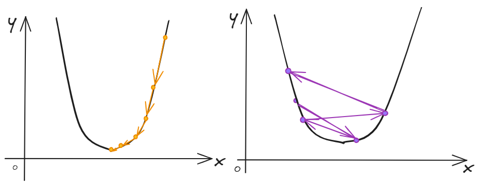

If we chose the alpha is too large, the fit efficiency is not very well. We can design the algorithm to decrease the alpha($\alpha$) following by the w and b.

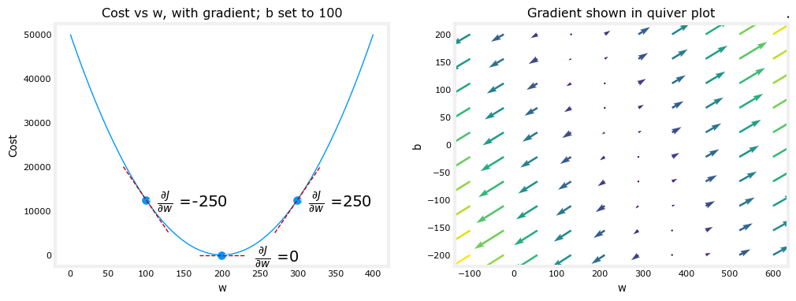


## Multiple linear regression

### Multiple Features

【Model】
$$
f_{\vec{w},b}\left( \vec{x} \right) =\vec{w}·\vec{x}+b=w_1x_1+w_2x_2+···+w_nx_n
$$
`Dot product(inner product)` of two vectors about $w$ and $b$.
$$
\vec{w}=\left[ w_1,w_2···,w_n \right] 
\\
\vec{x}=\left[ x_1,x_2···,x_n \right] 
$$
$x_j=j^{th} features$

$n = $ numbers of features

$\vec{x}^{(i)}$ = features of $i^{th}$ training example

$\vec{x}^{(i)}_j$ = value of feature j in  $i^{th}$ training example


### Vectorization

We contrast the two process between vectorization and without vectorization.

without vectorization

```python
for i in range(0,n):
    f = f + w[i]*x[i]
f = f + b
```

If n is infinite, the algorithm is time consuming.

with vectorization

```python
import numpy as np
f = np.dot(w,b)
```

 Without vectorization, we just only use the for loop to calculate the results one by one. In the contrast, we can use the function numpy.dot() to calculate the result. Using numpy can decrease the time complexity and improve the algorithm efficiency. Numpy can use `parallel process` hardware to carry out the data.

Dot product of two vectors:
$$
a·b=\underset{i=0}{\overset{n-1}{\varSigma}}a_ib_i=\left[ \begin{array}{l}
	\,\, a_0\\
	\,\, a_1\\
	\,\,···\\
	a_{n-1}\\
\end{array} \right] \left[ \begin{array}{l}
	\,\, b_0\\
	\,\, b_1\\
	\,\,···\\
	b_{n-1}\\
\end{array} \right] =\left[ a_0b_0+a_1b_1+···+a_{n-1}b_{n-1} \right] 
$$

### Gradient descent in Multiple regression

Parameters include $w_{1},w_{2},···w_{n}$ and $b$

Model is $f_{\vec{w},b}\left( \vec{x} \right) =\vec{w}·\vec{x}+b=w_1x_1+w_2x_2+···+w_nx_n+b$

Cost function is $J\left( w_{1},w_{2},···w_{n},b \right)$

Gradient descent:

	repeat{
$$
w_{j}=w_{j}-\alpha \frac{\partial}{\partial w_{j}}J\left(w_{1},w_{2},···w_{n},b \right)=w_{j}-\alpha \frac{\partial}{\partial w_{j}}J\left(\vec{w},b \right)
$$

$$
b=b-\alpha \frac{\partial}{\partial b}J\left(w_{1},w_{2},···w_{n},b \right)=b-\alpha \frac{\partial}{\partial b}J\left(\vec{w},b \right)
$$

}

`for i in range(1,n)`:
$$
\frac{\partial}{\partial w_{1}}J\left(\vec{w},b \right)=\frac{1}{m}\underset{i=1}{\overset{m}{\varSigma}}\left( f_{\vec{w},b}\left( \vec{x}^{\left( i \right)} \right) -y^{\left( i \right)} \right) x_{1}^{\left( i \right)} \\
\frac{\partial}{\partial w_{n}}J\left(\vec{w},b \right)=\frac{1}{m}\underset{i=1}{\overset{m}{\varSigma}}\left( f_{\vec{w},b}\left( \vec{x}^{\left( i \right)} \right) -y^{\left( i \right)} \right) x_{n}^{\left( i \right)} \\
\frac{\partial}{\partial b}J\left(\vec{w},b \right)=\frac{1}{m}\underset{i=1}{\overset{m}{\varSigma}}\left( f_{\vec{w},b}\left( \vec{x}^{\left( i \right)} \right) -y^{\left( i \right)} \right)
$$
Normal equation:

- Only for linear regression
- Solve for w,b without iterations

Disadvantages:

- Does not generalize to other learning algorithm
- Slow when number of features is large(n>10000)

### Feature engineering

The technology of Features scaling will enable Gradient descent to run much faster.

Z-score normalization:
$$
x_i=\frac{x_i-\mu}{\sigma}
$$
$\mu$ is the sample average value, and $\sigma$ is standard error of sample.

Aim for about $-1\leqslant x_j\leqslant 1$ for $x_{j}$.

The objective of Gradient descent in Multiple regression is:
$$
\underset{\vec{w}.b}{\min}\,\,J\left(\vec{w},b \right)
$$
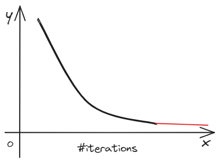

As the calculate process, $y=J\left(\vec{w},b \right)$ is decreased until a low score. If we can get the similar the result in the experiment, the cost function is `convergence` and we can find the min $J\left(\vec{w},b \right)$.

【**Skill**】

At the beginning, we can set the learning rate($\alpha$) in a small value like 0.001. As running the algorithm, we can update the parameter $\alpha$ gradually.(0.001->0.01->0.1)

**Feature Engineering** : Using `intuition` to design new features, by transforming or combining original features.

> [Wiki]:**Feature engineering** or **feature extraction** or **feature discovery** is the process of extracting features (characteristics, properties, attributes) from raw data.

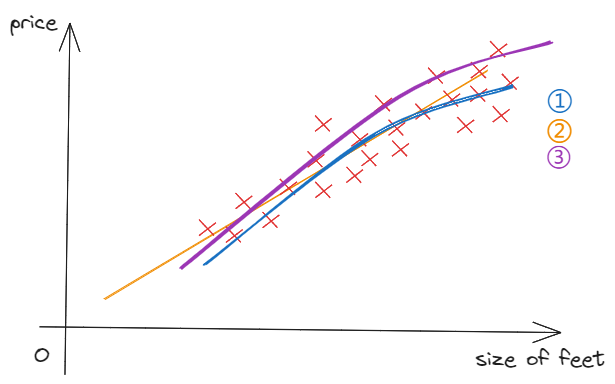

Except for using linear regression, we can also use `polynomial regression` to fit data. Through finding the segment of the data distribution(scatter), we can create special features($\sqrt{x}\quad x^3$) to fit data successfully.
$$
f_{\vec{w},b}\left( x \right) =w_1x+b\quad②
\\
f_{\vec{w},b}\left( x \right) =w_1x+w_2x^2+b\quad①
\\
f_{\vec{w},b}\left( x \right) =w_1x+w_2\sqrt{x}+b\quad③
$$

## Classification

It turns out that, linear regression is not the good algorithm for classification. For classification, the output is not a continuous number. In the fact, it is a class variable like **0(false-negative class)** or **1(true-positive class)**.

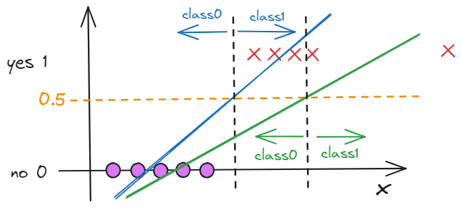

Sometimes, if we want to classify the output, the method of linear regression maybe not fit. Through the figure, the result of predict can be changed when we add a sample. The original fit result is the blue line, but, the new result is the green line. The standard of classification can be changed as the sample we adding.

### Logistic Regression

In this chapter, we will learn a useful algorithm model——`Logistic Regression` to solve the classification problem.

With linear regression method, the model is $f_{\vec{w},b}\left(x^{i} \right) =\vec{w}·x^{i}+b$, to predict $y$ given $x$. However, we would like the predictions of our classification model to be between 0 and 1 since our output variable $y$ is either 0 or 1.

This can be accomplished by using a `"sigmoid function"` which maps all input values to values between 0 and 1.

【sigmoid function】

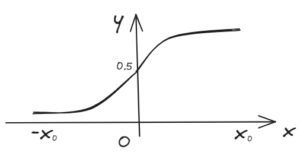

$$
g\left( Z \right) =\frac{1}{1+e^{-Z}},0<g\left( Z \right) <1
\\
f_{w,b}\left( X^{\left( i \right)} \right) =g\left( w·X^{\left( i \right)}+b \right) 
\\
f_{\vec{w},b}\left( \vec{x} \right) =g\left( \vec{w}·\vec{x}+b \right) =\frac{1}{1+e^{-\left( \vec{w}·\vec{x}+b \right)}}
$$

We can calculate the Z-score to classify the predict value by the probability.

$$
P\left( y=0 \right) +P\left( y=1 \right) =1
$$

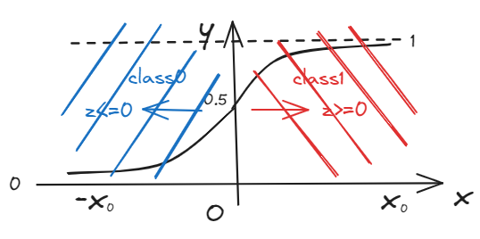

$$
f_{\vec{w},b}\left( \vec{X} \right) =P\left( y=1|\vec{X};\vec{w},b \right) 
\\ 
f_{\vec{w},b}\left( \vec{X} \right) =P\left( y=0|\vec{X};\vec{w},b \right)
$$

Probability that $y=1$  or $y=0$, given input $\vec{x}$, parameters $w,b$.

If $y=f_{\vec{w},b}\left( \vec{X} \right) > 0.5$ -> $g(Z)>0.5$ -> $Z>0$ -> $\vec{w}·\vec{x}+b > 0$ == YES $Y=1$.

Else, NO $y = 0$.

### Decision boundary

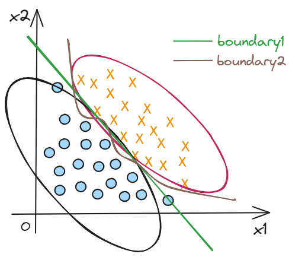


$$
g\left( Z \right) =g\left( w_1x_1+w_2x_2+b \right) 
\\ 
g\left( Z \right) =g\left( w_1x_1+w_2x_2+w_3x_1x_2+w_4x_{4}^{2}+b \right)\\
boundary1=w_1x_1+w_2x_2+b=0
\\
boundary2=w_1x_1+w_2x_2+w_3x_1x_2+w_4x_{4}^{2}+b=0
$$

###  Cost function for regularized logistic regression

Cost function:

$$
J_{\left( w,b \right)}=\frac{1}{m}\underset{i=1}{\overset{m}{\varSigma}}\frac{1}{2}\left( wx^{\left( i \right)}+b-y^{\left( i \right)} \right) ^2=L\left( f_{\vec{w},b}\left( \vec{x}^{\left( i \right)} \right) ,y^{\left( i \right)} \right)
$$

Our goal is to minimize the parameters to fit the model:

$$
\underset{w.b}{\min}\,\,J\left( w,b \right)
$$

**Simplified** loss function:

$$
L\left( f_{\vec{w},b}\left( \vec{x}^{\left( i \right)} \right) ,y^{\left( i \right)} \right) =\begin{cases}
	-\log \left( f_{\vec{w},b}\left( \vec{x}^{\left( i \right)} \right) \right) ,if\,\,y^{\left( i \right)}=1\\
	-\log \left( 1-f_{\vec{w},b}\left( \vec{x}^{\left( i \right)} \right) \right) ,if\,\,y^{\left( i \right)}=0\\
\end{cases}\\ \Longrightarrow \\
L\left( f_{\vec{w},b}\left( \vec{x}^{\left( i \right)} \right) ,y^{\left( i \right)} \right) =-y^{\left( i \right)}\log \left( f_{\vec{w},b}\left( \vec{x}^{\left( i \right)} \right) \right) -\left( 1-y^{\left( i \right)} \right) \log \left( 1-f_{\vec{w},b}\left( \vec{x}^{\left( i \right)} \right) \right)
$$


For regularized **logistic** regression, the cost function is of the form

$$
J(\mathbf{w},b) = \frac{1}{m}  \sum_{i=0}^{m-1} \left[ -y^{(i)} \log\left(f_{\mathbf{w},b}\left( \mathbf{x}^{(i)} \right) \right) - \left( 1 - y^{(i)}\right) \log \left( 1 - f_{\mathbf{w},b}\left( \mathbf{x}^{(i)} \right) \right) \right] + \frac{\lambda}{2m}  \sum_{j=0}^{n-1} w_j^2
$$

where:

$$
f_{\mathbf{w},b}(\mathbf{x}^{(i)}) = sigmod(\mathbf{w} \cdot \mathbf{x}^{(i)} + b)
$$


Compare this to the cost function without regularization (which you implemented in  a previous lab):

$$
J(\mathbf{w},b) = \frac{1}{m}\sum_{i=0}^{m-1} \left[ (-y^{(i)} \log\left(f_{\mathbf{w},b}\left( \mathbf{x}^{(i)} \right) \right) - \left( 1 - y^{(i)}\right) \log \left( 1 - f_{\mathbf{w},b}\left( \mathbf{x}^{(i)} \right) \right)\right]
$$

As was the case in linear regression above, the difference is the regularization term, which is   $\frac{\lambda}{2m}  \sum_{j=0}^{n-1} w_j^2$ 

Gradient descent:

repeat{

$$
tw_{j}=w_{j}-\alpha \frac{\partial}{\partial w_{j}}J\left(w_{1},w_{2},···w_{n},b \right)=w_{j}-\alpha \frac{\partial}{\partial w_{j}}J\left(\vec{w},b \right)
$$

$$
tb=b-\alpha \frac{\partial}{\partial b}J\left(w_{1},w_{2},···w_{n},b \right)=b-\alpha \frac{\partial}{\partial b}J\left(\vec{w},b \right)
$$

$$
w=tw_{j}\\
b=tb
$$

}

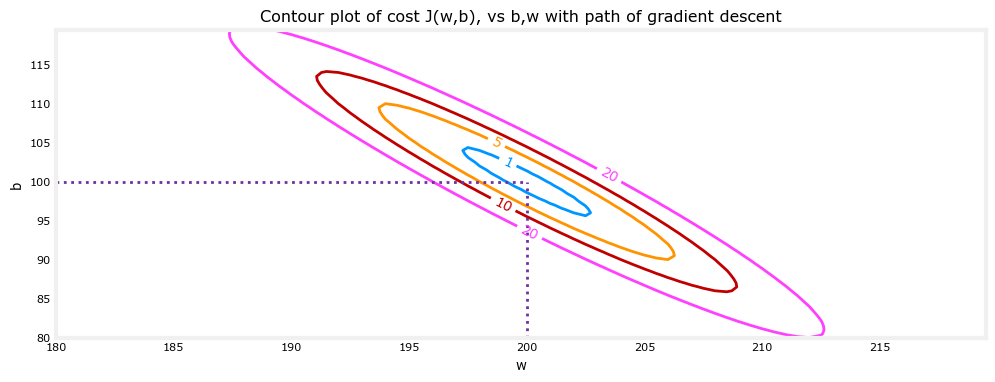

To provide the overfitting problem, we apply the regularized method to add the penalty coefficient. That is why the we add the $\frac{\lambda}{2m}\underset{j=1}{\overset{n}{\varSigma}}w_{j}^{2}$ at the end of the formula.

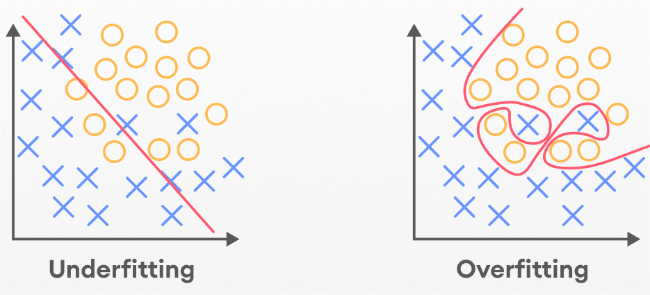

**Regularized**:

$$
J_{\left( \vec{w},b \right)}=\frac{1}{2m}\underset{i=1}{\overset{m}{\varSigma}}\left( \vec{w}·\vec{x}^{\left( i \right)}+b-y^{\left( i \right)} \right) ^2+\frac{\lambda}{2m}\underset{j=1}{\overset{n}{\varSigma}}w_{j}^{2}
\\
J_{\left( \vec{w},b \right)}=\frac{1}{2m}\underset{i=1}{\overset{m}{\varSigma}}\left( \vec{w}·\vec{x}^{\left( i \right)}+b-y^{\left( i \right)} \right) ^2+\frac{\lambda}{2m}\underset{j=1}{\overset{n}{\varSigma}}w_{j}^{2}+\frac{\lambda}{2m}\underset{j=1}{\overset{n}{\varSigma}}b_{j}^{2}
$$


The gradient calculation for both linear and logistic regression are nearly identical, differing only in computation of $f_{\mathbf{w}b}$.

$$
\frac{\partial J(\mathbf{w},b)}{\partial w_j}  &= \frac{1}{m} \sum\limits_{i = 0}^{m-1} (f_{\mathbf{w},b}(\mathbf{x}^{(i)}) - y^{(i)})x_{j}^{(i)}  +  \frac{\lambda}{m} w_j\\ \\
$$

$$
\frac{\partial J(\mathbf{w},b)}{\partial b}  = \frac{1}{m} \sum\limits_{i = 0}^{m-1} (f_{\mathbf{w},b}(\mathbf{x}^{(i)}) - y^{(i)})
$$

* m is the number of training examples in the data set      
* $f_{\mathbf{w},b}(x^{(i)})$ is the model's prediction, while $y^{(i)}$ is the target

* For a  <span style="color:blue"> **linear** </span> regression model 
    $f_{\mathbf{w},b}(x) = \mathbf{w} \cdot \mathbf{x} + b$  
* For a <span style="color:blue"> **logistic** </span> regression model 
    $z = \mathbf{w} \cdot \mathbf{x} + b$ \ $f_{\mathbf{w},b}(x) = g(z)$ 
    where $g(z)$ is the sigmoid function: 

$$
g(z) = \frac{1}{1+e^{-z}}
$$

```python
#cpmpute cost function through itertion process
def gradient_descent(x,y,w_in,b_in,alpha,num_iters,cost_function,gradient_function):
    w = copy.deepcopy(w_in)
    J_history = []
    p_history = []
    b = b_in 
    w = w_in
    for i in range(num_iters):
        # Calculate the gradient and update the parameters using gradient_function
        dj_dw,dj_db = gradient_function(x,y,w,b)
        # update the parameters 
        b = b - alpha * dj_db
        w = w - alpha * dj_dw
        # Save cost J at each iteration
        if i < 100000:
            J_history.append(cost_function(x,y,w,b))
            p_history.append([w,b])
        # Print cost every at intervals 10 times or as many iterations if < 10
        if i % math.ceil(num_iters/10) == 0:
            print(f"Iteraton {i:4}: Cost {J_history[-1]:0.2e}",f"dj_dw: {dj_dw: 0.3e}, dj_db: {dj_db: 0.3e}",f"w: {w: 0.3e}, b:{b: 0.5e}")
    return w,b,J_history,p_history
```


## Neural Network

### How to install TensorFlow

- conda install tensorflow
- pip install tensorflow

### How the brain works

The following picture shows the basic structure about neutral network. Like human`s neutral cell, it passes information by layers, which every cell includes a logistic function.

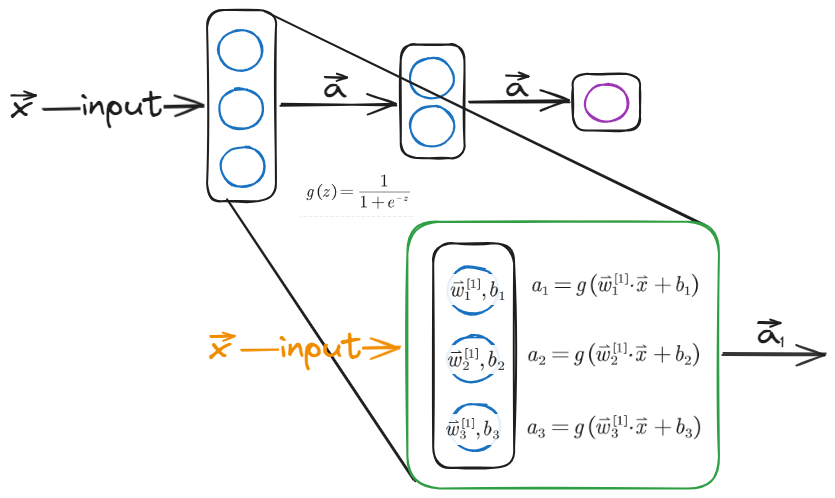


### Data format in Tensorflow

`matrix and tensor`

Numpy, a standard library created in 1970s, is used to calculate linear algebra in python(data analysis). Tensorflow is a machine learning framework created by Google.

In Tensorflow, the input format must **a matrix**. We should focus on the special characteristic in our work.

```python
a = np.array([1,2,3])#一维数组
b = np.array([[1,2,3]])#一维矩阵
x = np.array([
    [1,2,3],
    [4,5,6],
    [11,12,14],
])#3X3矩阵
Z = np.matmul(A_in,W) + B #input matrix to simplify for loop
```

### Build a Tensorflow

1. build the structure of the model
2. compile the model
3. input training data
4. fit the model
5. predict the model

```python
1.
layer_1 = Dense(units=25,activation='sigmoid')
layer_2 = Dense(units=15,activation='sigmoid')
layer_3 = Dense(units=1,activation='sigmoid')
model = Sequential([layer_1,layer_2,...layer_n])
----------------------------
model = Sequential([
    Dense(units=25,activation='relu'),
    Dense(units=15,activation='relu'),
    Dense(units=1,activation='sigmoid')
])
2.
model.compile()
3.
x = np.array([[0...,245,...,17],[0...,200,...,284]])
y = np.array([1,0])
4.
model.fit
5.
model.predict(x_new)
```

### Implementation of the preceding communication

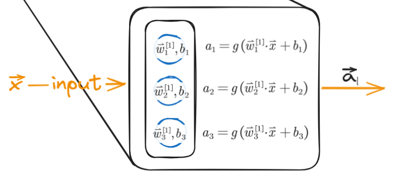
$$
\vec{w}_{1}^{\left[ 1 \right]}=\left[ \begin{array}{c}
	1\\
	2\\
\end{array} \right] ,\vec{w}_{2}^{\left[ 1 \right]}=\left[ \begin{array}{c}
	-3\\
	4\\
\end{array} \right] ,\vec{w}_{3}^{\left[ 1 \right]}=\left[ \begin{array}{c}
	5\\
	-6\\
\end{array} \right] 
$$


```python
W = np.array([
    [1,-3,5],
    [2,4,-6]
]) 
b = np.array([-1,1,2])
a_in = np.array([-2,4])
```

Implement the coding of dense function with python:

```python
def dense(a_in,W,b,g):
    #units equals to the numbers of cols of W
    units = W.shape[1]
    #Create a matrix with the same size of units--[0,0,0]
    a_out = np.zeros(units)
    #compete the g(z)
    for j in range(units):
        w = W[:,j]
        z = np.dot(w,a_in) + b[j]
        a_out[j] = g(z)
    return a_out

def sequential(x):
    a1 = dense(x,W1,b1)
    a2 = dense(a1,W2,b2)
    a3 = desne(a2,W3,b3)
    a4 = dense(a3,W4,b4)
    f_x = a4
    return f_x
    
    
```

### Choose activation function

Three types activation function:

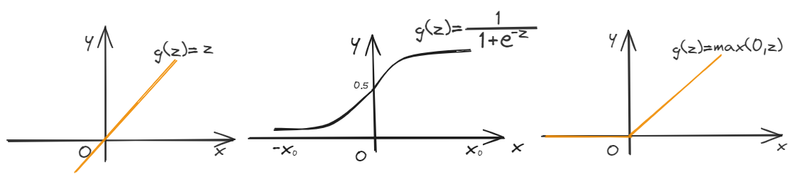

```py
activation="linear"
activation="sigmoid"
activation="relu"
```

| type y  | 0/1                  | +/-        | 0/+        |
| ------- | -------------------- | ---------- | ---------- |
| sigmoid | binary classfication |            |            |
| linear  |                      | regression |            |
| relu    |                      |            | regression |

[why we need activation function?]

If we use the linear activation function in  hidden layers all the time, the predict results of neutral network equal to linear regression. that`s why we should use sigmoid or relu function as the activation function to build the network.

### Soft-max regression

Softmax function has been used to solve the  multi-class problem. Essentially, it is still a **classification problem** `based on probability`. The expression of Softmax function as follow:
$$
z_j=\vec{w}_j·\vec{x}+b_j\\
a_j=\frac{e^{z_j}}{\underset{k=1}{\overset{n}{\varSigma}}e^{z_k}}=P\left( y=j|\vec{x} \right)
$$
a_j is the possibility of predict result.

The cost function of Soft-max function is:
$$
a_N=\frac{e^{Z_N}}{e^{Z_1}+e^{Z_2}+\cdot \cdot \cdot +e^{Z_N}}=P\left( y=N|\vec{x} \right)
$$

$$
loss\left( a_1,...,a_N,y \right) =\begin{cases}
	-\log a_1\,\,if\,\,y=1\\
	-\log a_2\,\,if\,\,y=2\\
	\vdots\\
	-\log a_n\,\,if\,\,y=n\\
\end{cases}
$$
The result is `one of` the loss functions. 

### Output of the soft-max

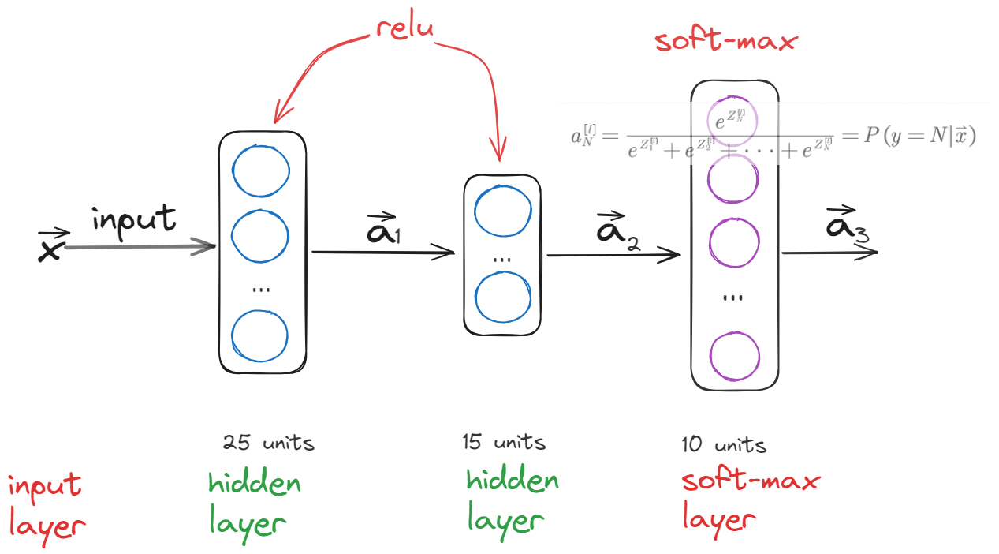

The outcome of soft-max classification is multiply. Every outcome will be competed a score to predict the right answer. 

Carefully, the loss function we must choose the `SparseCategoricalCrossentropy`.
$$
a_{N}^{\left[ l \right]}=\frac{e^{Z_{N}^{\left[ l \right]}}}{e^{Z_{1}^{\left[ l \right]}}+e^{Z_{2}^{\left[ l \right]}}+\cdot \cdot \cdot +e^{Z_{N}^{\left[ l \right]}}}
\\
-\log a_{N}^{\left[ l \right]}\ne -\log \frac{e^{Z_{N}^{\left[ l \right]}}}{e^{Z_{1}^{\left[ l \right]}}+e^{Z_{2}^{\left[ l \right]}}+\cdot \cdot \cdot +e^{Z_{N}^{\left[ l \right]}}}
$$
The difference of competing order can lead to the different outcome, which has different model accurancy.

### Improve the soft-max model

In order to improve the accuracy of calculations, we have made the following improvements to the model algorithm:

- In soft-max layer, we adopt the `linear` function as the activation.
- In the process of compiling model, we add a parameter to improve the accurancy.

```python
#linear function as the activation function in the soft-max layer
model = sequential([
    Dense(units = 25, activation="relu")
    Dense(units = 15, activation="relu")
    Dense(units = 10, activation="linear")
])
#add parameter:from_logits=True 
model.compile(loss=SparseCategoricalCrossentropy(from_logits=True))
model.fit(X,Y,epochs=100)
logit = model(X)
f_x = tf.nn.sigmoid(logit)
```

### MNIST Adam

## Evaluating a model

### Data set

Model fits the training data well(over-fit) but will fail to generalize to new examples not in the training set.

Hence, we need to **partition the dataset** to test the accurancy of the model.

The data set was divided into `test set` and `train set`.

【regression】

Fit parameters by minimizing cost function $J( \vec{w},b)$:

$$
J\left( \overrightarrow{w},b \right) =\underset{\overrightarrow{w},b}{\min}\left[ \frac{1}{2m_{train}}\underset{i=1}{\overset{m_{train}}{\varSigma}}\left( f_{\overrightarrow{w},b}\left( \vec{x}^{\left( i \right)} \right) -y^{\left( i \right)} \right) ^2+\frac{\lambda}{2m_{train}}\underset{j=1}{\overset{n}{\varSigma}}\omega _{j}^{2} \right]
$$

compute test error:


$$
J_{test}\left( \overrightarrow{w},b \right) =\frac{1}{2m_{test}}\left[ \underset{i=1}{\overset{m_{test}}{\varSigma}}\left( f_{\overrightarrow{w},b}\left( \vec{x}_{test}^{\left( i \right)} \right) -y_{test}^{\left( i \right)} \right) ^2 \right]
$$

compute train error:

$$
J_{train}\left( \overrightarrow{w},b \right) =\frac{1}{2m_{train}}\left[ \underset{i=1}{\overset{m_{train}}{\varSigma}}\left( f_{\overrightarrow{w},b}\left( \vec{x}_{train}^{\left( i \right)} \right) -y_{train}^{\left( i \right)} \right) ^2 \right]
$$


【train】

Fit parameters by minimizing cost function $J( \vec{w},b)$:


$$
J\left( \overrightarrow{w},b \right) =-\frac{1}{m}\underset{i=1}{\overset{m}{\varSigma}}\left[ y^{\left( i \right)}\log \left( f_{\overrightarrow{w},b}\left( \vec{x}^{\left( i \right)} \right) \right) +\left( 1-y^{\left( i \right)} \right) \log \left( 1-f_{\overrightarrow{w},b}\left( \vec{x}^{\left( i \right)} \right) \right) \right] +\frac{\lambda}{2m}\underset{j=1}{\overset{n}{\varSigma}}\omega _{j}^{2}
$$

compute test error:

$$
J_{test}=-\frac{1}{m_{test}}\underset{i=1}{\overset{m_{test}}{\varSigma}}\left[ y_{test}^{\left( i \right)}\log \left( f_{\overrightarrow{w},b}\left( \vec{x}_{test}^{\left( i \right)} \right) \right) 
+\left( 1-y_{test}^{\left( i \right)} \right) \log \left( 1-f_{\overrightarrow{w},b}\left( \vec{x}_{test}^{\left( i \right)} \right) \right) \right]
$$

compute train error:

$$
-\frac{1}{m_{train}}\underset{i=1}{\overset{m_{train}}{\varSigma}}\left[ y_{train}^{\left( i \right)}\log \left( f_{\overrightarrow{w},b}\left( \vec{x}_{train}^{\left( i \right)} \right) \right) +\left( 1-y_{train}^{\left( i \right)} \right) \log \left( 1-f_{\overrightarrow{w},b}\left( \vec{x}_{train}^{\left( i \right)} \right) \right) \right]
$$

### Model selection and cross validation

If we want to fit a function to predict a problem or classification, we often use test error $J_{test}$ to judge the accurancy of the model. But, the J test is likely to be an `optimistic estimate` of generalization error. Because, when we choose the degree of parameter d in polynomial fit.,This fit of J test may lower than the actual estimate. The optimistic estimate can lead to a low score of J_test.

So, we need to partition the dataset as three parts to avoid optimistic estimate:

- training set
- cross validation set
- test set

compute cross validation error:


$$
J_{cv}\left( \overrightarrow{w},b \right) =\frac{1}{2m_{cv}}\left[ \underset{i=1}{\overset{m_{cv}}{\varSigma}}\left( f_{\overrightarrow{w},b}\left( \vec{x}_{cv}^{\left( i \right)} \right) -y_{cv}^{\left( i \right)} \right) ^2 \right] 
$$


### Diagnosing bias and variance

Have idea-Train model-Diagnose bias and variance

 $J_{train}$ reflects bias, and  $J_{cv}$ reflects variance. A perfect model has low  $J_{train}$ and low  $J_{cv}$.

As the increasing of degree of d, $J_{train}$ will typically go down. Meanwhile, $J_{cv}$ will also go down and then it will increase.$J_{cv}$ will have a min value for different degree of d.

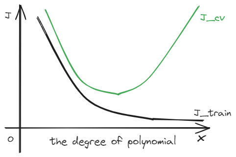

How do you tell if our algorithm has a bias or variance problem?

- High bias(under fit): $J_{train}$ will be high($J_{train}\approx J_{cv}$)
- High variance(over fit): $J_{cv}$>>$J_{train}$($J_{train}$ may be low)
- High bias and High variance $J_{train}$ will be high and $J_{cv}$>>$J_{train}$


### Regularization and bias/variance

A large neutral network will usually do as well or better than a smaller one so long as regularization is chosen appropriately.

```python
layer_1 = Dense(units=25,activation="relu",kernal_regularizer=L2(0.01))
layer_2 = Dense(units=15,activation="relu",kernal_regularizer=L2(0.01))
layer_1 = Dense(units=1,activation="sigmoid",kernal_regularizer=L2(0.01))
model = Sequential([layer_1,layer_2,layer_3])
```


### Learning curves

When we increase the size of training set, the train error will increase. But, the error of cross validation will decrease. As the increasing of sample points. a regression function(a line or a curve) cannot fit all the point.

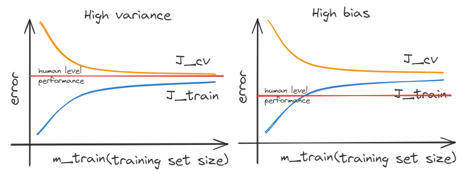

If a algorithm suffers from high variance, getting more training data is **likely** to help.

If a algorithm suffers from high bias, getting more training data **will not** help much.

【Debugging algorithm】

we have implemented the regularized linear regression:


$$
J\left( \overrightarrow{w},b \right) =\underset{\overrightarrow{w},b}{\min}\left[ \frac{1}{2m}\underset{i=1}{\overset{m}{\varSigma}}\left( f_{\overrightarrow{w},b}\left( \vec{x}^{\left( i \right)} \right) -y^{\left( i \right)} \right) ^2+\frac{\lambda}{2m}\underset{j=1}{\overset{n}{\varSigma}}\omega _{j}^{2} \right]
$$


|            operation            | what should do      |
| :-----------------------------: | ------------------- |
|   get more training examples    | fixes high variance |
|  try smaller sets of features   | fixes high variance |
| try getting additional features | fixes high bias     |
| try adding polynomial features  | fixes high bias     |
|    try decreasing  $\lambda$    | fixes high bias     |
|    try increasing  $\lambda$    | fixes high variance |

`Trade-off`

Simple model($f_{\overrightarrow{w},b}\left( x \right) =w_1x+b$) will get high bias VS complex model($f_{\overrightarrow{w},b}\left( x \right) =w_1x+w_2x^2+w_3x^3+w_4x^4+b$) will get high variance.

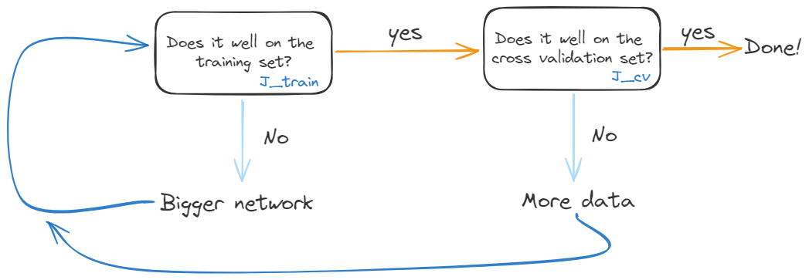

### Cycle of machine learning

The cycle of ML process:

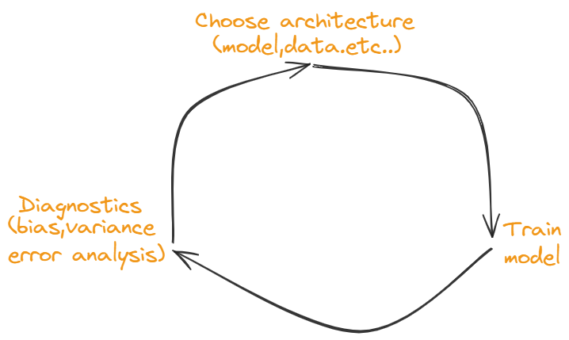

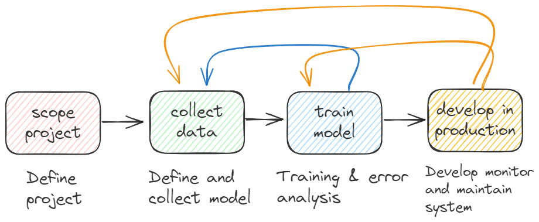

How to apply the ML model to solve the actual problem in software engineering design?


ML model is collected in the inference server. we use mobile app through API call to achieve these function.

### Precision and Recall

**Precision** (also called positive predictive value) is the fraction of relevant instances among the retrieved instances.

**Recall** (also known as sensitivity) is the fraction of relevant instances that were retrieved. 

We design a `confusion matrix` to show it:


In the trade-off  between Precision(P) and Recall(R), we use F1 score to evaluate the efficiency about the model.

the trade-off  between Precision(P) and Recall(R) has shown in the figure:

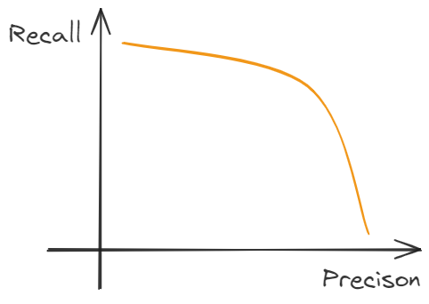


$$
F1=\frac{1}{\frac{1}{2}\left( \frac{1}{P}+\frac{1}{R} \right)}=\frac{2PR}{P+R}
$$


## Decision tree

The structure of a decision tree:

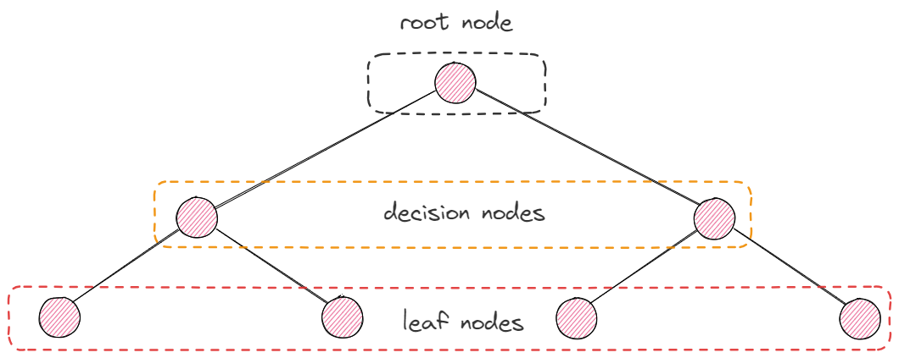


### Methods chosen

For Signal Decision tree, we should focus on the problem is that the data features.

If the data is  discrete(just like 0 or 1), we can build the Signal Decision tree model. But,a row data may includes more than two classes, in this situation we should use `one-hot encoding`.

> one-hot encoding only fit for the decision tree model.

If the data has continuous data(not only just like 0 or 1), we should split on a continuous variance.

For Multiple trees, we can use **Random Forest** and **XGboost** algorithm to solve.

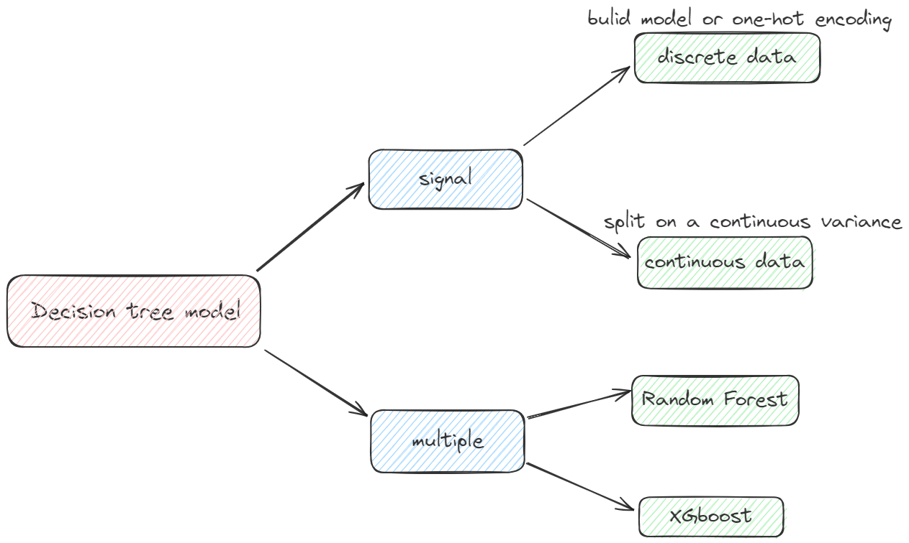

### Purity(entropy)

$p_{1}$ = fraction of examples that are True.

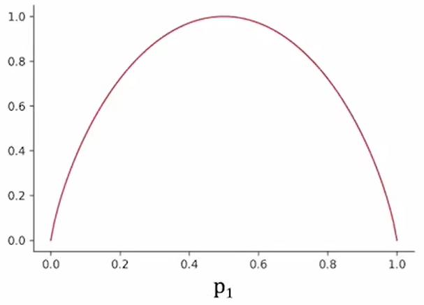


$$
H\left( p_1 \right) =-p_1\log \left( p_1 \right) -p_0\log \left( p_0 \right) 
\\
=-p_1\log \left( p_1 \right) -\left( 1-p_1 \right) \log \left( 1-p_1 \right)
$$

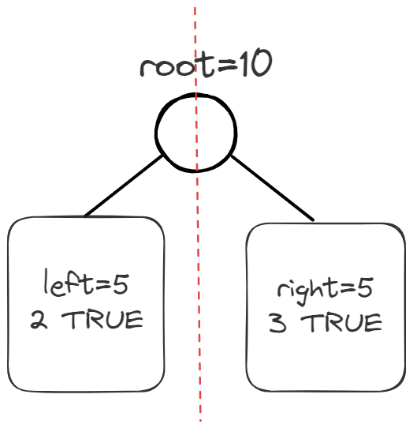


In this figure, $w^{left}$=2/5、 $w^{right}$=3/5、$p_{1}^{left}$=5/10、$p_{2}^{left}$=5/10.

Information Purity


$$
Information Purity =H\left( p_{1}^{root} \right) -\left( w^{left}H\left( p_{1}^{left} \right) +w^{right}H\left( p_{1}^{right} \right) \right)
$$

We should choose the `max` value of the Information Purity to **recursive** the decision tree model, which is called `Information Gain`.

In the process of split on a continuous variance(**Regression tree**), we also choose the max decreasing variance result as a good fit model.

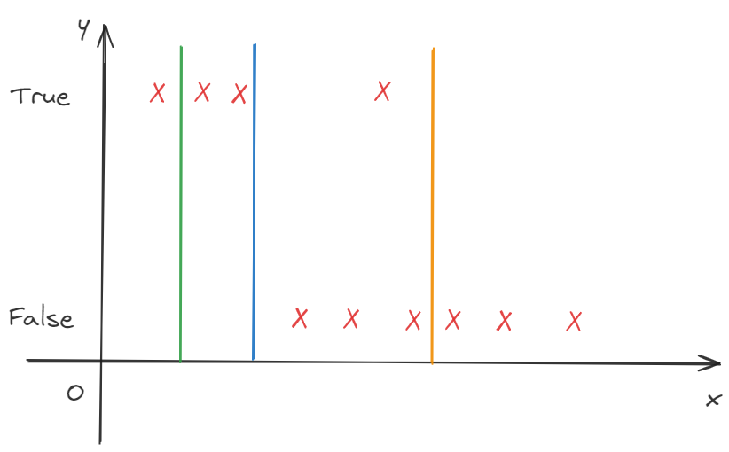

The purity of regression tree(equal to information gain):


$$
D=V^{root}-\left( w^{left}V^{left}+w^{right}V^{right} \right)
$$

V instead of `variance`.

### Decision tree learning

- Start with all examples at the root node
- Calculate information gain for all features, and pick the one with the highest information gain
- Split dataset according to selected features, and create left and right branches of the tree
- Keep repeating splitting process until stopping criteria is met:

			```
	when a node is 100% one class
	
			when splitting a node will result in the tree exceeding a maximum depth
		
			Information gain from additional splits is less than threshold
		
			when number of examples in a node is below  a threshold
	```


## Decision tree VS Neutral network


### Decision tree

- Works well on tabular(structured) data
- Not recommended for unstructured data(images,audios,text)
- Small decision tree may be human interpretable

### Neutral network

- Works well on all types of data,including tabular(structured) data and unstructured data(images,audios,text)
- May be slower than decision tree
- Works with transfer learning
- When building a system of multiple models working together, it might be easier to string together multiple neutral network


## SVM-支持向量机


## 模型优化

L1、L2范数

正则化

归一化


