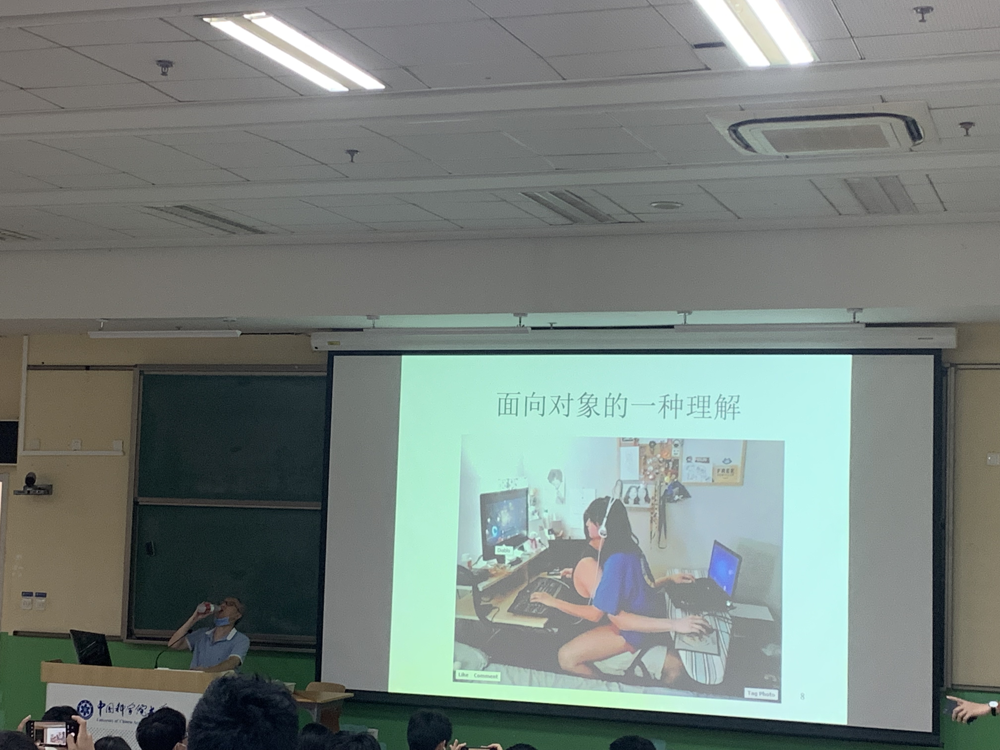


天下大事，必做于细

站在设计者的角度去思考问题



## 把程序写成东西

感谢今生遇见杨力祥老师！！！活了20多年了，第一次遇到一位将面向对象思想讲解这么透彻的老师。

老师一上来的课程就非常硬核，告诉我们，**面向对象就是把程序写成东西**

以麦当劳炸薯条的例子，教会我们区分面向过程和面向对象。面向过程就是流程化，第一步做什么第二部做什么。。。最后一步做什么。规则、时间、火候、尺寸必须一点都不能差。

而面向对象是将工作的各个流程打包成几个“东西”，任何人只要学会使用这个东西，就可以炸出麦当劳家的高质量薯条。

## 复用

为什么要学面向对象？有什么好处？

答案就是：**复用**，程序写一次，在不修改的情况下大量拷贝使用。而复用的本质是**共性**，程序只有写成东西才容易找到共性。

杨老师还从人类思维认知起源给我们讲起，人类最初学会的工作就是`分类`，引申出类和对象的关系。将分类比做一个多叉树，在实际思考时，是自下而上抽取共性，抽象就是脱离形式提取共性，但写的时候从上到下派生。

为什么把程序写成东西就容易复用？

因为人类祖先最早学会的技能就是分类，根据东西的**共性**进行分类，面向对象根本目的是提高复用率。

程序写成东西的唯一目的就是复用。复用就是自己可以作为贡献者也可以作为创新者。

不要做“万能工具箱类”，万能工具箱类不可以进行程序的复用，谁都可以拿来用。

## 共性与个性

共性+差异=个性

面向对象提高效率的理论基础与使用依据：**共性远远远远大于差异，但是差异体现价值**，自然界的事物亦如此。

继承派生的过程中加入了多态的思想，于是产生了个性的差异价值；如果只是单纯的继承派生无法体现出个性的差异价值。

虚函数是技术、多态是思想。

越能加入差异反而复用率越多，越能体现差异越能找到共性。

加机制产生变异，减机制适者生存。

## 创新思维

创新力与创新思维不是天生的，一定是要经过后天大量培训锻炼出来的。分析问题要抓住本质，这句话很空，但是很难做到。

作为未来的计算机从业者，凡事用数据和计算的思维去思考。

开源的东西想卡脖子也是很容易的，代码很难体现出思想上的变化。

## 鉴赏力

不管是机器还是人，提高鉴赏力尤为重要。

## C语言拾遗

1.为什么要发明C++/为什么要复用，单纯使用C语言不行吗？

面向对象就是把程序写成东西，东西可以复用。实际生产生活中，利益趋使、采取封装，采取找边界，采取把程序写成东西，可以省钱，这才是最重要的原因！

面向对象就是把程序写成东西，是东西就要有边界(水是唯一能想到的唯一没有边界的东西)。而硬件无法做到边界感，需要人为创造，编译器看着阻止越界。

边界靠编译器维护，所以不要耍小聪明越级跳过编译器。

2.C与C++区别与联系

class从c语言中struct衍生而来，只是多了成员函数与访问控制（public、private，protected）

**class is type**

**类作用域**：function::method1()，过去函数库的玩法不行了，面向对象需要的是类库

~~~c++
//a也是一个对象
int   a;
//CDate类的实例化
CDate odate;
~~~

对象在内存中的存储：内存中只有对象：对象的内存结构是只存一份代码，但是存有n个数据

3.业界规范编码

每一个类写两个文件(以CDate类为例)：一个CDate.h文件放在Headers File文件夹下，另一个是CDate.cpp文件放在Source File文件夹下。

~~~c++
//Headers File/CDate.h
//头文件中只声明类和函数
class CDate{
private://不允许从类的外部直接访问、修改成员变量
  int m_iYear;
  int m_iMonth;
  int m_iDay;
public:
  int isLeapYear();
  void Print();
  void Set(int,int,int);
};

//Source File/CDate.cpp
//头文件中只声明类和函数
#include<iostream>
#include"CDate.h"

int CDate::isLeapYear(){
  
}

void CDate::Print(){
  cout << m_iYear << "\" << m_iMonth << "\" << m_iDay << endl;
}

void CDate::Set(int y,int m,int d){
  //函数定义
}
~~~

4.声明与定义

操作系统通电即有值（0010010101010....）

什么叫函数声明？-只给编译器看不占内存

函数声明的作用：函数的栈空间是靠函数的声明开辟的，被调函数的形参空间是主调函数做出来的。而空间大小有参数的类型决定，仅仅告诉编译器要撑多大空间。

函数外不能进行赋值运算，编译完是指令的（动作）必须进函数。无论是变量还是函数，只要**定义就要在内存中出东西**。

所有C语言编译完是指令的，一定要进函数，不能在全局位置，指令必须存在函数内部。函数调用必须也要在函数内部进行，main函数是出发点。

~~~c++
#include<iostream>
int a;//变量的声明，全局变量直接在内存中静态代码区赋值为0
int b;
b = 5//函数外的赋值操作，编译报错！！
int c = 10;//定义了一个变量c并初始化为10，与前两行不等价
int main(){
  int a = 1;//变量的声明+定义 
  
}
~~~

main函数存在的意义：

禁止全局的语句进行运算操作，函数调用也是语句

1）编译完是指令的（动作）必须进函数

2）函数调用是指令也要进函数

3）总要有一个初始调用，于是mian函数来干这件事

5.狗屎值与野指针

~~~c++
int main(){
  int a;//生成狗屎值-只声明不赋值
  //千万不要这么写
	int *p;//野指针-指向位置随机，危险系数极大
	*p = 5;//给一个随机位置赋值，会发生难以预料的危险，如果这个指针指向了内核
}

~~~

C++有两类人，一类是负责设计类机构的，另一部分是基于类架构写程序的人

C++语言的设计与演化

## 接受工头的思想

工头就是抽取共性，事物都是共性大于差异。

可以从Vector类中的set、get方法出发，用public方法去修改private数据。

程序写成东西，东西就是要有一套数据和一套配套数据的操作，面向对象也是相对独立、完整的东西，就像每一个人一样。数据都要private，修改数据要用借助public方法。

五子棋的工头和围棋的工头抽取共性，然后从大共性中派生出象棋的工头、跳棋的工头。。。。

要把东西就要放在一眼看的范围

虚函数是C++面向对象程序设计中影响最显著的特性（影响的是复用）。

虚函数赋值0为纯虚函数，虚函数为抽象类，其不能创建对象。

添加差异获取复用共性的收益。

虚函数在基类和派生类中必须是一模一样！

对于一些程度词，读书的时候要重点关注，什么是好？什么是最显著？

## 设计思想

写程序前要成为行业专家，挣钱多是因为活不好干

面向对象的程序设计学会画两种设计图：

- 类架构图
- 对象图

会画图、会设计是理清思路的关键！

以银行系统为例：能把人民币取款和微信取款两个行为的共性抽取出来，写出来才是能力。

真正的共性是脱离了具象的，更接近本质，既体现了内在含义，又脱离了具体的对象，同时又是各个多态共有的东西。

