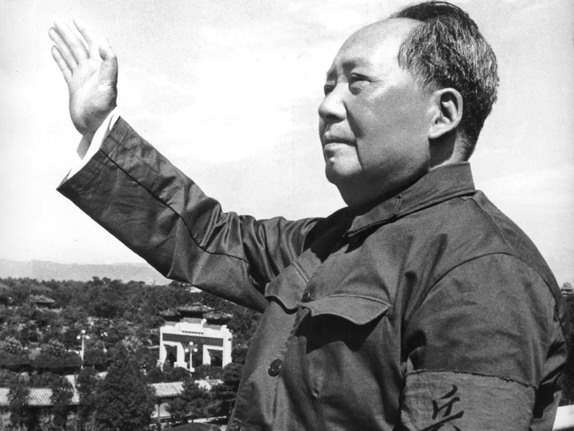


今日欢呼孙大圣，只缘妖雾又重来


# 唯物辩证法的基本规律

《大众哲学》——艾思奇

唯物主义者必须让自己养成一种习惯：遇到任何事情、任何问题，都能够认真地做系统周密的调查研究，把事物本身的规律寻找出来，然后按照规律去办事，去解决问题，去指导工作，使事情办的好，问题得以顺利解决，工作做的有成绩，不至于碰钉子，或者至少不碰大钉子。

不如意和碰钉子的原因是因为我们的主观意愿和事物的客观规律不符合！

世界上一切事物，是在我们的主观心意之外独立存在着的，它们的发展变化情况不是依赖我们的心意为转移的。世界上的事情，绝对不是我们想要怎样就怎样的，相反的，常常是我们希望这样，而偏偏事实上就不会这样。考试失利、投资失败、分手失恋、失业…

“凡事不会无缘无故的发生”，这就是“无风不起浪”这一个成语包含的最主要的哲学思想，这种思想在每个人的头脑中普遍存在着，其实每个人都相信，一切事物的发生，它的出现总有一定的原因，一定道理。一切事物不会凭空产生和消失，任何事物都有它发生、发展和没落的过程。

# 实践论

用联系和运动的观点看待事物的发展

# 矛盾论

对立统一

在研究一切问题的时候，注意到事物发展的曲折性，不要把事物的发展，看作一条直线上升，而没有任何迂回、后退、停滞的形式，也不要把任何事物的发展看作是简单的循环，而不注意它由低级到高级的上升。事物的发展是曲折的，螺旋式上升的。

## 战略战术分析

中国红色政权存在的原因

井冈山斗争

论持久战

抗日游击战争的战略问题

# 预见力与原则

## 原则

1.独立自主

独立自主、自力更生，在此基础之上来尽可能多的争取外援。合理的看待外援也是一种辩证法。

只有坚持独立自主，自己把自己照顾好，让自己强大起来，才能帮助到父母和家人，才能真正帮助到朋友。否则都是假的。

白手起家还需要独立自主。

爱别人，首先爱自己。

让步一定是积极的而不是消极的，本质是为了更好的合作，同样，让步也是有一定界限的。

2.实事求是

实事——客观存在的一切事物

求——调查研究

是——客观事物的内部联系，即规律性

实事：研究一切问题都要从实际事物出发，而不是从理论、概念、观点和定义出发。

求是：研究事物的规律，总结事物的规律，然后用规律指导行动。

3.群众路线

群众路线就是不脱离不脱离社会实际，因为群众是构成社会实际最基础的基础。

## 预见力

什么事预见力？就是将矛盾发展演变成种种趋势加以判断，然后对自己主观能动性加以判断，最后得出事物发展的最大可能性。并且把这种可能性和必然性指出来，辅助以相应的对策，最后取得胜利。

在复杂的事物也是由简单事物的叠加组成的，提高预见力与洞察力，本质上就是需要我们擅长事物的矛盾分析和条件分析。

# 成事的科学原理

分析清楚事物的矛盾，通过调查研究得出干这件事需要哪些条件，然后确定现在是否时机已经成熟们是否具备这样的条件，之后就是发挥主观能动行去创造条件，最终把事情尽可能的按照自己想的那样去办成。

