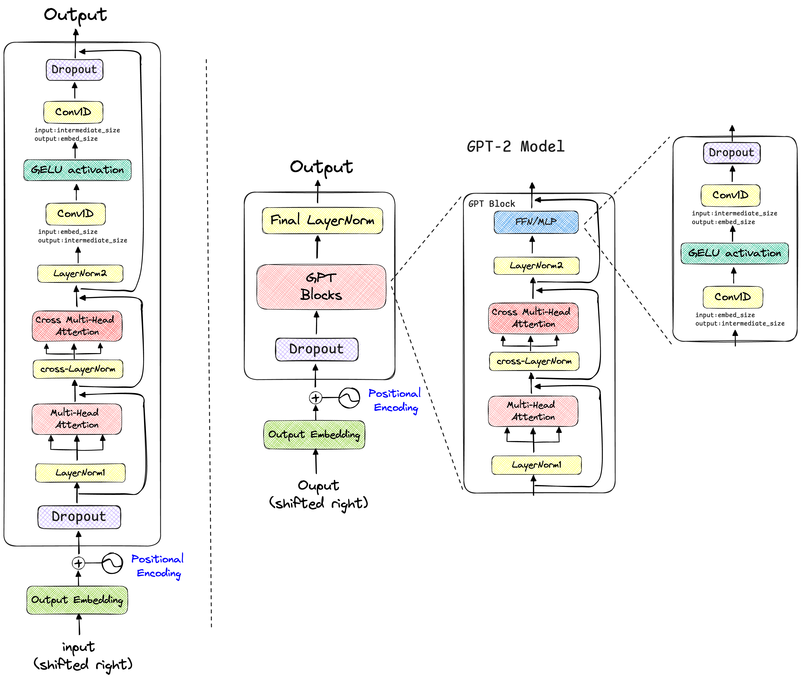
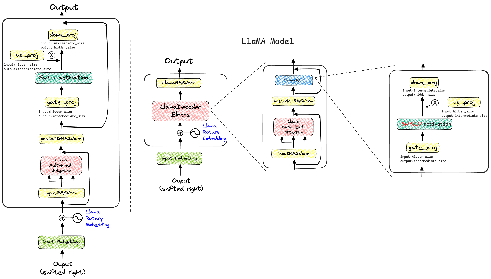
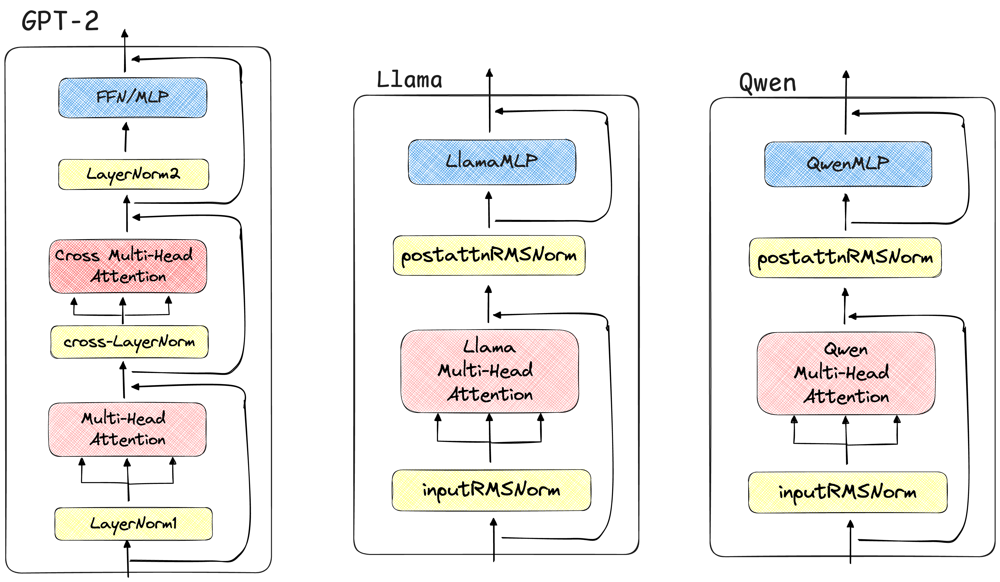
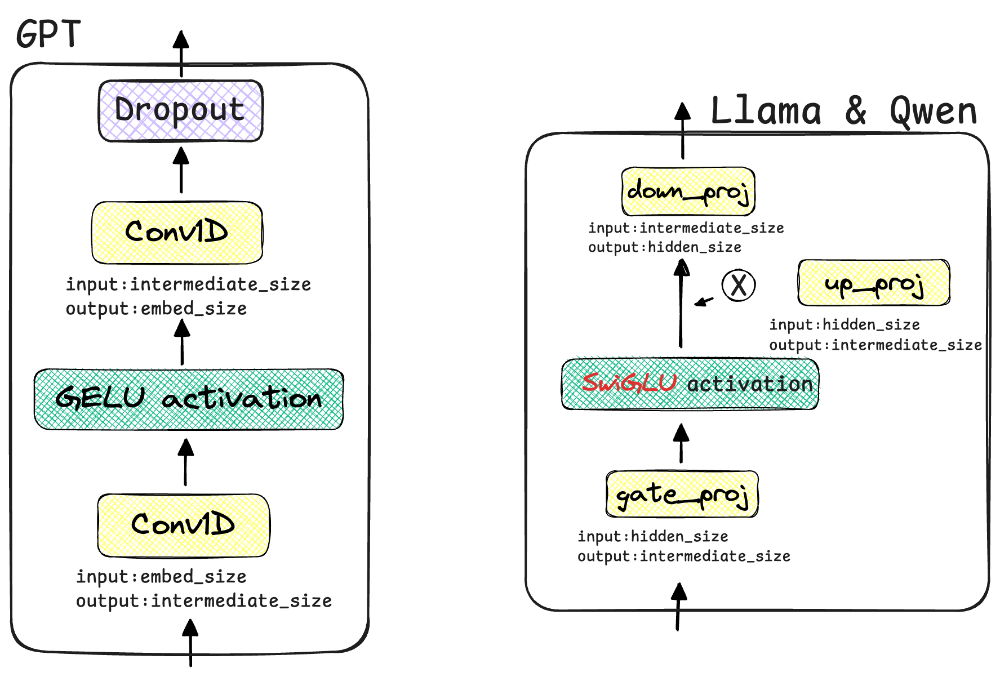
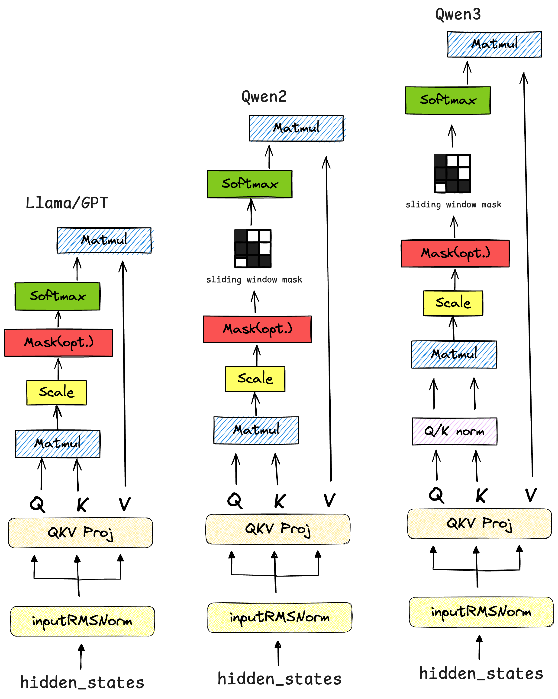
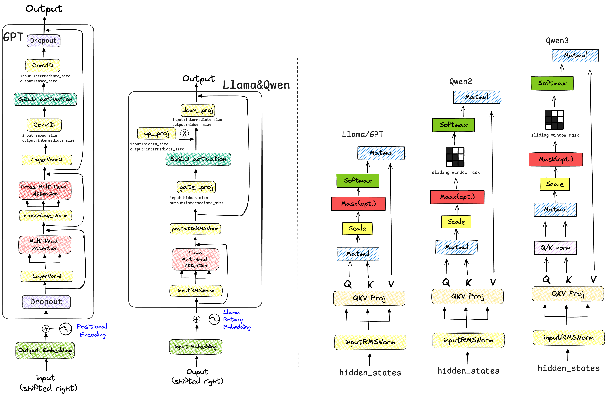

九月份投递完第一篇论文初稿以后，认真把三个经典大模型架构的源代码阅读、复现了一遍。动机出于以下因素：首先，暑假期间读完了[Sebastian Raschka](https://sebastianraschka.com/)大佬写的Build a Large Language Model (From Scratch)这本书，把GPT-2的完整架构熟悉了一遍，但是一些具体的细节设计和GPT源代码还是有些区别。其次，考虑到后续论文复现的工作大多是建立在transformers库中的源代码基础之上，索性多花费了一些时间把“LLM三驾马车”的架构设计对比学习一下，知道后续在此基础之上如何去修改、动哪里。

全文是我在认真阅读并复现了GPT-2、LlaMA-2与Qwen3的transformers源代码后撰写的架构设计对比分析，如有失偏颇，烦请给位读者大佬们批评指正！

## Top-Down

开篇先宏观理一下我对三个架构设计的对比分析：

- 整体架构设计上LLaMA的架构设计要比GPT架构更**简洁**，LLaMA舍弃了GPT架构中首位的Dropout层。
- 相比于GPT-2的`绝对位置编码`，Llama使用`ROPE旋转位置编码`。
- 相比于GPT-2中的`LayerNorm层归一化`，Llama使用的是`RMSNorm层归一化`，并且RMSNorm层主要用在LlamaDecoder**后**、LlamaAttention块**前后**、以及最后经过MLP**输出后**。
- 在MLP层的设计上，LLaMA使用的`SwiGELU激活+门控制方法`，GPT使用`GELU激活+Conv1D线性变换`的方式。
- Qwen2的源代码基本上和LLaMA源代码保持一致，相比于GPT-2和Llama架构增加了**self.sliding_window滑动窗口注意力**部分。
- Qwen3的源代码基本上和Qwen2源代码保持一致，只是相比于Llama和Qwen2，在计算注意力的时候增加了self.q_norm和self.k_norm的RMSNorm归一化层，提升训练的稳定性。

## 具体展开

### LlaMA的简洁如何体现？

在GPT-2中，输入的词嵌入（Token Embeddings）和位置嵌入（Position Embeddings）相加后，会立刻经过一个nn.Dropout层，然后再进入Transformer的Decoder层堆栈。Llama直接将词嵌入送入Decoder层，省去了这个初始的Dropout。

通过阅读transformers库中的源代码，我绘制了GPT-2与LLaMA的模型架构对比图，如下所示：





观察上述架构设计图可知，实际上GPT-2和LlaMA的架构设计细节与《Attention is All You Need》、《Improving Language Understanding by Generative Pre-Training》论文里面绘制的模型架构图是有所区别的。

实际的数据转换过程应该是，经过位置编码后，进入模型的主体部分，GPT-2的数据流动过程为DropOut层 -> GPT Blocks -> Final LayerNorm，而LlaMA简洁就体现在去掉了GPT-2经过绝对位置编码后的Dropout层，使得输入数据经过旋转位置编码后，直接进入LlaMADecoderBlocks层，所以Llama模型的数据流动过程只有LlaMADecoderBlocks -> LlamaRMSNorm。

### DecoderBlock

在DecoderBlocks里面，GPT-2主要先经过了多头注意力层，之后再经过多头掩码注意力块，之后输入到FFN网络中；而Llama的DecoderBlocks层中，只有一个多头注意力层计算块，之后便输入到LlamaRMSNorm层中；Qwen的DecoderBlocks基本上就是“继承”了Llama的源代码，只是注意力块与Llama模型有所不同。

通过阅读源代码，描绘了三个模型的DecoderBlock架构设计对比图如下所示：



GPT-2使用标准的**LayerNorm**，而Llama的RMSNorm省去了LayerNorm中的“减去均值”这一步，只保留了“除以方差”的缩放，计算量更小，实验证明在性能上几乎没有损失。

三个模型的DecoderBlock层源代码如下：

```python
#下面是GPT的前向传播逻辑
class GPT2Block():
    def __init__(self, config, layer_idx=None):
        super().__init__()
        hidden_size = config.hidden_size
        inner_dim = config.n_inner if config.n_inner is not None else 4 * hidden_size

        self.ln_1 = nn.LayerNorm(hidden_size, eps=config.layer_norm_epsilon)
        self.attn = GPT2Attention(config=config, layer_idx=layer_idx)
        self.ln_2 = nn.LayerNorm(hidden_size, eps=config.layer_norm_epsilon)

        if config.add_cross_attention:
            self.crossattention = GPT2Attention(config=config, is_cross_attention=True, layer_idx=layer_idx)
            self.ln_cross_attn = nn.LayerNorm(hidden_size, eps=config.layer_norm_epsilon)

        self.mlp = GPT2MLP(inner_dim, config)

    def forward(
        ...
    ) -> Union[tuple[torch.Tensor], Optional[tuple[torch.Tensor, tuple[torch.FloatTensor, ...]]]]:
        residual = hidden_states
        hidden_states = self.ln_1(hidden_states)
        attn_output, self_attn_weights = self.attn(
            ...
        )
        # residual connection
        hidden_states = attn_output + residual

        if encoder_hidden_states is not None:
            # add one self-attention block for cross-attention
            if not hasattr(self, "crossattention"):
                raise ValueError(
                    f"If `encoder_hidden_states` are passed, {self} has to be instantiated with "
                    "cross-attention layers by setting `config.add_cross_attention=True`"
                )
            residual = hidden_states
            hidden_states = self.ln_cross_attn(hidden_states)
            cross_attn_output, cross_attn_weights = self.crossattention(
                ...
            )
            # residual connection
            hidden_states = residual + cross_attn_output

        residual = hidden_states
        hidden_states = self.ln_2(hidden_states)
        feed_forward_hidden_states = self.mlp(hidden_states)
        # residual connection
        hidden_states = residual + feed_forward_hidden_states

        outputs = (hidden_states,)
        if output_attentions:
            outputs += (self_attn_weights,)
            if encoder_hidden_states is not None:
                outputs += (cross_attn_weights,)

        return outputs
    
#----------------------
#下面是LlaMA的前向传播逻辑
class LlamaDecoderLayer():
    def __init__(self, config: LlamaConfig, layer_idx: int):
        super().__init__()
        self.hidden_size = config.hidden_size

        self.self_attn = LlamaAttention(config=config, layer_idx=layer_idx)

        self.mlp = LlamaMLP(config)
        self.input_layernorm = LlamaRMSNorm(config.hidden_size, eps=config.rms_norm_eps)
        self.post_attention_layernorm = LlamaRMSNorm(config.hidden_size, eps=config.rms_norm_eps)

    def forward(
        ...
    ) -> torch.Tensor:
        residual = hidden_states
        hidden_states = self.input_layernorm(hidden_states)
        # Self Attention
        hidden_states, _ = self.self_attn(
            ...
        )
        hidden_states = residual + hidden_states

        # Fully Connected
        residual = hidden_states
        hidden_states = self.post_attention_layernorm(hidden_states)
        hidden_states = self.mlp(hidden_states)
        hidden_states = residual + hidden_states
        return hidden_states
      
#----------------------
#下面是Qwen的前向传播逻辑
class Qwen3DecoderLayer():
    def __init__(self, config: Qwen3Config, layer_idx: int):
        super().__init__()
        self.hidden_size = config.hidden_size

        self.self_attn = Qwen3Attention(config=config, layer_idx=layer_idx)

        self.mlp = Qwen3MLP(config)
        self.input_layernorm = Qwen3RMSNorm(config.hidden_size, eps=config.rms_norm_eps)
        self.post_attention_layernorm = Qwen3RMSNorm(config.hidden_size, eps=config.rms_norm_eps)
        self.attention_type = config.layer_types[layer_idx]

    def forward(
        ...
    ) -> torch.Tensor:
        residual = hidden_states
        hidden_states = self.input_layernorm(hidden_states)
        # Self Attention
        hidden_states, _ = self.self_attn(
            hidden_states=hidden_states,
            attention_mask=attention_mask,
            position_ids=position_ids,
            past_key_values=past_key_values,
            use_cache=use_cache,
            cache_position=cache_position,
            position_embeddings=position_embeddings,
            **kwargs,
        )
        hidden_states = residual + hidden_states

        # Fully Connected
        residual = hidden_states
        hidden_states = self.post_attention_layernorm(hidden_states)
        hidden_states = self.mlp(hidden_states)
        hidden_states = residual + hidden_states
        return hidden_states
```


### MLP层

在MLP层的设计上，LLaMA与Qwen使用的`SwiGELU激活+门控制方法`，GPT使用`GELU激活+Conv1D线性变换`的方式。阅读源代码，将两种设计方式绘制了架构图进行对比：



GPT-2的MLP是一个标准的结构：一个线性层将维度放大，经过**GELU**激活函数，再由另一个线性层将维度缩小。Llama采用了更先进的**SwiGLU**，使用**三个**线性层 (gate_proj, up_proj, down_proj) 而不是两个，gate_proj和up_proj并行作用于输入，然后将gate_proj的输出经过SiLU/Swish激活函数后，作为“门”与up_proj的输出进行逐元素相乘。

```python
#GPT的MLP层
class GPT2MLP(nn.Module):
    def __init__(self, intermediate_size, config):
        super().__init__()
        embed_dim = config.hidden_size
        self.c_fc = Conv1D(intermediate_size, embed_dim)
        self.c_proj = Conv1D(embed_dim, intermediate_size)
        self.act = ACT2FN[config.activation_function]
        self.dropout = nn.Dropout(config.resid_pdrop)

    def forward(self, hidden_states: Optional[tuple[torch.FloatTensor]]) -> torch.FloatTensor:
        hidden_states = self.c_fc(hidden_states)
        hidden_states = self.act(hidden_states)
        hidden_states = self.c_proj(hidden_states)
        hidden_states = self.dropout(hidden_states)
        return hidden_states
      
#----------------------------
#GPT的MLP层
class Qwen3MLPandLlamaMLP(nn.Module):
    def __init__(self, config):
        super().__init__()
        self.config = config
        self.hidden_size = config.hidden_size
        self.intermediate_size = config.intermediate_size
        self.gate_proj = nn.Linear(self.hidden_size, self.intermediate_size, bias=False)
        self.up_proj = nn.Linear(self.hidden_size, self.intermediate_size, bias=False)
        self.down_proj = nn.Linear(self.intermediate_size, self.hidden_size, bias=False)
        self.act_fn = ACT2FN[config.hidden_act]

    def forward(self, x):
        down_proj = self.down_proj(self.act_fn(self.gate_proj(x)) * self.up_proj(x))
        return down_proj
```


### Attention计算的区别

Qwen3相比于Llama和Qwen2，在计算注意力的时候增加了self.q_norm和self.k_norm，起作用是在生成query和key的时候使用，将生成的q和k要经过一次归一化。



self.q_norm和self.k_norm通常是RMSNorm层。它们被应用在Query和Key向量经过RoPE之后**，但在它们进行点积运算（Q @ K.T）**之前。

在FP16或BF16等低精度浮点数训练下，经过多层计算后，向量中可能会出现极大的或极小的值，导致数值不稳定。Q和K的点积对向量的“长度”（L2范数）非常敏感。如果某些Q或K向量的范数异常大，它们会在Softmax中产生极端接近于1的概率，导致梯度消失，使得模型学习变得困难。

同时，在标准的自回归模型中，每个新的token需要关注前面**所有**的token。当序列长度达到几万甚至几十万时，计算量和内存占用会变得巨大（复杂度为O(序列长度²)），这使得处理超长上下文非常困难。滑动窗口注意力提出，一个token的语义通常与它**最邻近**的上下文关系最密切。因此，没有必要让每个token都关注从开头到现在的全部历史Token。

## 总结

以GPT-2为base model，Llama和Qwen系列模型在架构上基本相似；但是Llama和Qwen系列模型与GPT-2模型在架构细节上有明显的区别。

Llama与Qwen的LayerNorm归一化层都是使用的RMSNorm归一化函数，MLP层的设计上Llama和Qwen系列都使用了门控制机制并使用SwiGELU函数作为激活函数，在数据经过Attention与MLP之前都要经过归一化层，最后经过RMSNorm层后输出。

而GPT-2模型是在位置编码完后经过Dropout层，模型最后输出前也要经过Dropout层，Llama和Qwen系列省去了Dropout层，在架构设计上相比于GPT-2更为简洁。

GPT-2和Llama主要使用的全量注意力方式计算前向传播过程中的Attention；而Qwen2和Qwen3在注意力计算上进行了改进，使用了混合注意力机制；Qwen2引入滑动窗口机制，Qwen3在滑动窗口基础之上，又在计算点积之前加入了query和key的RMSNorm层。



## 知识点


Qwen与LlaMA中的MLP层和FFN层的作用是什么？两者是一个东西吗？


**在Llama和Qwen等Transformer模型的语境下，它们基本上指的是同一个东西。**FFN源自开创性论文《Attention Is All You Need》的**官方术语**。它特指在自注意力（Self-Attention）子层之后那个由两个线性层和一个激活函数组成的模块。

**MLP (Multi-Layer Perceptron)**: 这是一个更**通用、更古老**的神经网络术语，泛指任何由多个全连接层（通常带有非线性激活函数）组成的网络。

FFN与MLP的作用是：

1. 增加非线性，提升模型表达能力，Transformer模型中，自注意力计算和线性投影本质上都是线性的（Softmax除外）。如果没有MLP层中的非线性激活函数（如GELU, SiLU/Swish），那么整个Transformer堆叠起来也只不过相当于一个巨大的线性变换，其表达能力将极其有限，无法学习复杂的模式。**非线性是“深度”学习之所以强大的根本。**
2. MLP层通常采用一种“**扩展-压缩**”的结构；在原始的 hidden_size 空间中可能难以分离或理解的复杂特征，在被映射到更高维的 intermediate_size 空间后，可能就变得线性可分或更容易处理了。


GPT模型MLP组件中的Conv1D？


一个kernel_size=1的Conv1D在数学上等价于一个全连接的线性层。为了能**直接加载原始的TensorFlow权重文件**，他们实现了一个Conv1D来模拟线性层，因为TensorFlow的全连接层权重矩阵的存储方式恰好与PyTorch中Conv1D的权重存储方式（在特定排列下）相匹配，并且与PyTorch的nn.Linear层的权重**互为转置**。


