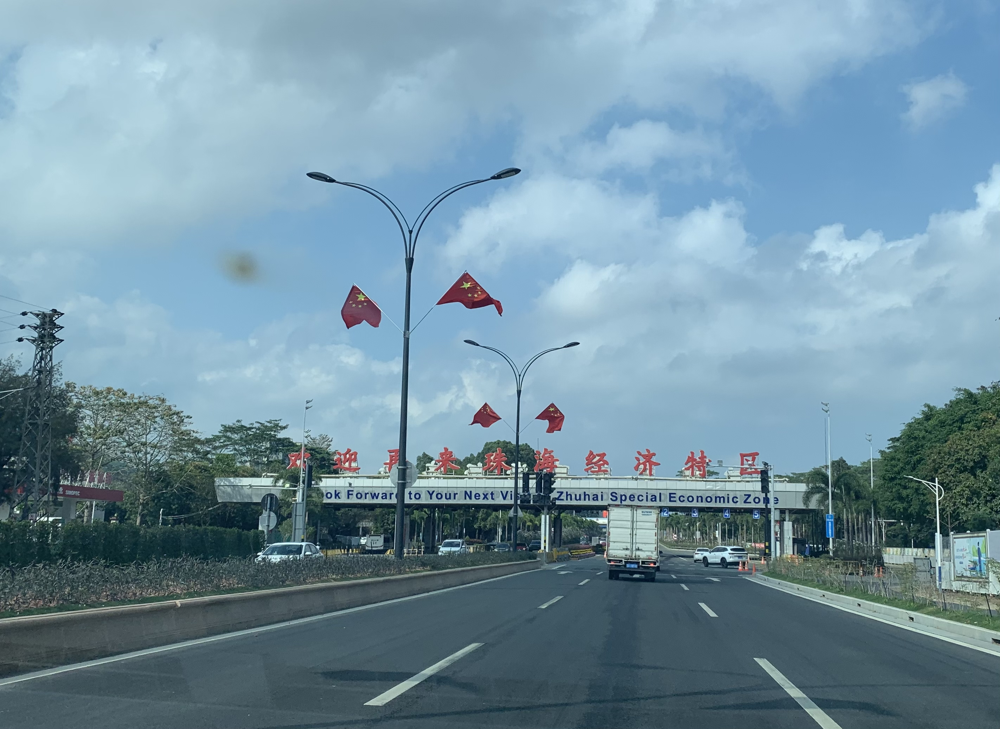
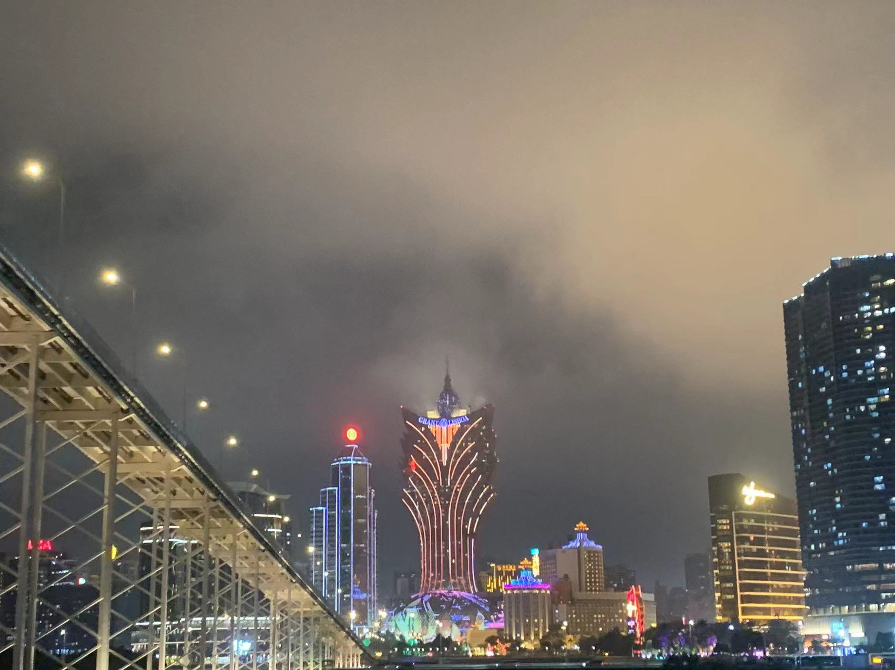
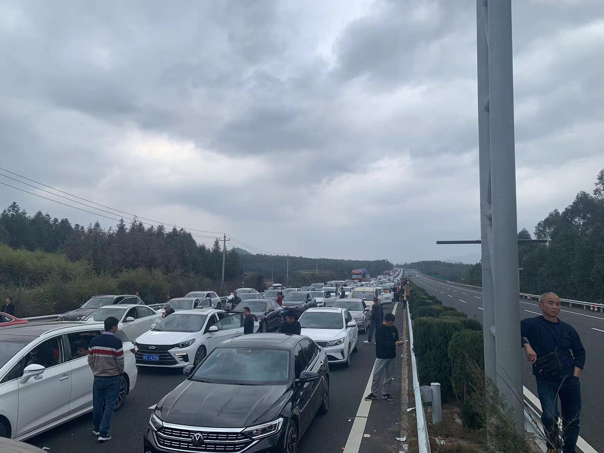

自驾一路向南，澳门、珠海、佛山、广州

2024.02.16-2024.02.22

和老舅一家自驾大湾区(广州、珠海、佛山、澳门)。总体收获很大，一路上经历丰富，有高速堵车、昼夜奔袭、度假休息、患病感冒。这次出行，属实是把自己的身体耐造性提高性了一大截，不过代价就是回来之后感染了 新冠嗓子疼病毒 并且身体变虚了。。。开学晚回去几天，把身体调整调整，休整好身体之后再出发。

大湾区气候感觉还是潮湿，特别是珠海。一路上的风景也是很美的，我国的经济特区珠海、横琴，特别行政区澳门，还有超级都市群广州、佛山都特别开眼界。以前总觉得湖北、湖南地区属于我国的经济发达地区，总之要比我们河北省好。但是经过这次的实地调查后才发现，原来湖北、湖南大部分地区都依旧还是非常贫困的山区。高速公路也是非常不好走，只有双向4车道，特别是经过湖南地区的隧道的时候，几乎每年都要堵车。围绕着长沙的几个小城市还都是不错的，湘潭、株洲市都很干净，衡阳也可以。回来之后江西境内的高速都要顺畅很多，而且总体体验要比湖北、湖南地区丝滑很多。地势也没有绵延起伏，赣州以南有很多高山，赣州以北又有很多的平原。河南是个人口大省，人口密度大到难以想象，进入高速后根据车流量就可以判断出来。这片中原大地是我国的大粮仓，一路上除华北平原外少有的大平原开阔地带。

这一路上和老舅、舅妈聊了很多，家庭、学业、事业。。。原来老舅和舅妈大二才确定关系、原来老妈年轻的时候并没有那么有自信和光环、原来我一直有偏见的LMJ在老舅眼里被降维打击般的望眼欲穿。老舅也和自己分享了很多学业、事业上的经历，对于**顺境和逆境的分析**、**对于名和利的取舍**、**对于变通的处世方法**。他将他自己宝贵的经验分享给了我，自己一定要认真复盘。

大湾区之旅，一生铭记，并且未完待续….
