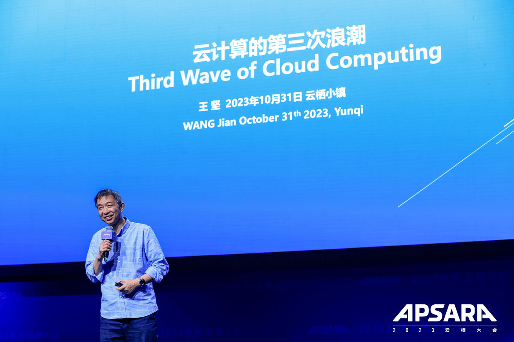

2025年3月3日，星期一，阴天，第52篇博客。

## 谈谈阿里(我眼中的)



王坚：中国工程院院士，云计算技术专家，之江实验室主任，阿里巴巴集团技术委员会主席



我是一直看好阿里的，从本科接触到大数据技术以来，我就在一直慢慢探索大数据技术领域的领先技术。随着短视频爆火、电商领域重大变革，马老师退居二线“靠边站”，阿里系内部也有人事重大调整，很多人唱衰阿里。

但是我是一直看好阿里的，因为我知道阿里是懂技术、懂变革的，有真正懂技术、做技术的人，王坚院士便是首当其冲的一位。而不是像某公司，一开始说大模型开源毫无价值，但是当DeepSeek火起来了，它又拥抱开源，早干嘛去了！

阿里在国内**云计算**、**AI**领域处于绝对领先地位，毋庸置疑、不服不行。特别是阿里云，在阿里转型期起到决定性作用。马老师也因为阿里的转型成功，重新满血而归、出山。

## 算力革命

央视面对面栏目最新专访：https://www.bilibili.com/video/BV1xc98YAEwk/?spm_id_from=333.1007.tianma.1-1-1.click&vd_source=f093c3d64ba399e149cbffa6cd31a7b0



Get新观点

1. 一定条件下，**车慢了**才堵车，并不是**车多了**才堵车。大家都觉得堵车，所以车慢了；事实上是车慢了才堵车的。

2. 黑土地这个词，很少人问为什么这样叫，大家只知道黑土地很肥沃。其实大家没搞明白，黑土地就是死下来的东西烂在这里才叫黑土地。创新，其实是是成千上万个公司、团队死在这里，才会涌现出的创新。就是死在这里，不能叫失败；叫失败就有价值判断了，没有失败；变成肥料也叫失败？！



**云计算就是帮助小公司去做大公司做的事情，创新就是一堆看似不起眼的人却做出来了很多变革的东西。**

马力革命时代，人类驯服马匹作为提高生产力工具，伦敦享有“马粪城”的绰号。马力革命留下的基础设施是道路。马力革命时代不管怎么进步，本质上还是供给不足。

电力革命时代，城市文明就是电力革命，以纽约为代表的现代都市群发展，电力革命留下的基础设施是电网，新能源再怎么改进，电网没有改。电力时代不管怎么讲科技进步，最后落到一个关键点就是：人类消耗自然资源的能力大大增加，从而带来了一系列环境问题。

下一次：算力革命，互联网作为算力革命时代的基础设施——算力网。算力时代要做到的目标就是达到生活生平的提升而不增加自然资源的消耗。

## AI4S

科学新范式与开放科学 - Computing,Al and The Third Paradigm



ChatGPT是革命的工具，而不是工具的革命。

人工智能不仅是一次工具的革命，还是一次科学革命的工具——它已成为一种可以能够打破学科壁垒的通用语言，而不仅是对科学研究的简单“赋能”。



科学研究四范式的提出者：图灵奖得主 Jim Gray

第一范式：实验（经验）科学，其关键词是**观察**。基于实验或经验的观察来描述自然现象。从最原始的钻木取火到哈维的血液循环学说、伽利略的动力学、达尔文的进化论等，都是实验科学的典范。

第二范式：理论科学，其关键词是“**归纳**”，第一范式受到实验条件的限制，难以完成对自然现象更精确的理解，科学家在自然现象基础上进行了抽象，尽量简化实验模型，去掉一些复杂的干扰因素，只留下关键因素，然后通过建构数学模型进行归纳总结为科学理论。牛顿三大定律为基础的经典力学体系、麦克斯韦理论成功解释电磁学都是其中的典范。

第三范式：计算科学，其关键词是**计算**，随着验证理论的难度逐渐增加和经济投入越来越大，科学家靠一个人单打独斗获得巨大科研成就的可能性基本断绝。1946年，现代意义上的电子计算机发明以来，通过计算机对科学实验进行模拟仿真逐渐普及，从而衍生出了“人脑+电脑”的第三范式。如模拟核试验、天气预报、地质演变等都是其中的典范。时至今日，离开计算机程序、数据库，很多学科的科研已是寸步难行。

第四范式：数据科学，其关键词是**挖掘**。随着科研数据的爆炸式增长以及大数据、人工智能的兴起，数据科学的新范式正在兴起。从某种程度上说，这种范式与计算科学最大的区别是“人脑”和“电脑”谁占主导地位。它将大量的数据进行深度神经网络训练，利用人工智能技术进行分析归纳整理，借助机器对于数据关联的敏感性从而得出更为精确的变量分析，甚至出现了“机器科学家”这种新型科研辅助工具。

### 发言稿

科学范式这一理念已被接受的，但对于经历了哪些范式以及当前所处阶段仍存争议。以 个人见解，在第三范式以后便是仁者见仁智者见智的情况了，简单讲述来看，第三范式引入 计算机模拟，第四范式为数据驱动，而第五范式则与人工智能密切相关。

然而，真正与第 一、第二范式对比来看，第三范式尚未完全成熟，对学科的影响不够深入，数据驱动范式也 未真正形成。

人工智能如果最简单地讲，就是数据碰上了模型，模型碰上了计算，也就是说数据+模 型+计算。从这个角度来讲，事实上互联网是所有这些东西的基础，当然现在人工智能包括 数据、模型和计算都跟互联网非常相同一致，甚至说是一模一样的特征，所以当时互联网之 所以不是网络或者是简单的网络，就是因为它的规模。

在人工智能阶段，知识与财富已不再局限于源代码，因此我提出 “Open Resource Innovation”这一概念，即科技资源的全面开放。这里的资源不仅包括 代码，还涵盖数据、方法论等多方面内容。我非常提倡开源的精神，是一个人、一个机构、 一个国家对社会的贡献，是对全世界的贡献，现在事实上到了人工智能阶段，到了数据时 代，已经不能用简单的Open Source Code来表达，因为你最重要的财富、知识已经不是简 单在Source Code里体显出来。所以我觉得今天创新有一个非常大的特点，把它叫做Open Resource Innovation，也就是说要把科技资源开放出来。

当年美国对工程教育的担心，使他们提出了一个概念叫STEM（即科学、技术、工程、 数学），当时我们在讨论，到底数学是不是科学？为什么要把数学单独拿出来？后来理解了 一些事情，是因为他们觉得它是Science、Technology、Engineering的共同语言，这不是 并列，是数学把这些东西都连在一起了，所以把它单独拿出来。

而到了人工智能时代， STEM发生了变化，这个变化是什么？就是数学来统一这些东西就没有那么简单了，变成了 一个东西叫MAP，什么叫MAP？M还是数学，但今天有一个A出来了，就是AI，也就是AI会贯穿到科学、技术、工程。

但是为什么会有P？P字也很有意思，这也是跟着科技部做“大科学计划”时提出来的， 总书记在很多地方讲过“中国要为世界提供公共产品”。所以大家可以认真想一下，过去的公共产品是什么？教科书是我们的公共产品，但事实上这个世界可能做科学研究也要一个公共产品，所以这个P是中国要有机会为大家提供一个科学研究的公共产品，如果今天真的要把所有的能力都发挥出来，包括AI的能力都发挥出来，那是需要有一个公共产品来支撑的。

所以我相信如果我们能够把这样一个技术用好，我自己觉得这就是Open Resource Innovation，再也没有人可以把真正的科技创新资源放在一个非常少的圈子里能做到这些事 情，这可能也是这件事情的意义以及它的价值所在，无论是我个人，还是之江实验室去推 动，真的可以在中国乃至世界上做好这件事。

